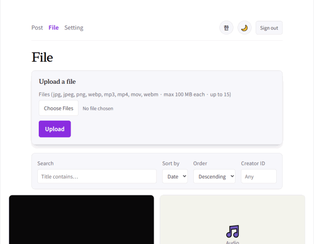
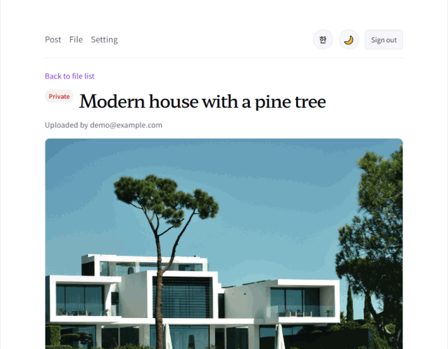
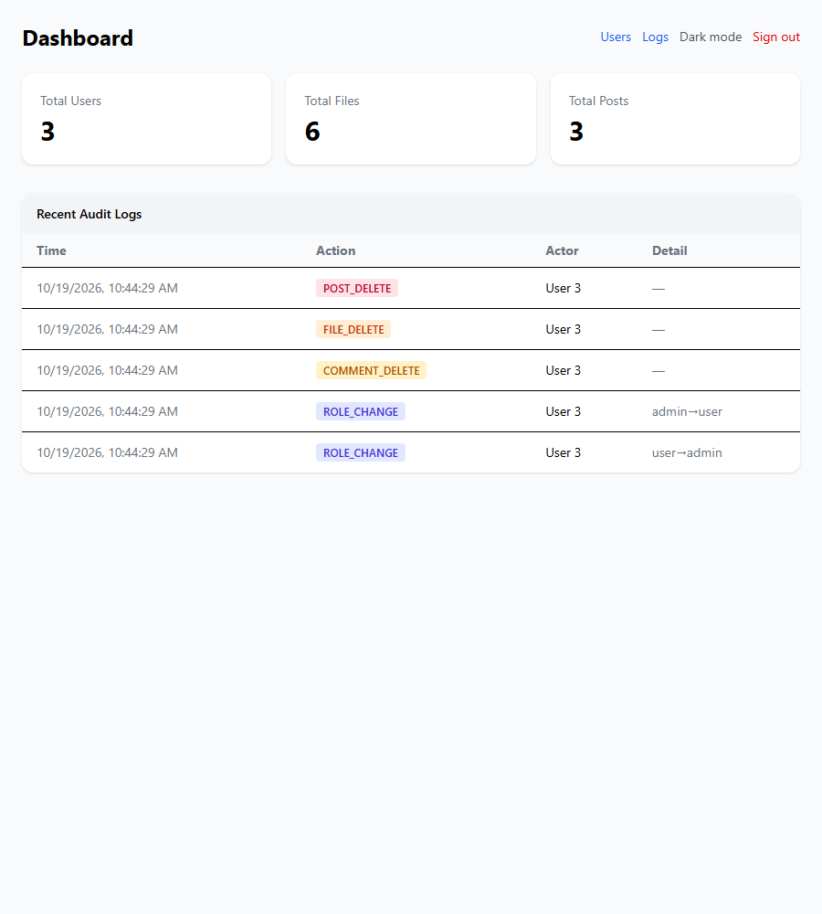
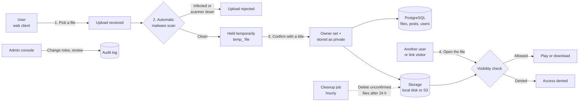

[](https://github.com/Bluecode77732/Upload-Board-Project/actions/workflows/ci.yml)


# Sharenpo

> 한국어: [README.md](README.md) · Technical detail: [docs/TECHNICAL.md](docs/TECHNICAL.md)

**A media board where you upload images, audio and video and decide, file by file, who gets to see each one.**
Every upload is scanned for malware before it is stored, and every view checks the file's visibility first, so only the people you allowed can open it.

One developer led an AI coding tool (Claude Code) through a rules document ([CLAUDE.md](CLAUDE.md)) and 69 decision records ([ADRs](docs/ADR/README.md)), taking the project from planning and design to an AWS deployment and its verification. Where a decision had real alternatives, the AI laid them out in a comparison table, the developer chose, and the reasoning was written down ([How this was built](docs/TECHNICAL.md#how-this-was-built)).

## Screens



**Multi-file upload** — pick files of different types at once; each one uploads in turn with its own progress bar.



**Sharing control** — turn a private file into a shared link; rotating the link stops the old one working immediately.



**Admin console** — totals and the latest audit log entries on one screen.

More screens (the board, video and audio playback, ownership transfer) are in the [technical reference's screenshots](docs/TECHNICAL.md#screenshots).

## Problems solved and key features

**Where the usual approach falls short**

- Once a file goes out through a messenger or a shared folder, there is little control over who is looking at it.
- Nobody can check by hand that every uploaded file is safe.
- A dropped upload or a double-clicked button leaves duplicate and ownerless files piling up in storage.
- Handing files over when someone changes roles, and keeping track of who deleted what or changed whose permissions, is left to people to remember.

**What this program automates or improves**

- **Per-file visibility** — public, private (the default) or shared by link. A link can be rotated at any time to shut out the old one, and an expiry time can be set through the API. Files are only ever served through a path that checks access.
- **Automatic upload scanning** — every file is scanned with ClamAV before it is stored. Infected files are rejected, and when the scanner can't be reached the upload is blocked rather than let through.
- **Duplicates and leftovers handled automatically** — repeating the same upload confirmation returns the first result instead of storing the file again. Temporary files nobody confirmed are deleted after 24 hours by a cleanup job that runs every hour.
- **Ownership transfer with consent** — the owner proposes a transfer by email, and it only happens once the recipient accepts from their own account. It can also be rejected or cancelled.
- **Roles and an audit log** — three levels (user, admin, superadmin); only the owner or an admin can edit or delete. Deletions and role changes are recorded in the audit log automatically and can be reviewed in the admin console.

These features sit on a board (posts, comments, search and sort), so files can be attached to posts and shared there. On every change, GitHub Actions runs the unit tests, an end-to-end suite against a real PostgreSQL and browser end-to-end tests for both clients. A k6 load of 500 virtual users (500 VUs) produced zero unexpected failures (measured on a single PC, [ADR 0069](docs/ADR/0069-k6-load-testing.md)).

## System flow



1. When a user picks a file, the server scans it in memory straight away. Only files that pass are stored, and only temporarily.
2. When the user confirms it with a title, the database record and the file move are handled as one operation. If either fails, both are undone, so there is never a record pointing at a missing file.
3. Every time a file is opened, its visibility (public, private, shared by link) is checked. With S3, someone who passes the check gets a download address that is valid for a few minutes.

In production, the user client, the admin console and the API are deployed together on AWS EKS behind a single load balancer, with Prometheus and Grafana watching their health. The infrastructure diagram and the data model are in the [technical reference's architecture section](docs/TECHNICAL.md#architecture).

## Tech stack

| Area | Technology | What it does here |
|---|---|---|
| Frontend | React 19, Vite, React Router 7, CSS Modules | User client (`frontend/`). Korean and English, light and dark themes |
| | React 19, Zustand, axios, Tailwind CSS | Admin console (`admin/`). Role management and the audit log viewer |
| Backend | NestJS 11, TypeScript | REST API, split into modules for auth, files, the board and uploads |
| | Passport JWT, bcrypt | Sign-in, token issue and refresh, password hashing |
| | ClamAV (`clamscan`) | Malware scanning for uploads |
| | `@nestjs/throttler`, helmet, Swagger | Rate limiting, security headers, API docs at `/doc` |
| DB/Infra | PostgreSQL 16, TypeORM 0.3 | Data storage; the schema is managed by migrations |
| | AWS S3, EKS, RDS, Route 53, ACM | File storage and the production environment |
| | Docker, Docker Compose, Helm, Terraform | Container images, local runs, Kubernetes deploys, infrastructure as code |
| | Prometheus, Grafana | Metrics collection and dashboards |
| Automation/Testing | GitHub Actions | Lint and tests on every change; only images that pass are published to Docker Hub |
| | Jest, Playwright, Vitest | Unit tests, E2E against a real database, browser E2E |
| | k6, autocannon | Load tests and response-time measurement (`perf/`) |
| | Claude Code | AI development tool run through a rules document ([CLAUDE.md](CLAUDE.md)) and hooks (`.claude/hooks/`) |

## Quick Start

You need Docker with Compose 2.24 or later. PostgreSQL, ClamAV, the migrations and the API start together.

```bash
cp .env.example .env
# Fill in three values in .env (the app refuses to boot while they're blank):
#   DB_PASSWORD           any password
#   ACCESS_TOKEN_SECRET   32+ characters, with lower case, upper case, a digit and a symbol
#   REFRESH_TOKEN_SECRET  same rule, a different value

docker compose up --build    # the API comes up on http://localhost:3000
```

The first start can take a few minutes while ClamAV downloads its signatures. Once it's up, `http://localhost:3000/doc` lets you call every API through Swagger.

Start the user client in another terminal (needs Node.js 24 and pnpm 10).

```bash
cd frontend && pnpm install && pnpm dev    # http://localhost:5173
```

Run the tests from the repository root. The unit tests need no database.

```bash
pnpm install
pnpm test                            # backend unit tests
CLAMD_HOST=127.0.0.1 pnpm test:e2e   # backend E2E; needs the compose db and clamav from above running
```

Running the admin console, running without Docker, environment variables and deploying to AWS are covered in the [technical reference's Quick Start](docs/TECHNICAL.md#quick-start).

## License

[MIT](LICENSE) · Author BLUECODE77732 — https://github.com/Bluecode77732
