[](https://github.com/Bluecode77732/Upload-Board-Project/actions/workflows/ci.yml)


# Sharenpo

> English version: [README.md](README.md)

로그인한 사용자가 이미지·오디오·동영상을 업로드하고, 파일마다 볼 수 있는 사람을 정하고,
게시글과 댓글이 있는 게시판으로 공유하는 서비스입니다. NestJS API, React 클라이언트, 관리자
콘솔로 이루어져 있고, Helm과 Terraform으로 AWS/EKS에 배포하며 Prometheus와 Grafana로
관찰합니다.

- 기간: 첫 커밋 2025-12-17, 현재 진행 중
- 범위: 개발자 1인, [CLAUDE.ko.md](CLAUDE.ko.md)의 규약 아래 AI의 도움을 받아 진행 — 백엔드,
  `frontend/`, `admin/`, 컨테이너, CI, Helm, Terraform
- 이 README는 저장소 전체를 다룹니다. 백엔드는 저장소 루트에 있고, 클라이언트에는 각자의
  README가 있습니다([frontend/](frontend/README.ko.md), [admin/](admin/README.ko.md))

## 상태

상시 운영 중인 데모는 없습니다. 이 스택은 AWS/EKS에 적용했다가 실행 사이사이에 내렸습니다
(날짜별 기록: [ROADMAP.ko.md](docs/ROADMAP.ko.md) §9). 지금 떠 있는지는 이 README에 적지
않습니다. 프로젝트를 확인하는 방법은 다음과 같습니다.

- 아래의 [스크린샷과 GIF](#스크린샷)를 봅니다
- Docker로 직접 실행합니다: [빠른 시작](#빠른-시작)
- 모든 엔드포인트를 브라우저에서 로컬로 호출해 봅니다: [API 써 보기](#api-써-보기-swagger)

## 2분 요약

- **2단계 업로드.** 파일을 `temp_…`로 임시 저장한 뒤 하나의 트랜잭션으로 `granted_…`로 승격하므로,
  DB 행과 저장된 파일이 함께 커밋되거나 함께 롤백됩니다
  ([ADR 0003](docs/ADR/0003-two-phase-upload-contract.ko.md)). 같은 업로드를 두 번 제출하면 실패하지
  않고 앞선 결과를 그대로 돌려줍니다([ADR 0019](docs/ADR/0019-upload-claim-idempotency.ko.md)).
- **정적 파일 서빙 없음.** 저장된 바이트는 공개 범위를 먼저 검사하는 `GET /file/:id/content`로만
  나갑니다([ADR 0025](docs/ADR/0025-file-visibility-and-media-expansion.ko.md)).
- **재사용 감지가 있는 리프레시 토큰 교체.** 서버는 현재 리프레시 토큰의 해시만 보관합니다
  ([ADR 0012](docs/ADR/0012-refresh-cookie-rotation.ko.md)).
- **모든 업로드에 fail-closed 악성코드 스캔**을 저장 전에 적용합니다
  ([ADR 0059](docs/ADR/0059-upload-malware-scanning-clamav.ko.md)).
- **확인한 것:** 백엔드 단위 테스트 282건(2026-10-21 실행)과 실제 PostgreSQL을 쓰는 백엔드 E2E
  76건(2026-10-22 실행)이 모두 통과했고, 두 클라이언트의 Playwright E2E와 결정을 기록한 ADR 67개가
  있습니다.
- **AI와 함께, 문서로 정한 규칙 아래에서 만들었습니다.** 코드의 대부분은 Claude Code로 작성했습니다.
  개발자가 [CLAUDE.ko.md](CLAUDE.ko.md)에 규칙을 정하고, 대안 중에서 선택하고, 그 내용을 ADR로
  남깁니다. AI가 규칙을 어긴 일도 함께 적어 두었습니다([만든 방식](#만든-방식)).
- **먼저 읽을 파일:** [backend/file/file.service.ts](backend/file/file.service.ts)(트랜잭션, claim),
  [backend/auth/auth.service.ts](backend/auth/auth.service.ts)(토큰),
  [backend/storage/](backend/storage/)(스토리지 포트).

## 스크린샷

임시 데모 데이터를 넣은 로컬 스택에서 한국어 UI, 한국어 예시 글, 라이트 테마로 찍었습니다. UI는
영어와 다크 테마도 지원합니다. 모든 그림은 같은 900 × 1000 프레임에 맞췄고, 필요한 부분이
보이도록 스크롤해서 찍었습니다. 파일 URL은 ALB 뒤에서처럼 클라이언트와 같은 출처를 가리키게
했고, 링크 공유 토큰은 가렸습니다. [알려진 한계](#알려진-한계와-다음-단계)를 참고하세요.

<table>
<tr>
<td width="50%">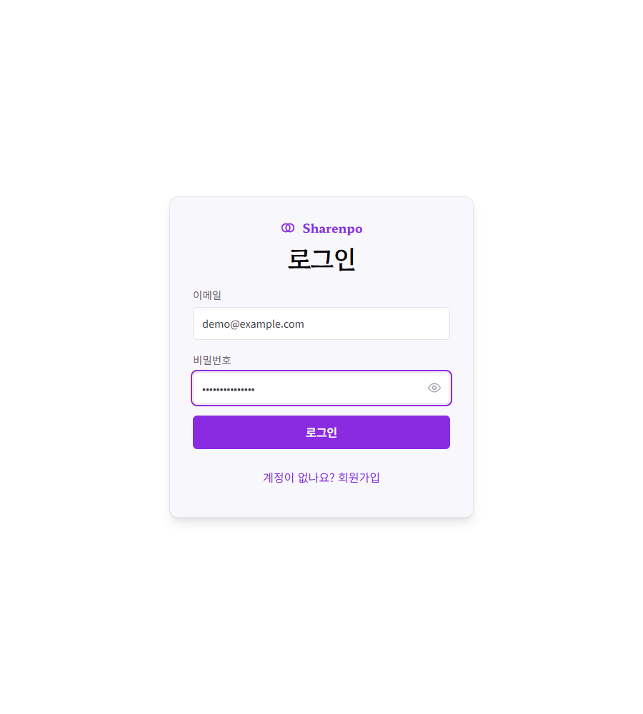<br><sub><b>로그인</b> — Basic 토큰 로그인, 회원가입 전환, 비밀번호 표시/숨김</sub></td>
<td width="50%">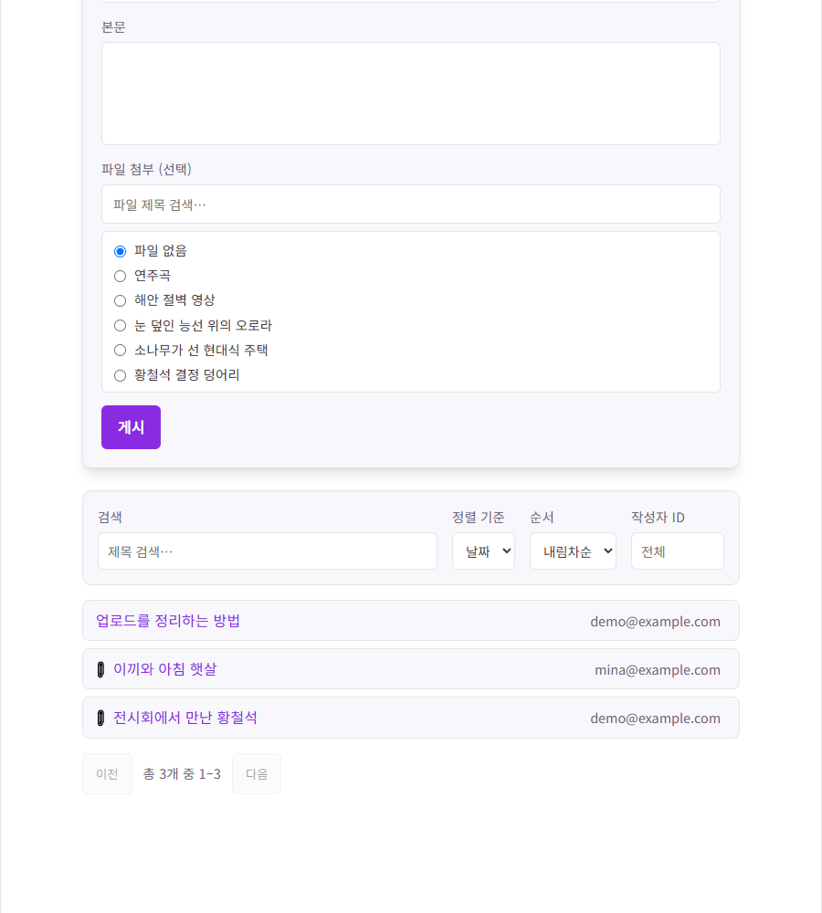<br><sub><b>게시판</b> — 파일을 붙일 수 있는 새 글 폼, 검색·정렬, 페이지네이션</sub></td>
</tr>
<tr>
<td width="50%">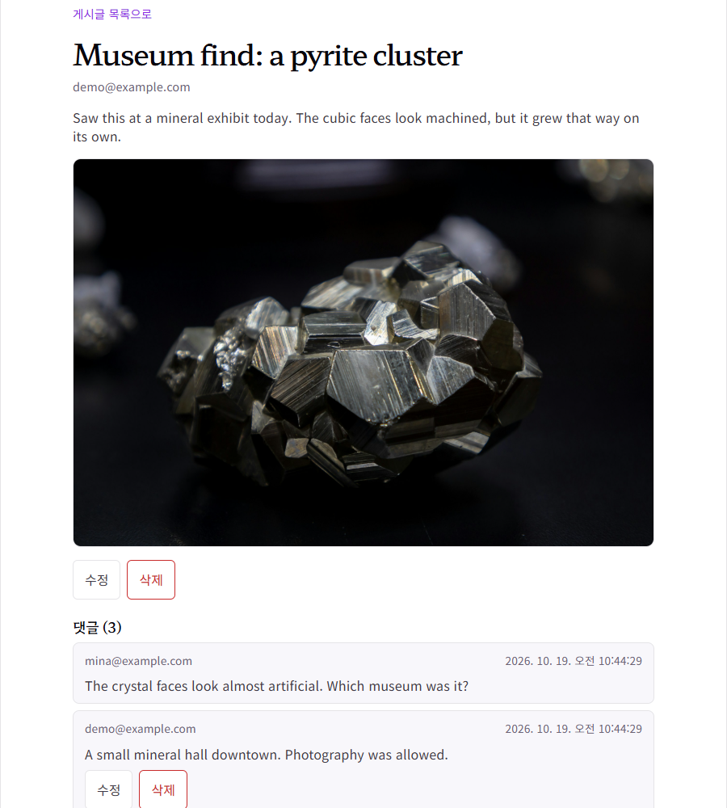<br><sub><b>게시글 상세</b> — 첨부 이미지와 오래된 순의 평면 댓글 스레드</sub></td>
<td width="50%">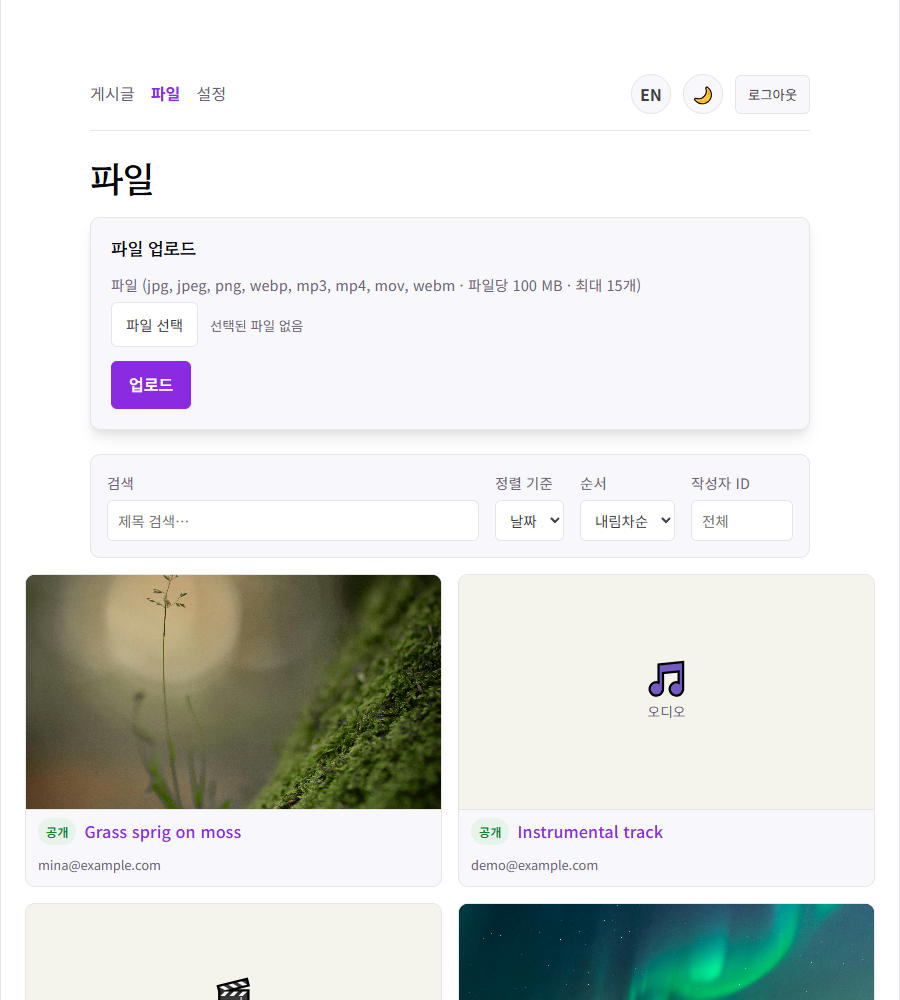<br><sub><b>파일 보드</b> — 업로드 폼, 검색·정렬·작성자 필터, 그 아래의 미리보기 그리드</sub></td>
</tr>
<tr>
<td width="50%">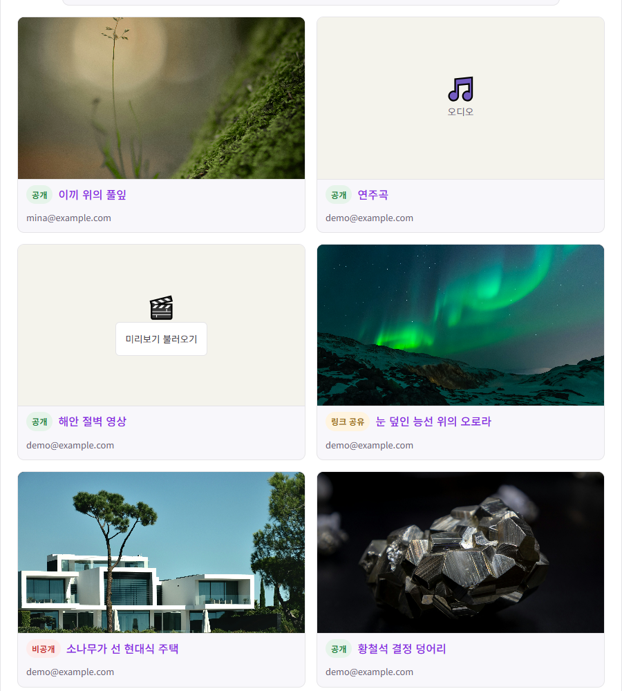<br><sub><b>여러 미디어</b> — 이미지·오디오·영상 타일과 공개·링크 공유·비공개 배지</sub></td>
<td width="50%">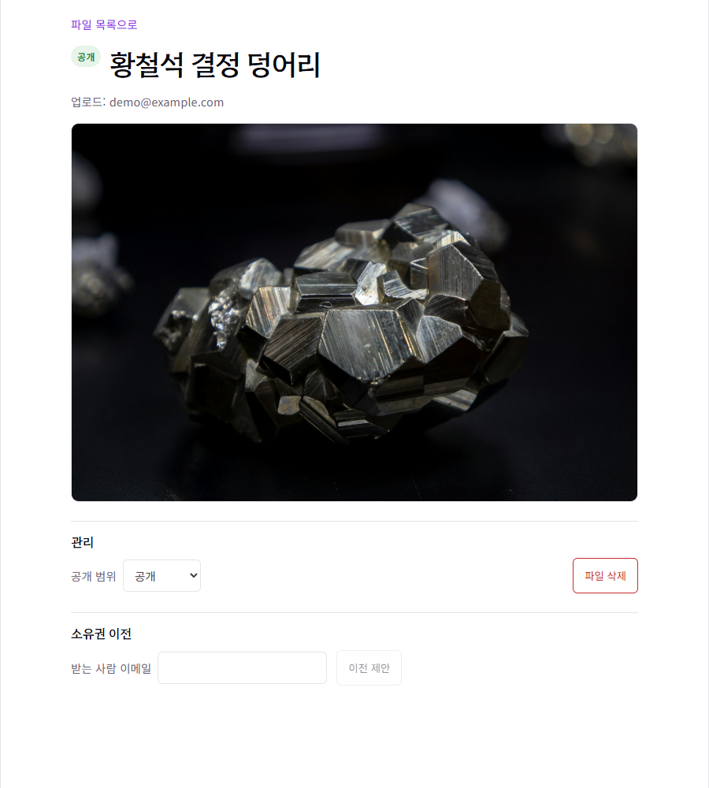<br><sub><b>파일 상세</b> — 이미지, 공개 범위 설정, 소유권 이전</sub></td>
</tr>
<tr>
<td width="50%">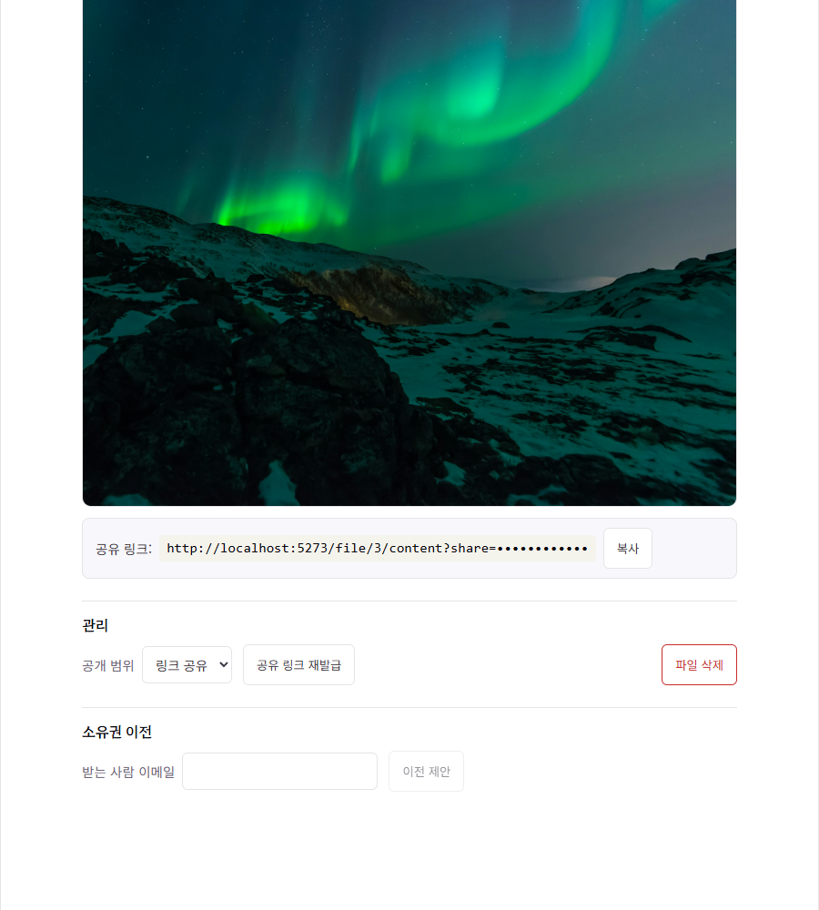<br><sub><b>링크 공유 파일</b> — 공유 링크(토큰은 가림), 링크 재발급 버튼, 공개 범위 설정</sub></td>
<td width="50%">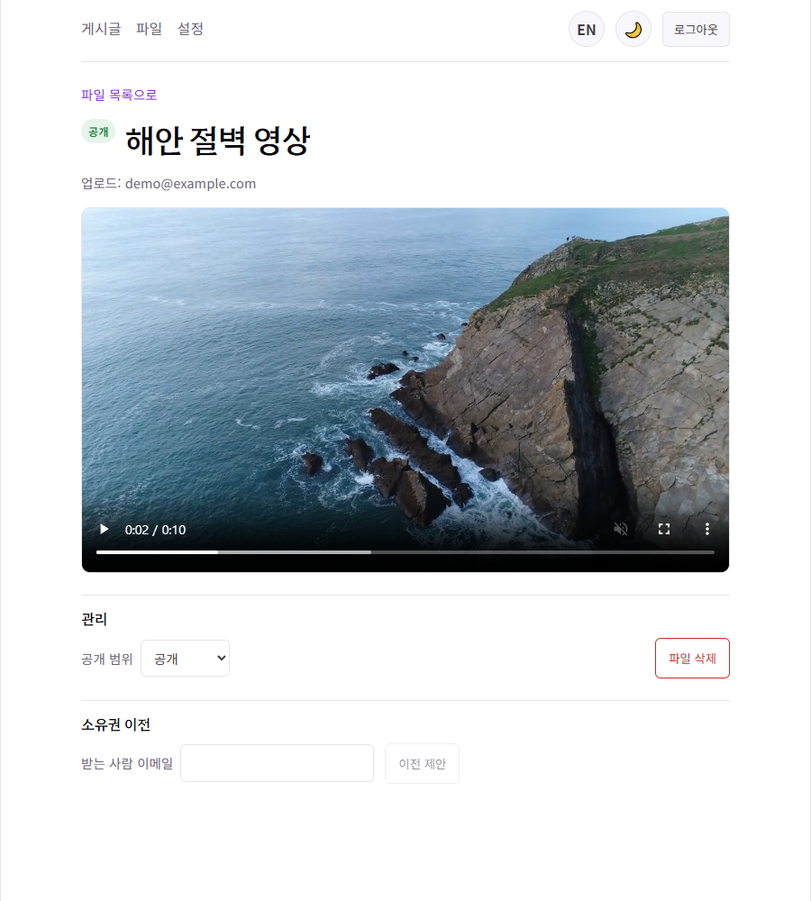<br><sub><b>영상</b> — 브라우저 기본 플레이어로 재생하는 공개 영상(탐색은 Range 요청으로 처리)</sub></td>
</tr>
<tr>
<td width="50%">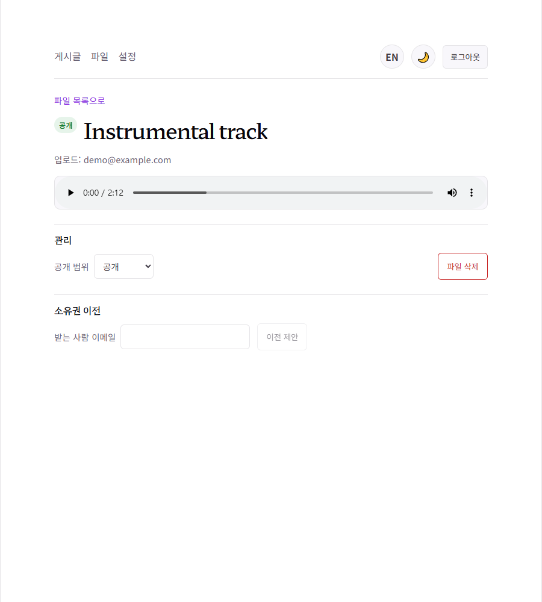<br><sub><b>오디오</b> — 브라우저 기본 플레이어로 재생하는 공개 오디오</sub></td>
<td width="50%">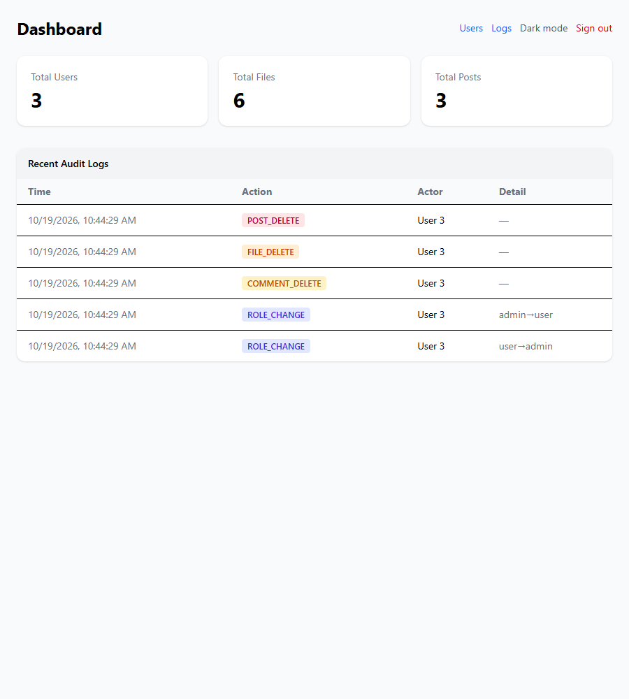<br><sub><b>관리자 콘솔</b> — 총계와 최근 감사 로그(관리자 UI는 영어만 지원)</sub></td>
</tr>
</table>

### GIF

정지 사진으로는 보이지 않는 흐름 네 가지를 짧은 GIF로 담았습니다(640 × 498, 각 0.5 MB
미만). 위와 같은 로컬 스택과 예시 데이터로 찍었습니다.

<table>
<tr>
<td width="50%">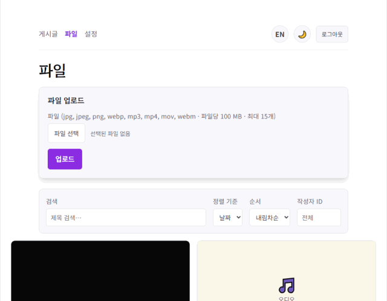<br><sub><b>여러 파일 업로드</b> — 종류가 다른 파일 세 개를 한 번에 골라 제목을 붙이고, 파일별 진행률을 보며 하나씩 올리는 과정</sub></td>
<td width="50%">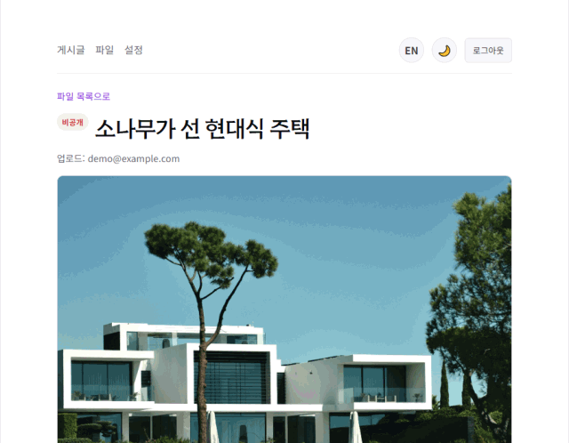<br><sub><b>공유 링크</b> — 비공개를 링크 공유로 바꿔 공유 링크를 만들고, 복사한 뒤 재발급해 새 토큰을 받는 과정(토큰은 앞부분만 표시)</sub></td>
</tr>
<tr>
<td width="50%"><br><sub><b>소유권 이전</b> — 소유자가 이메일로 제안하고, 받는 사람이 자기 계정에서 수락해야 소유권이 옮겨지는 과정</sub></td>
<td width="50%">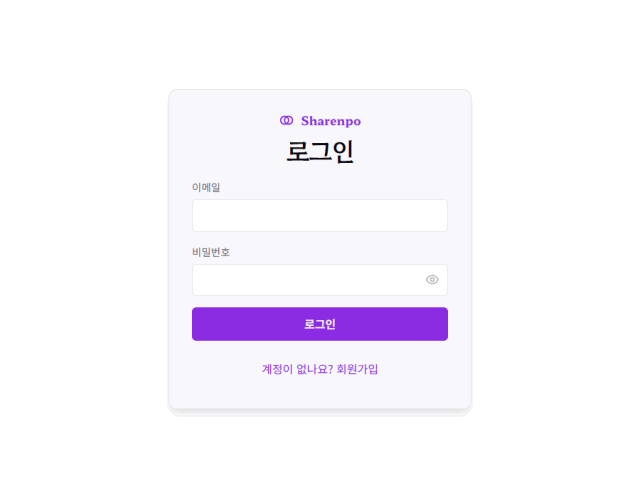<br><sub><b>약한 비밀번호</b> — "password"로 가입하면 구체적인 규칙 안내가 뜨고, 규칙에 맞게 고치면 가입과 로그인까지 되는 과정</sub></td>
</tr>
</table>

## 기능

- **인증** — HTTP Basic 토큰으로 가입·로그인하고, 서로 다른 시크릿으로 서명하며 `type` 클레임을
  가진 JWT 액세스·리프레시 토큰 쌍을 발급합니다 ([ADR 0002](docs/ADR/0002-dual-secret-token-pair.ko.md)).
  리프레시 토큰은 httpOnly 쿠키로만 오가고 서버에는 SHA-256 해시만 남깁니다. 갱신할 때마다
  토큰이 교체되며, 이미 교체된 토큰이 다시 들어오면 세션을 끝내고 `AUTH_REFRESH_REUSED`로
  응답합니다 ([ADR 0012](docs/ADR/0012-refresh-cookie-rotation.ko.md))
- **2단계 업로드** — `temp_` → `granted_` 접두사 상태 머신으로 동작하며, DB insert와 물리 파일
  이동이 함께 커밋되거나 함께 롤백됩니다
  ([ADR 0003](docs/ADR/0003-two-phase-upload-contract.ko.md)). attach 단계가 돌려준 파일명은
  한 번만 쓸 수 있는 claim 토큰입니다. 같은 사용자가 다시 보내면 기존 파일을 그대로 돌려주고(200),
  다른 사용자는 409 `FILE_ALREADY_CLAIMED`를 받습니다
  ([ADR 0019](docs/ADR/0019-upload-claim-idempotency.ko.md))
- **RBAC + 감사 로그** — `user`/`admin`/`superadmin` 역할이 있고, 소유권 검사가 "본인
  또는 admin"으로 확장되며, 역할 변경과 삭제가 감사됩니다
  ([ADR 0013](docs/ADR/0013-rbac-and-audit-log.ko.md)은
  [ADR 0007](docs/ADR/0007-ownership-checks-without-rbac.ko.md)을 바탕으로 합니다)
- **경계 검증** — 전역 `ValidationPipe`(`whitelist` + `forbidNonWhitelisted`)를 쓰고,
  응답으로 직렬화한 엔티티에는 `password`가 들어가지 않습니다
- **요청 횟수 제한** — 모든 라우트가 기본 분당 100회 제한을 받고, 한도는 라우트마다 따로
  계산하며, 앱 전체가 나눠 쓰는 하나의 풀이 아닙니다(`@nestjs/throttler`가 컨트롤러+핸들러+
  클라이언트 IP를 키로 씁니다). `POST /auth/register`/`signin`/`token/refresh`는 분당 5회로,
  `POST /upload/attach`는 분당 15회로 더 엄격합니다. health/metrics 프로브는 제외되어
  오케스트레이터와 Prometheus 트래픽이 남용으로
  오인되지 않습니다([ADR 0053](docs/ADR/0053-global-rate-limiting.ko.md),
  [ADR 0054](docs/ADR/0054-per-route-rate-limit-tuning.ko.md))
- **Swagger** — `/doc`에서 전체 API 문서를 열람하고 수동으로 테스트할 수 있습니다
- **업로드 악성코드 스캔** — 모든 업로드는 디스크에 쓰기 전에 메모리에 있는 상태로 ClamAV
  검사를 거칩니다. 감염이 확인되면 거절하고, 스캐너에 연결할 수 없을 때도 검사를 건너뛰지 않고
  업로드를 막는 fail-closed로 동작합니다([ADR 0059](docs/ADR/0059-upload-malware-scanning-clamav.ko.md))
- **파일 공개 범위** — 모든 파일은 `public`, `private`(기본값), `unlisted` 중 하나입니다.
  unlisted 파일은 공유 링크로 열며, 링크의 토큰은 재발급하거나 만료 시각을 둘 수 있습니다.
  파일 바이트는 정적 폴더가 아니라 접근 검사를 거치는 `GET /file/:id/content`로만 서빙됩니다
  ([ADR 0025](docs/ADR/0025-file-visibility-and-media-expansion.ko.md),
  [ADR 0026](docs/ADR/0026-file-visibility-implementation.ko.md))
- **스토리지 포트** — 파일 작업은 `FileStorage` 인터페이스를 거치며, `STORAGE_DRIVER`로 로컬
  디스크 어댑터와 S3 어댑터 중 하나를 고릅니다. S3에서는 접근 검사를 통과하면 수명이 짧은
  presigned URL로 리다이렉트하므로 앱 서버는 바이트를 내려 주는 경로에서 빠집니다
  ([ADR 0029](docs/ADR/0029-storage-port-adapter.ko.md),
  [ADR 0036](docs/ADR/0036-s3-presigned-content-redirect.ko.md))
- **게시판** — 파일을 선택적으로 첨부하는 게시글과 평면 댓글 스레드. 목록은 하나의 검색·필터·
  정렬·페이지네이션 규약을 공유합니다
  ([ADR 0021](docs/ADR/0021-list-query-search-filter-sort.ko.md),
  [ADR 0023](docs/ADR/0023-board-domain-schema.ko.md))
- **계정과 파일의 수명 주기** — 계정 삭제는 명시적으로 확인했을 때만 연쇄 삭제되고, 모든 삭제는
  설계상 되돌릴 수 없습니다([ADR 0020](docs/ADR/0020-account-deletion-cascade.ko.md)). 파일의
  소유자를 바꾸려면 받는 사람의 동의가 필요합니다 — 제안, 수락, 거절, 취소
  ([ADR 0050](docs/ADR/0050-consent-based-file-ownership-transfer.ko.md))
- **보안 강화** — 보안 응답 헤더([ADR 0055](docs/ADR/0055-helmet-security-headers.ko.md)),
  토큰 시크릿과 비밀번호의 강도 검사, non-root 컨테이너 이미지
  ([ADR 0030](docs/ADR/0030-container-non-root-and-arch-stance.ko.md)), 기본 거부(default-deny) 방식의
  NetworkPolicy([ADR 0056](docs/ADR/0056-networkpolicy-east-west-restriction.ko.md)), 아래에
  설명한 Ingress 경로 허용 목록
- **운영** — liveness/readiness 엔드포인트
  ([ADR 0031](docs/ADR/0031-health-and-readiness-endpoints.ko.md)), Grafana를 곁들인 Prometheus
  메트릭([ADR 0047](docs/ADR/0047-observability-prometheus-grafana.ko.md)), 고아 `temp_` 파일
  ([ADR 0018](docs/ADR/0018-orphan-temp-file-cleanup.ko.md))과 고아 `granted_` 파일의 주기적
  정리 — 후자는 운영자가 삭제를 켜기 전까지 보고만 합니다
  ([ADR 0051](docs/ADR/0051-orphaned-granted-file-reclaim.ko.md))
- **React 클라이언트(`frontend/`)** — 로그인과 회원가입, 댓글이 있는 게시판, 미리보기 그리드
  형태의 파일 보드, 미디어 종류별 재생, 공개 범위와 공유 링크 관리, 소유권 이전, 계정 삭제.
  업로드 폼은 파일을 최대 15개까지 한 번에 고르고 파일마다 진행률 표시줄을 보이며 하나씩
  보냅니다([ADR 0065](docs/ADR/0065-multi-file-upload-client-sequential.ko.md)). UI는 영어와
  한국어, 라이트와 다크 테마를 지원합니다
- **관리자 콘솔(`admin/`)** — 로그인, 총계와 최근 감사 로그가 있는 대시보드, 역할 관리가 있는
  사용자 목록, 감사 로그 뷰어. 같은 ALB의 `/admin` 아래에서 서빙됩니다
  ([ADR 0062](docs/ADR/0062-admin-same-alb-subpath-routing.ko.md))

## 아키텍처

하나의 Helm 릴리스가 세 워크로드를 하나의 ALB 뒤에서 실행합니다. Ingress는 경로를 명시한
허용 목록이며, `/health`, `/metrics`, `/doc`은 Ingress로 라우팅되지 않습니다
([ADR 0058](docs/ADR/0058-ingress-path-allowlist.ko.md)).

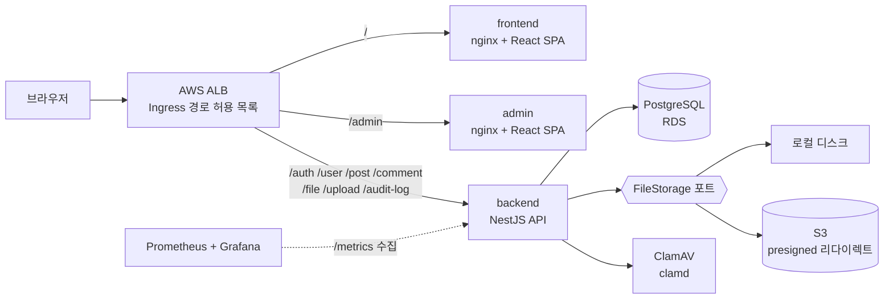

업로드는 요청 두 번으로 이루어집니다. 첫 요청은 스캔한 뒤 `temp_` 파일로 임시 저장하고, 두 번째
요청은 하나의 트랜잭션으로 승격하면서 소유자와 공개 범위를 부여합니다
([ADR 0003](docs/ADR/0003-two-phase-upload-contract.ko.md)).

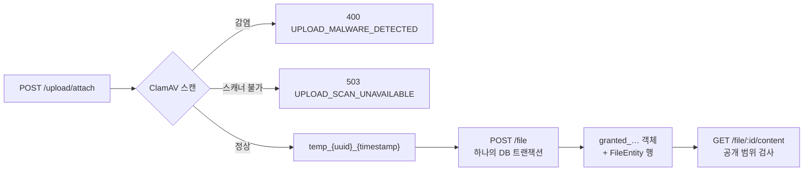

데이터 모델은 `backend/*/entity/`의 엔티티 관계를 그대로 옮긴 것입니다.

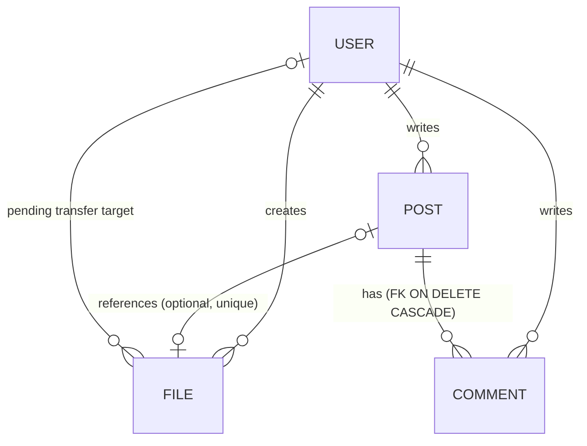

게시글은 파일을 참조할 뿐이라 게시글을 지워도 파일은 남습니다. `comment.postId`는 이 스키마에서
유일한 데이터베이스 수준 연쇄 삭제입니다([ADR 0023](docs/ADR/0023-board-domain-schema.ko.md)).

AWS 쪽을 리소스를 만드는 Terraform state별로 묶어 그렸습니다. 점선 상자는 Terraform이 아니라 Ingress와
Helm이 만드는 것입니다([ADR 0044](docs/ADR/0044-terraform-three-state-split.ko.md)).

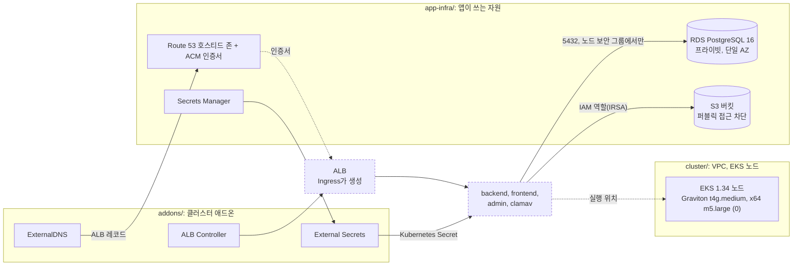

백엔드 모듈은 단일 책임 기준으로 나뉩니다. **Auth**(토큰), **User**, **File**(메타데이터와 공개
범위 검사), **Post**, **Comment**, **Upload**(임시 저장), **AuditLog**가 있고, 운영용 모듈로
**Storage**(로컬 디스크와 S3 어댑터를 가진 `FileStorage` 포트), **TempCleanup**(고아 파일
정리), **Health**, **Metrics**가 있습니다. 요청과 데이터 흐름은
[ARCHITECTURE.ko.md](docs/ARCHITECTURE.ko.md)를 참고하세요.

## 기술 스택

| 기술 | 여기서 하는 일 | 위치 |
|---|---|---|
| NestJS 11(Express), TypeScript | REST API. 관심사마다 모듈 하나 | [backend/app.module.ts](backend/app.module.ts), [backend/main.ts](backend/main.ts) |
| TypeORM 0.3 + PostgreSQL | 엔티티와 관계. `synchronize: false`이고 스키마는 마이그레이션으로 관리([ADR 0006](docs/ADR/0006-schema-policy-and-migration-adoption.ko.md)) | [backend/entities.ts](backend/entities.ts), [backend/migrations/](backend/migrations/), [backend/data-source.ts](backend/data-source.ts) |
| 트랜잭션 | 파일 이동이 DB 쓰기와 함께 커밋되어야 할 때는 수동 QueryRunner, 순수 DB 쓰기에는 `dataSource.transaction()`([ADR 0004](docs/ADR/0004-transaction-pattern-selection.ko.md)) | [backend/file/file.service.ts](backend/file/file.service.ts), [backend/user/user.service.ts](backend/user/user.service.ts) |
| Passport JWT, bcrypt | Basic 토큰 로그인, 분리된 액세스·리프레시 시크릿, 토큰 교체 | [backend/auth/](backend/auth/) |
| class-validator, Joi | 경계에서 DTO 검증, 부팅 시 환경변수 검증 | [backend/common/validation-pipe-options.ts](backend/common/validation-pipe-options.ts), [backend/app.module.ts](backend/app.module.ts) |
| `@nestjs/throttler`, helmet | 라우트별 요청 횟수 제한, 보안 응답 헤더 | [backend/app.module.ts](backend/app.module.ts), [backend/main.ts](backend/main.ts) |
| `clamscan`(ClamAV) | 업로드마다 동기식 fail-closed 스캔 | [backend/upload/scan.service.ts](backend/upload/scan.service.ts) |
| AWS SDK v3 | S3 어댑터와 presigned 리다이렉트 | [backend/storage/s3.storage.ts](backend/storage/s3.storage.ts) |
| `@nestjs/schedule` | 고아 `temp_`·`granted_` 파일 정리 | [backend/temp-cleanup/](backend/temp-cleanup/), [backend/file/granted-cleanup.service.ts](backend/file/granted-cleanup.service.ts) |
| `prom-client`, Swagger | `GET /metrics`, `/doc`의 API 문서 | [backend/metrics/](backend/metrics/), [backend/main.ts](backend/main.ts) |
| React 19, Vite, React Router 7 | `frontend/`: CSS Modules, 단순한 `fetch` 래퍼, 상태·데이터 패칭 라이브러리 없음 | [frontend/src/](frontend/src/), [frontend/src/api/client.ts](frontend/src/api/client.ts) |
| React 19, Zustand, axios | `admin/`: 역할 관리와 감사 로그 뷰어 | [admin/src/](admin/src/) |
| Jest, Playwright | 서비스 단위 테스트, 실제 PostgreSQL을 쓰는 백엔드 E2E, 클라이언트 E2E | `backend/**/*.spec.ts`, [test/](test/), [frontend/e2e/](frontend/e2e/), [admin/e2e/](admin/e2e/) |
| Docker, Compose, GitHub Actions | 멀티 스테이지 이미지(`main`에서는 `linux/amd64`와 `linux/arm64`), 로컬 스택, 이미지를 발행하는 CI | [Dockerfile](Dockerfile), [docker-compose.yml](docker-compose.yml), [.github/workflows/ci.yml](.github/workflows/ci.yml) |
| Helm, Terraform | 세 워크로드를 위한 릴리스 하나. 세 개의 state로 나눈 VPC, EKS, RDS, S3, Route 53과 ACM, 그리고 ALB Controller, External Secrets, ExternalDNS, kube-prometheus-stack | [k8s/helm/](k8s/helm/), [k8s/infra/terraform/](k8s/infra/terraform/) |

이 스택을 고른 이유는 나중에 적은 [ADR 0066](docs/ADR/0066-stack-selection-rationale-retroactive.ko.md)에
있습니다. NestJS, TypeORM, PostgreSQL은 트래픽이 커지면 서비스 단위로 나눌 수 있다는 점을 염두에 두고
골랐습니다. AWS/EKS는 배포 시장의 표준 도구를 익히는 것도 목적이었습니다. 프론트엔드는 화면이 적어서
상태 라이브러리를 쓰지 않습니다. ECS와의 비교처럼 글로 따져 보지 않은 부분도 그 ADR에 적혀 있습니다.

## 프로젝트 구조

| 경로 | 들어 있는 것 |
|---|---|
| `backend/` | NestJS API. 모듈마다 폴더 하나(`auth`, `user`, `file`, `post`, `comment`, `upload`, `storage` 등), `migrations/`, `entities.ts` |
| `frontend/` | React 클라이언트. 자체 README와 Playwright E2E가 있습니다 |
| `admin/` | 관리자 콘솔. 자체 README와 테스트가 있습니다 |
| `test/` | 백엔드 E2E 스위트(실제 PostgreSQL, 일회용 데이터베이스) |
| `k8s/helm/`, `k8s/infra/terraform/` | Helm 차트와 세 개의 Terraform state(`cluster`, `app-infra`, `addons`) |
| `docs/` | `ADR/`(결정 기록), `ROADMAP.md`, `ARCHITECTURE.md`, `CHANGELOG.md`, 스크린샷 |
| `perf/` | [ADR 0049](docs/ADR/0049-performance-capacity-criteria.ko.md)의 근거가 된 부하 테스트와 `EXPLAIN` 스크립트 |

## 빠른 시작

### 가장 빠른 방법: Docker

Compose 2.24 이상이 있는 Docker가 필요합니다. PostgreSQL, ClamAV, 마이그레이션, API를 함께
띄웁니다([ADR 0015](docs/ADR/0015-docker-and-compose.ko.md),
[ADR 0059](docs/ADR/0059-upload-malware-scanning-clamav.ko.md)).

1. 저장소 루트에서 `.env.example`을 `.env`로 복사하고 세 값만 채웁니다. 나머지는 로컬 개발용으로
   그대로 동작합니다.

   ```bash
   cp .env.example .env
   # 그다음 .env에서 다음을 설정합니다:
   #   DB_PASSWORD           원하는 비밀번호
   #   ACCESS_TOKEN_SECRET   32자 이상, 소문자·대문자·숫자·기호 포함
   #   REFRESH_TOKEN_SECRET  같은 규칙, 다른 값
   ```

   이 세 값은 일부러 비워 두거나 규칙에 어긋나게 해 두었습니다. 공개 저장소에서 누구나 읽을 수 있는
   값으로 서버가 뜨는 대신, 직접 채우기 전에는 부팅이 막힙니다.

2. 스택을 띄웁니다.

   ```bash
   docker compose up --build   # db + clamav → migrate(one-shot) → api를 :3000에 기동
   ```

   처음 시작할 때는 ClamAV가 시그니처 DB를 내려받으므로 `api`가 healthy가 되기까지 몇 분 걸릴 수
   있습니다. 그 뒤 `http://localhost:3000/doc`을 엽니다([API 써 보기](#api-써-보기-swagger)).

API만으로는 화면이 없습니다. 클라이언트를 실행하려면 별도 터미널에서 다음을 실행합니다.

```bash
cd frontend && pnpm install && pnpm dev   # http://localhost:5173 (백엔드 :3000으로 프록시)
cd admin && pnpm install && pnpm dev      # http://localhost:5174 — 백엔드 .env에 CORS_ORIGIN=http://localhost:5174 필요,
                                          # admin/README.ko.md 참고
```

참고:

- `db` 서비스가 `${DB_PORT}`(5435)를 노출하므로, 호스트에서 돌리는 `pnpm test:e2e`와
  `pnpm migration:*`도 같은 데이터베이스에 접속합니다. 그 포트를 쓰는 레거시 `upload-board-pg`
  컨테이너가 있으면 먼저 멈추세요.
- 마이그레이션은 `api`의 부팅 과정이 아니라 별도의 `migrate` 서비스로 실행됩니다
  ([ADR 0032](docs/ADR/0032-migration-as-separate-deploy-step.ko.md)). 이미지는 non-root 사용자로
  실행됩니다([ADR 0030](docs/ADR/0030-container-non-root-and-arch-stance.ko.md)). 네이티브 Linux
  호스트에서 바인드 마운트한 `./file` 디렉터리에 쓰기가 실패하면 `sudo chown -R 1001:1001 file/`을
  한 번 실행하세요.
- `.env`는 건드리지 않고 이 머신에서만 값을 바꾸려면 gitignore된 `.env.local`에 적으세요. `api`와
  `migrate`가 `.env` 뒤에 이 파일을 읽습니다
  ([ADR 0015](docs/ADR/0015-docker-and-compose.ko.md) 2026-10-03 Addendum).

### Docker 없이 실행

사전 요건: Node.js 24([.nvmrc](.nvmrc) 참고), Corepack 기반 pnpm 10, PostgreSQL 16, 그리고 접속할 수
있는 `clamd` — `CLAMD_HOST`/`CLAMD_PORT`(기본 `clamav`/`3310`)로 지정합니다. 스캐너가 없으면
`POST /upload/attach`는 설계대로 503 `UPLOAD_SCAN_UNAVAILABLE`로 답합니다.

```bash
pnpm install
cp .env.example .env              # 위의 세 값을 채웁니다 (DB_HOST는 이미 localhost)
# 그다음 DB_DATABASE에 지정한 데이터베이스를 만듭니다
pnpm migration:run                # 스키마 적용 (ADR 0006)
pnpm run start:dev                # 포트 3000, Swagger는 http://localhost:3000/doc

# 선택: superadmin 승격 — 먼저 계정을 등록하고 .env의 SUPERADMIN_EMAIL을 그 주소로 설정한 뒤
pnpm promote-superadmin           # 의도적인 수동 단계 (ADR 0013/0052)

pnpm test                         # 단위 테스트
pnpm run test:cov                 # 커버리지 (서비스만 측정)
```

마이그레이션 도입 이전의 스키마를 이미 가진 데이터베이스라면 `pnpm migration:run -- --fake`로
베이스라인을 적용 완료로 한 번 표시하세요.

### 환경변수

필수 항목은 부팅 시 Joi가 검증하며, 빠지면 즉시 실패합니다. `ENV`, `DB_TYPE`(반드시 `postgres`),
`DB_HOST`, `DB_PORT`, `DB_USERNAME`, `DB_PASSWORD`, `DB_DATABASE`, `HASH_ROUNDS`(10 이상),
`ACCESS_TOKEN_SECRET`과 `REFRESH_TOKEN_SECRET`(각각 32자 이상이면서 소문자·대문자·숫자·기호 포함),
`ACCESS_TOKEN_SECRET_EXPIRES_IN`, `REFRESH_TOKEN_SECRET_EXPIRES_IN`(숫자)입니다.

선택 항목은 모두 기본값이 있고 `.env.example`에 설명되어 있습니다.

| 변수 | 용도 |
|---|---|
| `BASE_URL` | 파일 URL을 만드는 공개 기준 URL(기본 `http://localhost:3000`) |
| `CORS_ORIGIN` | 콤마로 구분한 브라우저 origin 목록. 미설정이면 CORS 비활성([ADR 0008](docs/ADR/0008-opt-in-cors.ko.md)). 배포된 클라이언트는 ALB 뒤에서 same-origin이라 필요 없습니다 |
| `STORAGE_DRIVER` | `local`(기본) 또는 `s3`. `s3`일 때는 `S3_BUCKET`과 `AWS_REGION`도 필요합니다([ADR 0029](docs/ADR/0029-storage-port-adapter.ko.md)) |
| `CLAMD_HOST`, `CLAMD_PORT` | 악성코드 스캐너가 듣는 위치 |
| `SUPERADMIN_EMAIL` | `pnpm promote-superadmin`이 승격할 계정. 부팅할 때 자동으로 승격하지는 않습니다 |
| `TEMP_SWEEP_*`, `GRANTED_SWEEP_*` | 고아 파일 정리. granted 정리는 `GRANTED_SWEEP_DRY_RUN=false`로 바꾸기 전까지 보고만 합니다 |
| `THROTTLE_ENABLED` | `true`로 두세요. E2E 스위트가 요청 횟수 제한을 우회하기 위한 용도로만 있습니다 |

### AWS / Kubernetes 배포

백엔드·`frontend/`·`admin/`은 하나의 ALB 뒤에서 하나의 Helm 릴리스로 배포됩니다
([ADR 0060](docs/ADR/0060-frontend-same-alb-path-routing.ko.md),
[ADR 0062](docs/ADR/0062-admin-same-alb-subpath-routing.ko.md)). 실행 방법은 세 가지이고,
정확한 플래그와 선행 조건은
[k8s/infra/terraform/README.md](k8s/infra/terraform/README.ko.md)와
[k8s/helm/README.md](k8s/helm/README.ko.md)에 있습니다.

| 방법 | 명령 | 쓰는 경우 |
|---|---|---|
| 1. 스크립트 | `bash k8s/infra/terraform/deploy.sh all` (또는 `cluster` / `app-infra` / `addons` / `helm [브랜치]`를 하나씩) | 기본 경로. Terraform 세 state를 순서대로 적용한 뒤, 세 이미지에 같은 `:<git-sha>`를 넣어 `helm upgrade --install`을 실행합니다([ADR 0046](docs/ADR/0046-deploy-sequence-automation.ko.md)) |
| 2. 직접 실행 | `cluster/` → `app-infra/` → `addons/` 각 디렉터리에서 `terraform init -backend-config="bucket=<state-bucket>"`, `plan`, `apply`를 실행한 뒤 `k8s/helm`에서 `helm upgrade --install` | 스크립트를 쓰고 싶지 않을 때 — 스크립트가 감싸고 있는 순서 그대로입니다 |
| 3. Helm만 | `k8s/helm`에서 `helm upgrade --install sharenpo . -f values-prod.yaml --set image.tag=<sha> --set frontend.image.tag=<sha> --set admin.image.tag=<sha>` | 인프라가 이미 떠 있고 앱 Secret도 있어서, 재배포하거나 이전 sha로 롤백하기만 하면 될 때 |

`deploy.sh`는 모든 `apply` 전에 `y`를 직접 입력해야만 진행하며,
`-auto-approve`는 쓰지 않습니다. 세 방법 모두 도메인 구매/NS 위임, 1회성 External Secrets
동기화, `ingress.enabled` 켜기는 다루지 않으며, 이 셋은 계속 수동입니다(Terraform README
참고).

**CI는 배포하지 않습니다.** GitHub Actions는 세 이미지(`bluecode1775/sharenpo`,
`-frontend`, `-admin`)를 Docker Hub에 발행할 뿐이고
([ADR 0048](docs/ADR/0048-ci-trigger-restoration-and-docker-publish-design.ko.md)), 이
저장소에서 `terraform apply`나 `helm upgrade`를 자동으로 실행하는 것은 없습니다.

이 스택은 실제 AWS에 적용해 여러 번 검증했습니다. 지금의 실제 상태는 이 README가 아니라 AWS에서
직접 확인합니다. `apply`나 `destroy`를 실행하는 순간 이 문서의 내용은 낡아 버리기 때문입니다.

## API 써 보기 (Swagger)

Swagger UI는 백엔드가 `/doc`에서 직접 서빙합니다. 배포된 Ingress는 `/doc`을 일부러 라우팅하지
않으므로([ADR 0058](docs/ADR/0058-ingress-path-allowlist.ko.md)), 백엔드를 직접 실행했을 때 쓸 수
있습니다. [Docker 빠른 시작](#가장-빠른-방법-docker)으로 띄웠다면 `http://localhost:3000/doc`입니다.

1. `/doc`을 열고 **Authorize**를 누릅니다. 창에는 `bearer`(붙여 넣는 토큰), `basic`(이메일과
   비밀번호), `cookie`(리프레시 쿠키) 세 가지가 보입니다.
2. `basic`에 이메일과 규칙에 맞는 비밀번호(10자 이상, 소문자·대문자·숫자·기호 포함)를 입력하고
   적용합니다.
3. **Try it out**으로 `POST /auth/register`를 실행합니다. 방금 넣은 값이 Basic 토큰으로 쓰이고 201로
   답합니다. 이어서 `POST /auth/signin`을 실행해 응답의 `accessToken`을 복사합니다.
4. 그 토큰을 `bearer`에 붙여 넣고 적용한 뒤 나머지 API를 호출합니다. 예를 들면 `GET /file`입니다.
   토큰 없이 같은 호출을 하면 401이 옵니다.

`persistAuthorization`이 켜져 있어서 입력한 값은 페이지를 새로 고쳐도 남습니다.
`POST /upload/attach`는 멀티파트 업로드입니다. `image`, `audio`, `video` 필드 중 정확히 하나에
파일을 고르고, 돌려받은 `temp_…` 이름을 `POST /file`의 `filePath`로 보냅니다.

2026-10-21에 위의 Docker 스택으로 확인했습니다. `/doc`이 콘솔 에러 없이 서빙되고 렌더링됐습니다.
회원가입은 201이었고, 로그인이 토큰을 돌려줬으며, `GET /file`은 토큰 없이는 401, 있으면 200이었습니다.
1×1 PNG가 `attach`(201, ClamAV 스캔 통과)와 `POST /file`(201, `private`)을 거쳤고, `POST /file`을
다시 보내면 200이었으며, 그 파일의 콘텐츠는 토큰이 없으면 403, 소유자에게는 200이었습니다. Authorize 창이
열리는 것까지 브라우저로 확인했고, 그 안에 직접 입력하고 버튼을 누르는 동작은 따로 해 보지 않았습니다.

## 핵심 API

주요 흐름을 이루는 라우트 열 개입니다. 사용자, 소유권 이전, 감사 로그, health, metrics를 포함한
전체 라우트와 파라미터, 에러 코드는 `/doc`의 Swagger에 있습니다. `/auth/*`, 운영용 `/health/*`와
`/metrics`, `GET /file/:id/content`를 제외한 모든 라우트는 Bearer 액세스 토큰이 필요합니다.

| 라우트 | 인증 | 하는 일 | 주요 에러, ADR |
|---|---|---|---|
| `POST /auth/register` | Basic | `base64(email:password)`로 계정을 만듭니다. 비밀번호는 10자 이상이고 네 가지 문자 종류를 모두 포함해야 합니다 | 400 `AUTH_WEAK_PASSWORD`, 400 `AUTH_EMAIL_TAKEN`, 분당 5회 |
| `POST /auth/signin` | Basic | `{ accessToken }`을 돌려주고 httpOnly 리프레시 쿠키를 설정합니다 | 분당 5회([ADR 0002](docs/ADR/0002-dual-secret-token-pair.ko.md)) |
| `POST /auth/token/refresh` | 리프레시 쿠키 | 리프레시 쿠키를 교체하고 새 액세스 토큰을 돌려줍니다 | 401 `AUTH_REFRESH_REUSED`, 분당 5회([ADR 0012](docs/ADR/0012-refresh-cookie-rotation.ko.md)) |
| `POST /upload/attach` | Bearer | 스캔한 뒤 파일 하나(`image`, `audio`, `video` 필드, 100 MB)를 `temp_…`로 임시 저장하고 그 이름을 돌려줍니다 | 400 `UPLOAD_MALWARE_DETECTED`, 400 `UPLOAD_INVALID_TYPE`, 503 `UPLOAD_SCAN_UNAVAILABLE`, 분당 15회([ADR 0059](docs/ADR/0059-upload-malware-scanning-clamav.ko.md)) |
| `POST /file` | Bearer | 임시 저장한 파일을 하나의 트랜잭션으로 소유자가 있는 `private` 파일로 승격합니다. 같은 사용자가 다시 보내면 기존 결과를 돌려줍니다(200) | 409 `FILE_ALREADY_CLAIMED`([ADR 0019](docs/ADR/0019-upload-claim-idempotency.ko.md)) |
| `GET /file` | Bearer | 파일 목록: `take`, `skip`, `search`, `sortBy`, `order`, `creatorId` | 선언되지 않은 파라미터는 400 `VALIDATION_FAILED`([ADR 0021](docs/ADR/0021-list-query-search-filter-sort.ko.md)) |
| `GET /file/:id/content` | 선택적 Bearer | 공개 범위를 검사한 뒤 바이트를 `Range`와 함께 스트리밍합니다. S3에서는 presigned URL로 `302` 리다이렉트합니다 | 403 `FORBIDDEN_NOT_OWNER`, 403 `FILE_SHARE_INVALID`([ADR 0025](docs/ADR/0025-file-visibility-and-media-expansion.ko.md)) |
| `PATCH /file/:id` | Bearer | 메타데이터를 수정하고, `visibility`를 바꾸고, 공유 토큰을 재발급하고, 만료 시각을 정합니다 | 소유자가 아니면 403([ADR 0025](docs/ADR/0025-file-visibility-and-media-expansion.ko.md)) |
| `POST /post` | Bearer | 선택적 `fileId`와 함께 게시글을 만듭니다. `fileId`가 멱등 키 역할도 합니다 | 409 `POST_FILE_TAKEN`, 403 `FORBIDDEN_NOT_OWNER`([ADR 0023](docs/ADR/0023-board-domain-schema.ko.md)) |
| `POST /post/:postId/comment` | Bearer | 댓글을 답니다(1,000자 이하). 스레드는 오래된 순입니다 | 404 `POST_NOT_FOUND` |

일반적인 흐름:

```
POST /auth/register   (Basic)          → 사용자 생성
POST /auth/signin     (Basic)          → { accessToken } + Set-Cookie: refreshToken (httpOnly)
POST /upload/attach   (Bearer, image/audio/video 중 하나) → { filename: "temp_..." }
POST /file            (Bearer, { title, filePath: "temp_..." })
                                       → 승격(visibility: private); {BASE_URL}/file/:id/content로
                                         서빙 (PATCH /file/:id로 public/unlisted를 설정하기
                                         전까지는 Bearer 필요)
```

### 에러 응답

모든 에러는 동결된 기계 판독 가능 형태를 따릅니다
([ADR 0011](docs/ADR/0011-error-code-contract.ko.md)):

```json
{
  "statusCode": 400,
  "code": "FILE_TITLE_TAKEN",
  "message": "Title already in use.",
  "timestamp": "2026-07-23T09:00:00.000Z",
  "path": "/file/1"
}
```

에러를 구분할 때는 `code`(바뀌지 않는 계약 — `backend/common/error-code.ts` 참고)만 쓰고,
바뀔 수 있는 `message`로는 구분하지 마세요. 검증 실패는
`code`가 `VALIDATION_FAILED`이고 `message`가 배열로 오며, `ENV=dev`에서는 `stack`
필드가 추가됩니다.

## 트러블슈팅과 결정

측정하거나 재현한 문제와, 전체 기록이 있는 곳입니다. 여러 해결책 중 왜 하나를 골랐는지는 각 ADR에
있습니다.

| 문제 | 원인 | 해결 | 결과 |
|---|---|---|---|
| `docker stop`이 10.4초 걸리고 컨테이너가 137로 종료됨 | `node`가 PID 1이라 SIGTERM을 무시했고, 그래서 DB 풀이 닫히지 않았음 | [backend/main.ts](backend/main.ts)에 `app.enableShutdownHooks([], { useProcessExit: true })` 추가 | 로컬 컨테이너와 로컬 `kind` 클러스터의 파드에서 약 0.4초, 종료 코드 0. EKS에서는 측정하지 않았습니다([ADR 0061](docs/ADR/0061-shutdown-hooks-and-pid1-sigterm.ko.md)) |
| 스캐너가 판정을 내리지 못했는데도 업로드가 악성코드 스캔을 통과함 | `clamscan`이 reject하지 않고 `isInfected: null`("스캔 불가")로 resolve하는데, 코드가 이를 정상으로 읽었음 | boolean이 아닌 판정을 실패한 시도로 처리: 한 번 재시도한 뒤 503 `UPLOAD_SCAN_UNAVAILABLE` | 실제 `clamd`로 재현했고 수정 뒤에도 다시 확인했습니다([ADR 0059](docs/ADR/0059-upload-malware-scanning-clamav.ko.md) 2026-10-03, 2026-10-12 추가 기록) |
| 시크릿 강도 규칙이 생긴 뒤 첫 AWS 배포에서 백엔드가 crash-loop | Terraform이 JWT 시크릿을 영숫자 48자로 만들었는데, 앱의 Joi 규칙은 기호를 요구함 | 생성기가 문자 종류를 하나씩 반드시 포함하도록 수정 | 다시 apply한 뒤 백엔드가 부팅하고 로그인까지 됐습니다([ADR 0064](docs/ADR/0064-jwt-secret-generation-joi-strength-rule.ko.md)) |
| `GET /file`의 페이지 순서가 일정하지 않음 | 쿼리에 `ORDER BY`가 없어서 offset 페이지네이션이 행을 중복하거나 건너뛸 수 있었음 | 기본 `createdAt DESC`에 `id`를 tiebreaker로 추가. 정렬 필드는 고정된 표를 거쳐 매핑하므로 클라이언트 문자열이 컬럼명이 되지 않음 | 파일과 게시글이 하나의 목록 규약을 공유합니다([ADR 0021](docs/ADR/0021-list-query-search-filter-sort.ko.md)) |
| 목록 쿼리에 인덱스가 필요한지 | 측정한 근거가 없었음 | `file_entity`와 `post_entity`에 각각 10,000행을 넣고 측정한 뒤 채택 | 인덱스 6개, 합계 약 2.16 MB([ADR 0049](docs/ADR/0049-performance-capacity-criteria.ko.md)) |

## 만든 방식

코드의 대부분은 Claude Code로 작성했고, 커밋 이력에도 그대로 남아 있습니다. 커밋의 90% 넘게
`Co-Authored-By: Claude` 트레일러가 붙어 있습니다.

AI가 작업 중에 일으킬 수 있는 중대한 허점은 [CLAUDE.ko.md](CLAUDE.ko.md)에 원칙으로 먼저 명시해
두었습니다. 그래도 실제로 일어나면 날짜와 경위를 교훈으로 삼아 관련 문서에 기록합니다. 규칙이
사고를 막아 준다고 주장하지는 않습니다. 규칙이 있는데도 같은 부류의 실수가 되풀이된 일 역시
같은 곳에 적혀 있습니다.

### AI 운영 방식

- **규약을 문서로 정해 두었습니다.** [CLAUDE.ko.md](CLAUDE.ko.md)에는 묻지 않고 바꿔도 되는 것,
  코드에 나오면 안 되는 것(`any`, 검증하지 않은 환경변수, 클라이언트가 보낸 경로로 파일을 내주는
  코드), 작업을 끝났다고 말하기 전에 돌려야 하는 검증이 정리돼 있습니다. `.claude/hooks/`의 훅은
  영향 범위가 큰 파일을 수정하거나 `migration:generate`를 실행하기 전에 확인을 요청합니다.
- **선택은 개발자가 하고, 검토한 대안은 글로 남깁니다.** 선택지가 실제로 있던 곳에서는 대안을
  비교표로 정리해 개발자에게 물었고, 결과는 ADR로 남겼습니다. 저장소에서 확인할 수 있는 예는 다음과
  같습니다. 코드를 쓰기 전에 확정한 비밀번호 정책과 에러 코드, 세 가지 방안을 따져 본 뒤
  `AUTH_EMAIL_TAKEN` 노출을 유지한 결정([CLAUDE.ko.md](CLAUDE.ko.md) > 알려진 미해결 지점),
  프런트엔드를 외부 호스팅 대신 같은 ALB에서 서빙하기로 한 결정
  ([ADR 0060](docs/ADR/0060-frontend-same-alb-path-routing.ko.md)).
- **실제 환경에서 확인합니다.** 단위 테스트, 실제 PostgreSQL을 쓰는 E2E, 실행 중인 백엔드를 상대로 돌리는
  Playwright, 날짜와 함께 기록한 AWS 라이브 실행([ROADMAP.ko.md](docs/ROADMAP.ko.md) §9)이
  있습니다.

### 예시 1. AI를 지휘한 경우: 업로드 악성코드 스캔

개발자가 AI에게 지시한 범위는 다음과 같습니다.

- `clamd`가 무엇인지
- 예전에 쓰이던 전신 패키지(`clamdjs`)와 지금 쓰이는 패키지(`clamscan`)의 구분과 조사
- 두 패키지의 안전성과 의존성
- 구현 위치, 구현 코드, 사용처

그 결과 [ADR 0059](docs/ADR/0059-upload-malware-scanning-clamav.ko.md)에 남은 판단은 다음과 같습니다.

- 마지막 릴리스가 2019년이고 다운로드 수가 `clamscan`의 약 4%에 그치는 `clamdjs` 대신 `clamscan`을 선택했습니다.
- `clamscan`의 알려진 취약점(`CVE-2020-7613`)이 수정된 2.4.0을 쓰고, 취약한 경로는 켜지 않습니다.
- 저장하기 전에 메모리 버퍼에서 검사하고, 스캐너에 연결하지 못하면 통과시키지 않고 거부합니다.

이후 의존성 점검에서 스캐너가 판정을 내리지 못한 경우(`null`)를 정상으로 통과시키는 허점이 발견됐습니다.
실제 `clamd`로 재현한 뒤 고쳤고, 그 과정이 같은 ADR의 추가 기록에 남아 있습니다.

### 예시 2. AI의 허점을 바로잡은 경우

- **노드 구성 설계** ([ADR 0043](docs/ADR/0043-terraform-project-adaptation.ko.md)): AI가 기억에 의존해
  틀린 전제를 내세웠고, 개발자의 첫 판단도 그 잘못된 정보를 바탕으로 나왔습니다. 이 오류는 AI가 다른
  문서를 읽다가 알아챘습니다. 전제를 정정한 뒤에도 AI가 같은 질문을 다시 하자 개발자가 왜 또
  묻느냐고 되물었고, 이어서 둘 다 구현하려면 무엇을 골라야 하는지 물었습니다. 그 결과 x64와 ARM
  노드 그룹을 모두 두는 설계로 정리됐습니다. AI의 오류 세 가지는 ADR의 과정 메모에 그대로 적혀
  있습니다.
- **알림 설명이 깨진 문제** ([ADR 0047](docs/ADR/0047-observability-prometheus-grafana.ko.md)): 개발자가
  알림 규칙의 설명이 한국어도 영어도 아닌 글자로 보인다고 알렸습니다. AI가 저장된 값을 바이트 단위로
  확인해 깨진 문자(`U+FFFD`)가 들어 있음을 찾았고, 원인을 클라이언트 셸의 인코딩으로 추정해 설명했습니다.
  원문은 복구할 수 없어 새로 쓴 문구를 개발자에게 확인받은 뒤 적용했습니다.

### 기존 규칙을 어긴 사례

- **파일 44개 삭제 (2026-09-05).** [ADR 0051](docs/ADR/0051-orphaned-granted-file-reclaim.ko.md)이
  "DB 이력이 없으면 전부 고아로 읽힌다"는 위험을 이미 적어 두었는데도, 삭제 모드로 실제 디렉터리를
  대상으로 실행하다 생긴 사고입니다. 지워진 파일이 버려도 되는 테스트 데이터였던 것은 운이 좋았을 뿐이라고 ADR 0051의 추가
  기록과 [CLAUDE.ko.md](CLAUDE.ko.md)에 적었고, 이후의 라이브 검증은 격리된 환경에서 했습니다. 이
  규칙은 나중에 파괴적인 동작 전반으로 넓혀, 실행 전에 대상, 개수, 복구 경로를 확인하도록 했습니다.
- **낡은 근거로 우선순위를 매긴 일 (2026-10-14~16).** "근거에는 유효기간이 있다"는 규칙이 이미 있었는데도
  어긴 일이라서, 같은 규칙에 사례로 덧붙였습니다.

검토는 개발자 한 명이 전부 맡고 있으며, 별도의 검토자는 없습니다.

## 테스트와 CI

- **단위 테스트** — Jest, 소스 파일 옆의 `*.spec.ts`. 커버리지는 서비스만 측정하고, 리포지토리와
  QueryRunner는 모킹하므로 데이터베이스가 필요 없습니다(`pnpm test`). 2026-10-21에 20개 스위트,
  282건이 통과했습니다.
- **백엔드 E2E** — `pnpm test:e2e`는 실제 앱을 실제 PostgreSQL에 붙여 실행합니다. 실제
  마이그레이션으로 일회용 `sharenpo_e2e` 데이터베이스를 만들고, 테스트 사이에 비우고, 끝나면
  삭제합니다. 개발용 데이터베이스는 건드리지 않습니다. 2026-10-22에 76건이 통과했습니다.
- **클라이언트 E2E** — `frontend/`와 `admin/`의 Playwright(각 폴더의 README 참고). 두 잡 모두
  2026-10-22 CI에서 통과했습니다.
- **GitHub Actions**([ADR 0016](docs/ADR/0016-github-actions-ci.ko.md),
  [ADR 0048](docs/ADR/0048-ci-trigger-restoration-and-docker-publish-design.ko.md)) — lint와 단위
  테스트, PostgreSQL·ClamAV 서비스 컨테이너를 붙인 백엔드 E2E, 클라이언트별 lint와 E2E를 거친 뒤
  백엔드·`frontend/`·`admin/` 이미지를 발행합니다. 이미지를 푸시하기 전에, 빌드한 이미지를 일회용
  데이터베이스에 붙여 부팅하고 `HEALTHCHECK`가 healthy가 될 때까지 확인합니다.
- 배포 파이프라인과 git 훅은 없습니다. CI는 이미지를 발행하는 데서 끝납니다.

## 알려진 한계와 다음 단계

아직 열려 있는 항목이며, 각각 발견한 곳에 기록되어 있습니다. 전체 목록은
[ROADMAP.ko.md](docs/ROADMAP.ko.md) §7과 CLAUDE.md > Known Gaps에 있습니다.

- **청구 전 업로드 파일명이 업로더에게 묶여 있지 않습니다.** 첫 `POST /file` 전까지는 `temp_`
  파일명을 아는 로그인 사용자 누구나 청구할 수 있습니다. 위험은 낮게 평가했습니다(v4 UUID, 24시간
  뒤 만료)([ADR 0019](docs/ADR/0019-upload-claim-idempotency.ko.md), 2026-10-06 Addendum).
- **브라우저 탭 사이에서 refresh가 경합할 수 있습니다.** 계정당 앵커가 하나이고 유예 시간이 없습니다.
  한 번 시도했을 때는 재현되지 않았습니다.
- **끊긴 업로드는 처음부터 다시 보내야 합니다.** 이어 올리기나 청크 업로드는 없으며 설계도 하지
  않았습니다.
- **게시글 하나는 파일을 최대 하나만 참조합니다.** 한 게시글에 파일 여러 개를 붙이는 것은 아직
  결정하지 않은 스키마 변경입니다([ADR 0065](docs/ADR/0065-multi-file-upload-client-sequential.ko.md) D5).
- **회원가입은 이미 쓰는 이메일임을 알려 줍니다**(`AUTH_EMAIL_TAKEN`). 저울질한 끝에 그대로 두기로
  했고, 분당 5회 제한이 유일한 완화책입니다([ROADMAP.ko.md](docs/ROADMAP.ko.md) §7).
- **요청 횟수 카운터는 인스턴스 메모리에 있고,** 워크로드마다 레플리카가 하나라 이 배포는 고가용성이
  아닙니다. 레플리카를 늘리려면 공유 카운터 저장소가 필요합니다
  ([ADR 0053](docs/ADR/0053-global-rate-limiting.ko.md)).
- **로컬 개발 환경에서는 공개·링크 공유 미디어가 렌더링되지 않습니다.** 클라이언트(`:5173`)와
  API(`:3000`)의 출처가 달라서, API의 `Cross-Origin-Resource-Policy: same-origin` 때문에 브라우저가 파일을
  삽입하지 못합니다. 위 스크린샷은 `BASE_URL`을 클라이언트의 출처로 맞춰 이 문제를 피했습니다. 하나의
  ALB 뒤에서는 출처가 같으므로([ADR 0060](docs/ADR/0060-frontend-same-alb-path-routing.ko.md)) 생기지
  않으리라 보지만, 배포된 스택의 브라우저에서 확인하지는 않았습니다.
- **공유 링크는 앱 화면이 아니라 파일 자체를 엽니다.** 2026-10-20에 로컬 스택에서 확인했습니다. 파일
  주소는 바로 열리고 재생 위치도 옮길 수 있지만, 앱 화면은 로그인하지 않은 방문자를 로그인 화면으로
  보내고, 크롤러에게는 빈 페이지로 보이며, 다른 사이트는 이 파일을 끼워 넣을 수 없습니다. 아직 결정한
  것은 없고, 배포된 스택과 S3 리다이렉트는 확인하지 않았습니다
  ([ADR 0055](docs/ADR/0055-helmet-security-headers.ko.md) Addendum, [ROADMAP.ko.md](docs/ROADMAP.ko.md) §7).
- **전달은 이미지 발행에서 멈춥니다.** 배포는 사람이 실행합니다. 서비스 메시(Istio)는 일부러
  넣지 않았습니다. 이 프로젝트는 백엔드 워크로드가 하나뿐이라 메시가 관리할 서비스 간 트래픽이
  없기 때문입니다.
- **배포 설정에는 AWS 계정 번호와 데이터베이스 주소가 그대로 있습니다.** `deploy.sh`가 이 파일을
  그대로 `helm upgrade`에 넘기기 때문에 `k8s/helm/values-prod.yaml`에 평문 값으로 들어 있습니다.
  둘 다 자격 증명이 아니라 식별자이고 git 이력에도 이미 있습니다. 문서에서는 가렸고 배포 파일은
  일부러 그대로 두었습니다. gitleaks로 git 이력 전체를 검사한 결과(2026-10-22) 실제 비밀은 나오지
  않았습니다.
- **의존성.** 2026-10-09에 `pnpm audit --prod`는 알려진 취약점을 찾지 못했습니다. 같은 날 일반
  `pnpm audit`는 65건(심각 3건)을 보고했고, 모두 빌드·테스트 도구에 있습니다.

아직 만들지 않은 것은 로드맵에 적힌 순서대로 다음과 같습니다. 레플리카를 둘 이상으로 늘리면서
Redis 기반 요청 횟수 제한 저장소와 PodDisruptionBudget을 함께 두는 것(결정됨, 시작 전), 청구 전
업로드 파일명을 업로더에게 묶는 것(나중의 보강으로 결정됨, 시작 전), 그리고 위의 미결정 항목들입니다.

## 문서

| 문서 | 목적 |
|---|---|
| [ARCHITECTURE.ko.md](docs/ARCHITECTURE.ko.md) | 모듈 구성, 요청 흐름, 엔티티, 관례 |
| [ADR/](docs/ADR/README.ko.md) | 아키텍처 결정 기록 — 설계 이면의 *이유* |
| [CHANGELOG.ko.md](docs/CHANGELOG.ko.md) | 버전 이력 |
| [ROADMAP.ko.md](docs/ROADMAP.ko.md) | 단계별 전체 프로젝트 계획과 알려진 공백 |
| [CONTRIBUTING.ko.md](docs/CONTRIBUTING.ko.md) | 개발 워크플로와 관례 |
| [CLAUDE.ko.md](CLAUDE.ko.md) | AI 협업 개발을 위한 운영 규약 |
| [frontend/README.ko.md](frontend/README.ko.md) | React 클라이언트 — 구조, 인증 모델, E2E |
| [admin/README.ko.md](admin/README.ko.md) | 관리자 콘솔 — 무엇을 어떻게 맞췄고 어디에 호스팅되는지 |
| [k8s/helm/README.ko.md](k8s/helm/README.ko.md) | Helm 차트 — values, 시크릿, NetworkPolicy |
| [k8s/infra/terraform/README.ko.md](k8s/infra/terraform/README.ko.md) | Terraform — 세 개의 state, apply·destroy 순서 |

각 문서에는 영어 원본(`.md`)과 한국어 버전(`.ko.md`)이 있습니다.

## 라이선스

[MIT](LICENSE)

## 작성자

BLUECODE77732 — https://github.com/Bluecode77732
