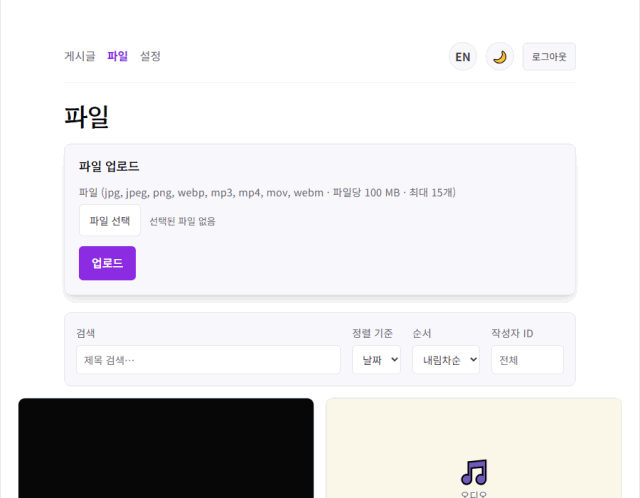
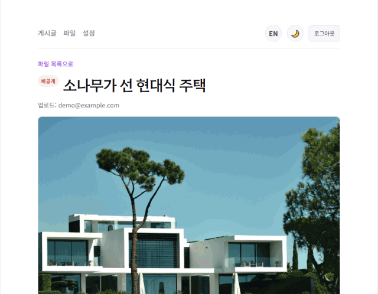
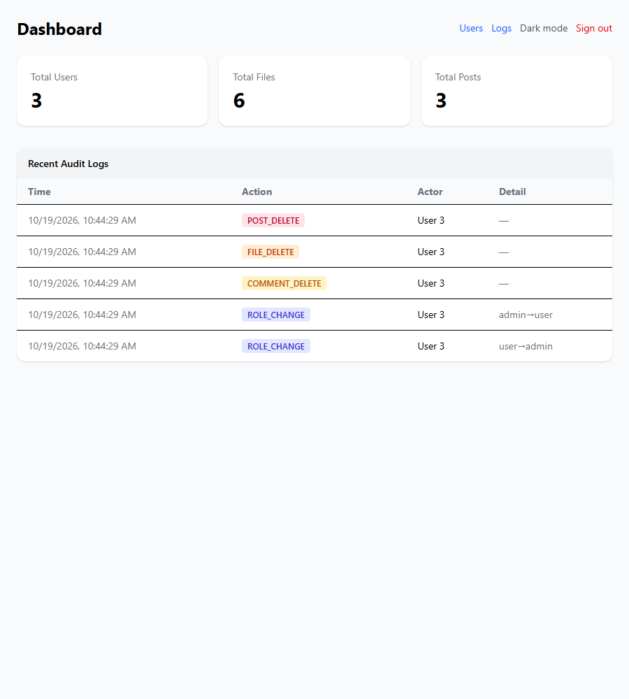
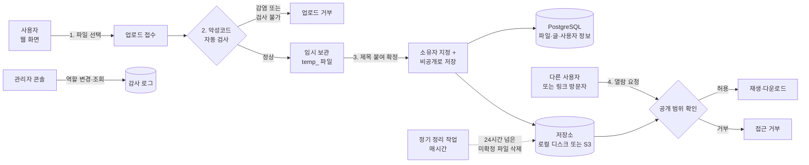

[](https://github.com/Bluecode77732/Upload-Board-Project/actions/workflows/ci.yml)


# Sharenpo

> English version: [README.en.md](README.en.md) · 기술 상세: [docs/TECHNICAL.ko.md](docs/TECHNICAL.ko.md)

**이미지·오디오·영상을 올리고, 파일마다 볼 수 있는 사람을 직접 정해 공유하는 미디어 게시판입니다.**
올라온 파일은 저장하기 전에 악성코드를 자동으로 검사하고, 열람할 때마다 공개 범위를 확인해 허락된 사람에게만 보여 줍니다.

개발자 한 명이 AI 코딩 도구(Claude Code)를 규칙 문서([CLAUDE.ko.md](CLAUDE.ko.md))와 69건의 결정 기록([ADR](docs/ADR/README.ko.md))으로 이끌어, 기획·설계부터 AWS 배포와 검증까지 진행했습니다. 선택지가 있는 결정은 AI가 대안을 표로 비교하면 개발자가 고르고, 그 이유를 기록으로 남겼습니다([만든 방식](docs/TECHNICAL.ko.md#만든-방식)).

## 주요 화면 미리보기



**여러 파일 업로드** — 종류가 다른 파일을 한 번에 고르면 파일마다 진행률을 보여 주며 하나씩 올립니다.



**공유 범위 관리** — 비공개 파일을 링크 공유로 바꾸고, 링크를 재발급하면 이전 링크는 바로 쓸 수 없게 됩니다.



**관리자 콘솔** — 전체 통계와 최근 감사 로그를 한 화면에서 봅니다(관리자 UI는 영어만 지원).

더 많은 화면(게시판, 영상·오디오 재생, 소유권 이전 등)은 [기술 문서의 스크린샷](docs/TECHNICAL.ko.md#스크린샷)에 있습니다.

## 해결한 문제와 핵심 기능

**기존 방식의 한계**

- 메신저나 공용 폴더로 파일을 주고받으면, 한 번 보낸 파일을 누가 보고 있는지 통제하기 어렵습니다.
- 올라온 파일이 안전한지 사람이 하나하나 확인할 수 없습니다.
- 업로드가 끊기거나 버튼을 두 번 누르면 중복 파일과 주인 없는 파일이 저장소에 쌓입니다.
- 담당자가 바뀔 때 파일을 넘기는 절차와, 누가 무엇을 지우고 권한을 바꿨는지에 대한 기록을 사람이 따로 챙겨야 합니다.

**이 프로그램으로 자동화·개선한 것**

- **파일별 공개 범위** — 공개, 비공개(기본값), 링크 공유 세 가지 중에서 고릅니다. 링크는 언제든 재발급해 이전 링크를 막을 수 있고, 만료 시각은 API로 지정할 수 있습니다. 파일은 항상 권한을 확인하는 경로로만 열립니다.
- **업로드 자동 검사** — 모든 파일을 저장 전에 ClamAV로 검사합니다. 감염된 파일은 거부하고, 검사기에 연결할 수 없을 때도 통과시키지 않고 막습니다.
- **중복·방치 파일 자동 처리** — 같은 업로드 확정 요청이 다시 와도 새로 저장하지 않고 처음 결과를 돌려줍니다. 확정되지 않은 임시 파일은 매시간 도는 정리 작업이 24시간 뒤 자동으로 지웁니다.
- **동의를 받는 소유권 이전** — 소유자가 이메일로 이전을 제안하고, 받는 사람이 자기 계정에서 수락해야 넘어갑니다. 거절과 취소도 할 수 있습니다.
- **역할별 권한과 감사 로그** — 일반 사용자, 관리자, 최고 관리자 세 단계가 있고, 본인이나 관리자만 수정·삭제할 수 있습니다. 삭제와 역할 변경은 감사 로그에 자동으로 남고, 관리자 콘솔에서 확인합니다.

이 기능들은 게시판(글, 댓글, 검색·정렬) 위에서 동작해, 파일을 글에 첨부해 공유할 수 있습니다. 변경할 때마다 GitHub Actions가 단위 테스트, 실제 PostgreSQL을 쓰는 E2E 테스트, 두 화면의 브라우저 E2E 테스트를 자동으로 돌립니다. k6로 가상 사용자 500명(500 VU) 부하를 걸었을 때 예상하지 못한 실패는 0건이었습니다(PC 한 대에서 측정, [ADR 0069](docs/ADR/0069-k6-load-testing.ko.md)).

## 전체 시스템 흐름도



1. 사용자가 파일을 고르면 서버가 메모리에서 바로 악성코드를 검사합니다. 검사를 통과한 파일만 임시로 저장합니다.
2. 사용자가 제목을 붙여 확정하면, DB 기록과 파일 이동이 하나의 작업으로 처리됩니다. 둘 중 하나라도 실패하면 함께 취소되어 기록만 있고 파일이 없는 상태가 생기지 않습니다.
3. 파일을 열 때마다 공개 범위(공개, 비공개, 링크 공유)를 확인합니다. S3를 쓸 때는 확인을 통과한 사람에게 몇 분만 유효한 다운로드 주소를 줍니다.

운영 환경에서는 사용자 화면, 관리자 콘솔, API가 AWS EKS에서 로드밸런서 하나 뒤에 함께 배포되고, Prometheus와 Grafana로 상태를 봅니다. 인프라 구성도와 데이터 모델은 [기술 문서의 아키텍처](docs/TECHNICAL.ko.md#아키텍처)에 있습니다.

## 사용 기술 스택

| 분류 | 기술 | 이 프로젝트에서 하는 일 |
|---|---|---|
| 프론트엔드 | React 19, Vite, React Router 7, CSS Modules | 사용자 화면(`frontend/`). 한국어·영어, 라이트·다크 테마 |
| | React 19, Zustand, axios, Tailwind CSS | 관리자 콘솔(`admin/`). 사용자 역할 관리와 감사 로그 조회 |
| 백엔드 | NestJS 11, TypeScript | REST API. 인증, 파일, 게시판, 업로드를 모듈로 나눔 |
| | Passport JWT, bcrypt | 로그인, 토큰 발급·갱신, 비밀번호 암호화 |
| | ClamAV(`clamscan`) | 업로드 파일 악성코드 검사 |
| | `@nestjs/throttler`, helmet, Swagger | 요청 횟수 제한, 보안 헤더, `/doc` API 문서 |
| DB/인프라 | PostgreSQL 16, TypeORM 0.3 | 데이터 저장, 마이그레이션으로 스키마 관리 |
| | AWS S3, EKS, RDS, Route 53, ACM | 파일 저장소와 운영 환경 |
| | Docker, Docker Compose, Helm, Terraform | 컨테이너 이미지, 로컬 실행, 쿠버네티스 배포, 인프라 코드 |
| | Prometheus, Grafana | 운영 지표 수집과 대시보드 |
| 자동화/테스트 | GitHub Actions | 변경마다 lint와 테스트를 돌리고, 통과한 이미지만 Docker Hub에 발행 |
| | Jest, Playwright, Vitest | 단위 테스트, 실제 DB를 쓰는 E2E, 브라우저 E2E |
| | k6, autocannon | 부하 시험과 응답 시간 측정(`perf/`) |
| | Claude Code | 규칙 문서([CLAUDE.ko.md](CLAUDE.ko.md))와 훅(`.claude/hooks/`)으로 운영한 AI 개발 도구 |

## 로컬 실행 및 테스트 방법

필요한 것: Compose 2.24 이상이 포함된 Docker. PostgreSQL, ClamAV, 마이그레이션, API가 함께 뜹니다.

```bash
cp .env.example .env
# .env에서 세 값을 채웁니다(비워 두면 부팅이 막힙니다):
#   DB_PASSWORD           원하는 비밀번호
#   ACCESS_TOKEN_SECRET   32자 이상, 소문자·대문자·숫자·기호 포함
#   REFRESH_TOKEN_SECRET  같은 규칙, 다른 값

docker compose up --build    # API가 http://localhost:3000 에서 뜹니다
```

처음에는 ClamAV가 시그니처를 내려받느라 몇 분 걸릴 수 있습니다. 뜨고 나면 `http://localhost:3000/doc`에서 Swagger로 모든 API를 직접 호출해 볼 수 있습니다.

사용자 화면은 별도 터미널에서 띄웁니다(Node.js 24, pnpm 10 필요).

```bash
cd frontend && pnpm install && pnpm dev    # http://localhost:5173
```

테스트는 저장소 루트에서 실행합니다. 단위 테스트는 DB 없이 돌아갑니다.

```bash
pnpm install
pnpm test           # 백엔드 단위 테스트
CLAMD_HOST=127.0.0.1 pnpm test:e2e   # 백엔드 E2E. 위 compose의 db와 clamav가 떠 있어야 함
```

관리자 콘솔 실행, Docker 없이 실행, 환경변수, AWS 배포 방법은 [기술 문서의 빠른 시작](docs/TECHNICAL.ko.md#빠른-시작)에 있습니다.

## 라이선스

[MIT](LICENSE) · 작성자 BLUECODE77732 — https://github.com/Bluecode77732
