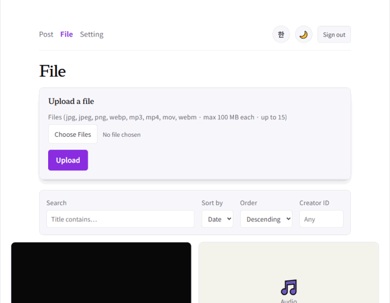
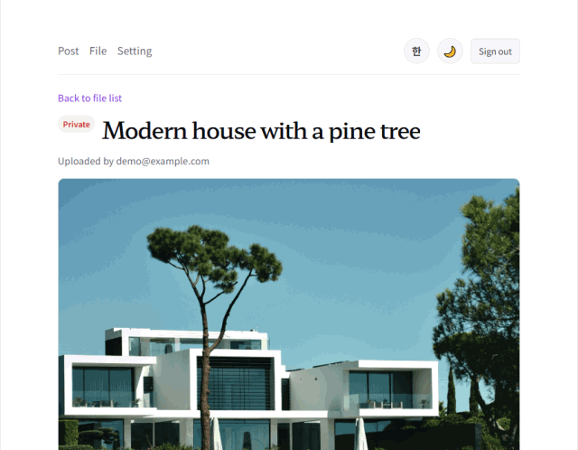
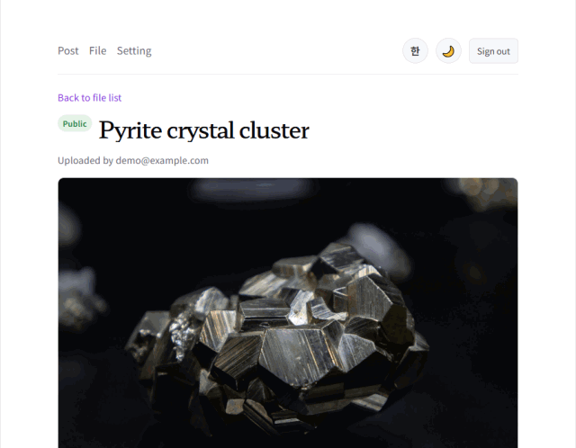
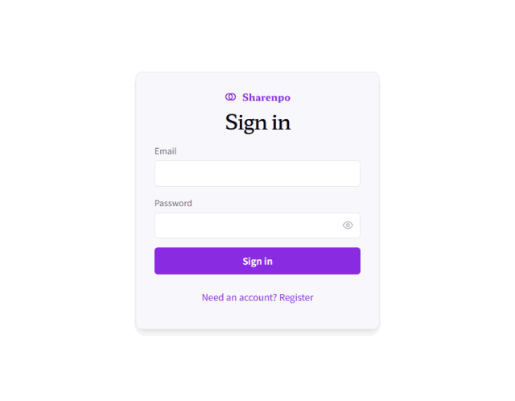
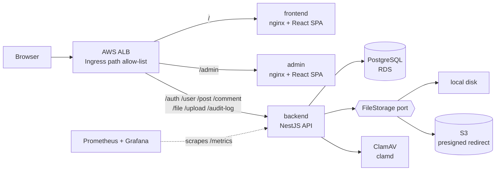
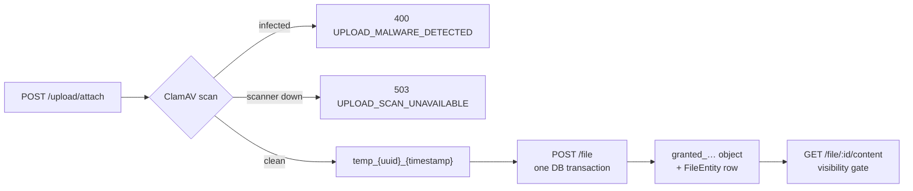
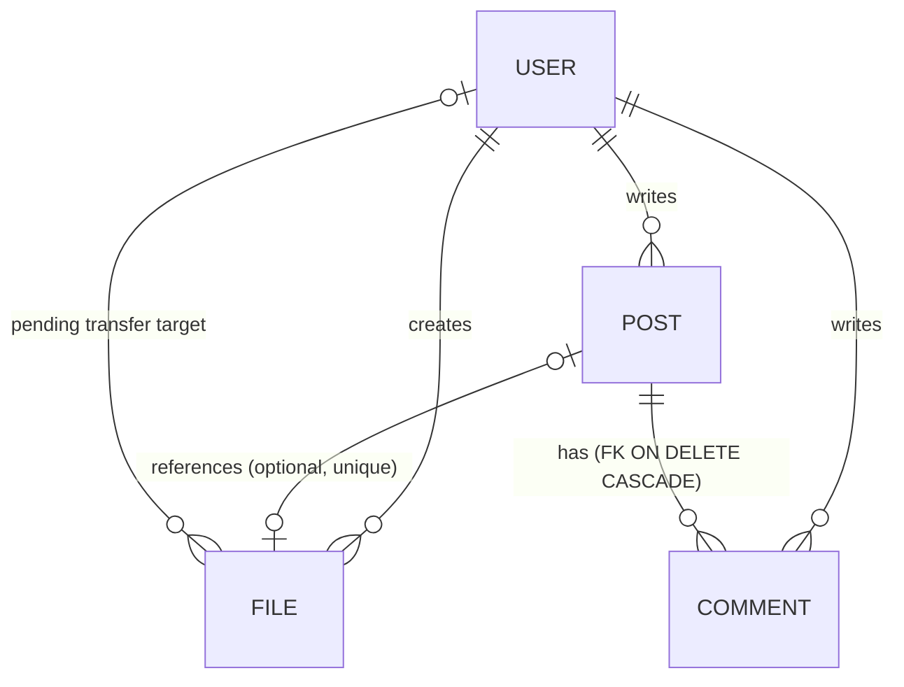
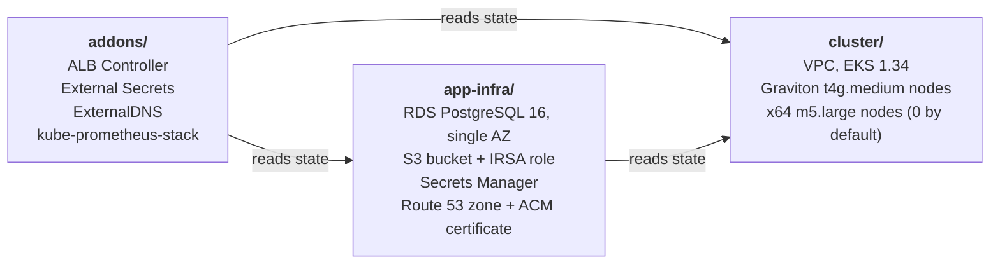

[](https://github.com/Bluecode77732/Upload-Board-Project/actions/workflows/ci.yml)


# Sharenpo

> 한국어 버전: [README.ko.md](README.ko.md)

A service where signed-in users upload images, audio and video, choose who can see each file,
and share them on a board with posts and comments. It is a NestJS API, a React client and an
admin console, deployed to AWS/EKS with Helm and Terraform and observed with Prometheus and
Grafana.

- Timeline: first commit 2025-12-17, still in progress
- Scope: one developer, AI-assisted under the contract in [CLAUDE.md](CLAUDE.md) — backend,
  `frontend/`, `admin/`, containers, CI, Helm and Terraform
- Role: the developer decided the password policy and its error code, serving the frontend from
  the same ALB instead of an external host, and fixing Terraform's secret generator instead of
  loosening the app's secret rule. Before any code is written, the AI lays out the options in a
  comparison table and the developer picks one; only that one is built. The developer reads and
  approves every change, and results are checked with tests, CI and reproductions in real
  environments (AWS/EKS, a real ClamAV)
- This README covers the whole repository. The backend sits at the repo root; the clients have
  their own READMEs ([frontend/](frontend/README.md), [admin/](admin/README.md))

## Status

There is no always-on demo. The stack has been applied to AWS/EKS and torn down between runs
(dated runs: [ROADMAP.md](docs/ROADMAP.md) §9 and the ADR addenda); this README does not say
whether it is up right now. To see the project work:

- Look at the [screenshots and GIFs](#screenshots) below
- Run it yourself with Docker: [Quick Start](#quick-start)
- Try every endpoint in the browser, locally: [Try the API](#try-the-api-swagger)

## In two minutes

- **Two-phase upload.** A file is staged as `temp_…`, then promoted to `granted_…` inside one DB
  transaction: if the move fails, the insert rolls back
  ([ADR 0003](docs/ADR/0003-two-phase-upload-contract.md)). The one unprotected window is a commit
  that fails after a successful move; it leaves an orphaned `granted_` file that a scheduled sweep
  reports ([ADR 0051](docs/ADR/0051-orphaned-granted-file-reclaim.md)). Submitting the same upload
  twice replays the result instead of failing
  ([ADR 0019](docs/ADR/0019-upload-claim-idempotency.md)).
- **No static file serving.** Stored bytes are only reachable through `GET /file/:id/content`,
  which checks the file's visibility first ([ADR 0025](docs/ADR/0025-file-visibility-and-media-expansion.md)).
- **Refresh-token rotation with reuse detection.** The server keeps only a hash of the current
  refresh token ([ADR 0012](docs/ADR/0012-refresh-cookie-rotation.md)).
- **Fail-closed malware scan** on every upload, before anything is stored
  ([ADR 0059](docs/ADR/0059-upload-malware-scanning-clamav.md)).
- **Checked:** the backend unit tests, a backend E2E suite on a real PostgreSQL and the Playwright
  E2E of both clients pass (counts and dates in [Testing and CI](#testing-and-ci)). 68 ADRs record
  the decisions.
- **Built with AI, under written rules.** Most of the code was written with Claude Code. The
  developer sets the rules in [CLAUDE.md](CLAUDE.md), chooses between alternatives and records them
  as ADRs; where the AI broke a rule, that is written down too ([How this was built](#how-this-was-built)).
- **Where to read first:** [backend/file/file.service.ts](backend/file/file.service.ts)
  (transactions, claims), [backend/auth/auth.service.ts](backend/auth/auth.service.ts) (tokens),
  [backend/storage/](backend/storage/) (the storage port).

## Screenshots

Local stack with throwaway demo data, English UI and sample content, light theme. The UI also runs in Korean and
in a dark theme. Every picture is the same 900 × 1000 frame, scrolled to the part that matters.
File URLs point at the client's own origin, as they do behind the ALB, and the share-link token
is masked; see [Known limitations](#known-limitations-and-next-steps).

<table>
<tr>
<td width="50%"><br><sub><b>Sign in</b> — Basic-token sign-in, register toggle, show/hide password</sub></td>
<td width="50%"><br><sub><b>Post board</b> — new post with an optional attached file, search, sort and pagination</sub></td>
</tr>
<tr>
<td width="50%"><br><sub><b>Post detail</b> — attached image and a flat, oldest-first comment thread</sub></td>
<td width="50%"><br><sub><b>File board</b> — upload form, search, sort and creator filter, with the preview grid below</sub></td>
</tr>
<tr>
<td width="50%"><br><sub><b>Mixed media</b> — image, audio and video tiles with Public, Unlisted and Private badges</sub></td>
<td width="50%"><br><sub><b>File detail</b> — image, visibility control and ownership transfer</sub></td>
</tr>
<tr>
<td width="50%"><br><sub><b>Unlisted file</b> — share link (token masked), rotate button and visibility control</sub></td>
<td width="50%"><br><sub><b>Video</b> — a public video in the browser's own player, served with Range support for seeking</sub></td>
</tr>
<tr>
<td width="50%"><br><sub><b>Audio</b> — a public audio file in the browser's own player</sub></td>
<td width="50%"><br><sub><b>Admin console</b> — totals and recent audit logs (the admin UI is English only)</sub></td>
</tr>
</table>

### GIF

Four short recordings of flows a still picture cannot show (640 × 498, under 0.5 MB each). Same
local stack and sample data as above.

<table>
<tr>
<td width="50%"><br><sub><b>Multi-file upload</b> — three files of different kinds are chosen at once, titled, and uploaded one by one with per-file progress</sub></td>
<td width="50%"><br><sub><b>Share link</b> — private → unlisted creates a share link; copy it, then rotate it to get a new token (token shortened)</sub></td>
</tr>
<tr>
<td width="50%"><br><sub><b>Ownership transfer</b> — the owner proposes by email; ownership moves only after the recipient accepts from their own account</sub></td>
<td width="50%"><br><sub><b>Weak password</b> — registering with "password" shows the specific rule; a valid one registers and signs in</sub></td>
</tr>
</table>

## Features

- **Authentication** — Basic-token register/sign-in and a dual-secret JWT access/refresh pair with a
  `type` claim ([ADR 0002](docs/ADR/0002-dual-secret-token-pair.md)); the refresh token is an httpOnly cookie that rotates on every
  refresh, with reuse detection ([ADR 0012](docs/ADR/0012-refresh-cookie-rotation.md))
- **Two-phase upload** — `temp_` → `granted_` state machine with the file move inside the DB
  transaction ([ADR 0003](docs/ADR/0003-two-phase-upload-contract.md)). The attach filename is a one-shot claim token: the same user
  resubmitting gets the file back (200), anyone else gets 409 `FILE_ALREADY_CLAIMED`
  ([ADR 0019](docs/ADR/0019-upload-claim-idempotency.md))
- **RBAC + audit log** — `user`/`admin`/`superadmin` roles, ownership checks that extend to "self or
  admin", role changes and deletes written to an audit log ([ADR 0013](docs/ADR/0013-rbac-and-audit-log.md), layered on [ADR 0007](docs/ADR/0007-ownership-checks-without-rbac.md))
- **Boundary validation** — global `ValidationPipe` (`whitelist` + `forbidNonWhitelisted`);
  serialized entities never leak `password`
- **Rate limiting** — 100 requests/minute per route (keyed on controller + handler + client IP),
  5/minute on `POST /auth/register`, `signin` and `token/refresh`, 15/minute on
  `POST /upload/attach`; health and metrics probes are exempt ([ADR 0053](docs/ADR/0053-global-rate-limiting.md), [ADR 0054](docs/ADR/0054-per-route-rate-limit-tuning.md))
- **Swagger** — API documentation and manual test bench at `/doc`
- **Upload malware scanning** — ClamAV, fail-closed, before anything is stored ([ADR 0059](docs/ADR/0059-upload-malware-scanning-clamav.md))
- **File visibility** — `public`, `private` (default) or `unlisted` (a share link whose token can be
  rotated or expire); bytes are served only through the access-checked `GET /file/:id/content`
  ([ADR 0025](docs/ADR/0025-file-visibility-and-media-expansion.md), [ADR 0026](docs/ADR/0026-file-visibility-implementation.md))
- **Storage port** — a `FileStorage` interface with local-disk and S3 adapters (`STORAGE_DRIVER`);
  under S3 a passing access check redirects to a short-lived presigned URL ([ADR 0029](docs/ADR/0029-storage-port-adapter.md),
  [ADR 0036](docs/ADR/0036-s3-presigned-content-redirect.md))
- **Board** — posts with an optional attached file, flat comments, and one search, filter, sort and
  pagination contract ([ADR 0021](docs/ADR/0021-list-query-search-filter-sort.md), [ADR 0023](docs/ADR/0023-board-domain-schema.md))
- **Account and file lifecycle** — account deletion cascades only on explicit confirmation and is
  irreversible by design ([ADR 0020](docs/ADR/0020-account-deletion-cascade.md)); moving a file to another owner needs the recipient's
  consent: propose, accept, reject or cancel ([ADR 0050](docs/ADR/0050-consent-based-file-ownership-transfer.md))
- **Hardening** — security response headers ([ADR 0055](docs/ADR/0055-helmet-security-headers.md)), a strength check on token secrets and
  passwords, a non-root image ([ADR 0030](docs/ADR/0030-container-non-root-and-arch-stance.md)), a default-deny NetworkPolicy ([ADR 0056](docs/ADR/0056-networkpolicy-east-west-restriction.md)) and the
  Ingress path allow-list below
- **Operations** — liveness/readiness endpoints ([ADR 0031](docs/ADR/0031-health-and-readiness-endpoints.md)), Prometheus metrics with Grafana
  ([ADR 0047](docs/ADR/0047-observability-prometheus-grafana.md)), and scheduled sweeps for orphaned `temp_` files ([ADR 0018](docs/ADR/0018-orphan-temp-file-cleanup.md)) and orphaned
  `granted_` files, which only reports until deletion is turned on ([ADR 0051](docs/ADR/0051-orphaned-granted-file-reclaim.md))
- **React client (`frontend/`)** — sign-in and register, the post board with comments, a preview-grid
  file board, playback by media type, visibility and share-link management, ownership transfer and
  account deletion. The upload form sends up to 15 files one by one with a progress bar per file
  ([ADR 0065](docs/ADR/0065-multi-file-upload-client-sequential.md)); the UI is English or Korean, light or dark
- **Admin console (`admin/`)** — login, a dashboard with totals and recent audit logs, the user list
  with role management, and the audit-log viewer, served under `/admin` on the same ALB ([ADR 0062](docs/ADR/0062-admin-same-alb-subpath-routing.md))

## Architecture

One Helm release runs the backend, `frontend/` and `admin/` behind one ALB, plus ClamAV as its own
Deployment. The Ingress is an explicit path
allow-list: `/health`, `/metrics` and `/doc` are not routed to it
([ADR 0058](docs/ADR/0058-ingress-path-allowlist.md)).



An upload is two requests. The first scans and stages a `temp_` file; the second promotes it in
one transaction and gives it an owner and a visibility
([ADR 0003](docs/ADR/0003-two-phase-upload-contract.md)):



The data model, from the entity relations in `backend/*/entity/`:



A post only references a file; deleting the post leaves the file. `comment.postId` is the
schema's only database-level cascade
([ADR 0023](docs/ADR/0023-board-domain-schema.md)).

The AWS side is three Terraform states, each its own root module. It is drawn from the Terraform
code and was not checked against a live state. Arrows are `terraform_remote_state` reads, one way
only: `cluster/` reads neither of the others
([ADR 0044](docs/ADR/0044-terraform-three-state-split.md)).



How the pieces meet at runtime, which the diagram leaves out:

- RDS is private and accepts port 5432 only from the node security group. The S3 bucket blocks
  public access, and the app reaches it through an IAM role (IRSA).
- Secrets Manager feeds External Secrets, which creates a Kubernetes Secret, after one manual
  `kubectl apply`.
- ExternalDNS writes the ALB's DNS record into the Route 53 zone, and the Ingress attaches the ACM
  certificate to the ALB.
- The ALB and the four workloads are not Terraform's: the Ingress and Helm create them.

Backend modules, split by single responsibility: **Auth** (tokens), **User**, **File**
(metadata and the visibility gate), **Post**, **Comment**, **Upload** (staging), **AuditLog**,
plus operational modules — **Storage** (the `FileStorage` port with local-disk and S3 adapters),
**TempCleanup** (orphan sweep), **Health** and **Metrics**. See
[ARCHITECTURE.md](docs/ARCHITECTURE.md) for the request and data flow.

## Tech stack

| Technology | What it does here | Where |
|---|---|---|
| NestJS 11 (Express), TypeScript | The REST API; one module per concern | [backend/app.module.ts](backend/app.module.ts), [backend/main.ts](backend/main.ts) |
| TypeORM 0.3 + PostgreSQL | Entities and relations; `synchronize: false`, schema by migrations ([ADR 0006](docs/ADR/0006-schema-policy-and-migration-adoption.md)) | [backend/entities.ts](backend/entities.ts), [backend/migrations/](backend/migrations/), [backend/data-source.ts](backend/data-source.ts) |
| Transactions | Manual QueryRunner where a file move must commit with the DB write, `dataSource.transaction()` for pure DB writes ([ADR 0004](docs/ADR/0004-transaction-pattern-selection.md)) | [backend/file/file.service.ts](backend/file/file.service.ts), [backend/user/user.service.ts](backend/user/user.service.ts) |
| Passport JWT, bcrypt | Basic-token sign-in, separate access and refresh secrets, rotation | [backend/auth/](backend/auth/) |
| class-validator, Joi | DTO validation at the boundary; env vars validated at boot | [backend/common/validation-pipe-options.ts](backend/common/validation-pipe-options.ts), [backend/app.module.ts](backend/app.module.ts) |
| `@nestjs/throttler`, helmet | Per-route rate limits; security response headers | [backend/app.module.ts](backend/app.module.ts), [backend/main.ts](backend/main.ts) |
| `clamscan` (ClamAV) | Synchronous, fail-closed scan of each upload | [backend/upload/scan.service.ts](backend/upload/scan.service.ts) |
| AWS SDK v3 | S3 adapter and presigned redirects | [backend/storage/s3.storage.ts](backend/storage/s3.storage.ts) |
| `@nestjs/schedule` | Orphan `temp_` and `granted_` file sweeps | [backend/temp-cleanup/](backend/temp-cleanup/), [backend/file/granted-cleanup.service.ts](backend/file/granted-cleanup.service.ts) |
| `prom-client`, Swagger | `GET /metrics`; API docs at `/doc` | [backend/metrics/](backend/metrics/), [backend/main.ts](backend/main.ts) |
| React 19, Vite, React Router 7 | `frontend/`: CSS Modules, plain `fetch` wrapper, no state or data-fetching library | [frontend/src/](frontend/src/), [frontend/src/api/client.ts](frontend/src/api/client.ts) |
| React 19, Zustand, axios | `admin/`: role management and audit-log viewer | [admin/src/](admin/src/) |
| Jest, Playwright | Service unit tests; backend E2E on a real PostgreSQL; client E2E | `backend/**/*.spec.ts`, [test/](test/), [frontend/e2e/](frontend/e2e/), [admin/e2e/](admin/e2e/) |
| Docker, Compose, GitHub Actions | Multi-stage image (`linux/amd64` and `linux/arm64` from `main`), local stack, CI that publishes images | [Dockerfile](Dockerfile), [docker-compose.yml](docker-compose.yml), [.github/workflows/ci.yml](.github/workflows/ci.yml) |
| Helm, Terraform | One release for the backend, `frontend/`, `admin/` and ClamAV; VPC, EKS, RDS, S3, Route 53 and ACM in three state files, plus ALB Controller, External Secrets, ExternalDNS, kube-prometheus-stack | [k8s/helm/](k8s/helm/), [k8s/infra/terraform/](k8s/infra/terraform/) |

Why these were chosen is in [ADR 0066](docs/ADR/0066-stack-selection-rationale-retroactive.md),
written after the fact. NestJS, TypeORM and PostgreSQL were picked with a later move toward
services in mind. AWS/EKS was also a way to learn the deployment market's standard tools. The
frontend has no state library because it has few screens. The ADR also says what was never
weighed in writing, such as a comparison with ECS.

## Project structure

| Path | What is there |
|---|---|
| `backend/` | The NestJS API: one folder per module (`auth`, `user`, `file`, `post`, `comment`, `upload`, `storage`, …), `migrations/`, `entities.ts` |
| `frontend/` | The React client, with its own README and Playwright E2E |
| `admin/` | The admin console, with its own README and tests |
| `test/` | Backend E2E suite (real PostgreSQL, throwaway database) |
| `k8s/helm/`, `k8s/infra/terraform/` | The Helm chart and the three Terraform states (`cluster`, `app-infra`, `addons`) |
| `docs/` | Decision records, roadmap, architecture notes, changelog and the screenshots (see [Documentation](#documentation)) |
| `perf/` | Load-test and `EXPLAIN` scripts behind [ADR 0049](docs/ADR/0049-performance-capacity-criteria.md) |

## Quick Start

### Fastest: Docker

Needs Docker with Compose 2.24 or newer. This brings up PostgreSQL, ClamAV, the migrations and
the API ([ADR 0015](docs/ADR/0015-docker-and-compose.md),
[ADR 0059](docs/ADR/0059-upload-malware-scanning-clamav.md)).

1. Copy `.env.example` to `.env` in the repo root and fill in three values; the rest works for
   local development as it is:

   ```bash
   cp .env.example .env
   # then set, in .env:
   #   DB_PASSWORD           any password you choose
   #   ACCESS_TOKEN_SECRET   32+ characters with a lowercase letter, an uppercase letter, a digit and a symbol
   #   REFRESH_TOKEN_SECRET  the same rule, a different value
   ```

   These three are left empty or invalid on purpose: the app refuses to boot until you set them,
   rather than running with values anyone can read in this public repo.

2. Start the stack:

   ```bash
   docker compose up --build   # db + clamav → migrate (one-shot) → api on :3000
   ```

   The first start downloads ClamAV's signature database, so `api` can take a few minutes to
   become healthy. Then open `http://localhost:3000/doc` ([Try the API](#try-the-api-swagger)).

These steps start only the API, which has no UI. To run the clients, use separate terminals:

```bash
cd frontend && pnpm install && pnpm dev   # http://localhost:5173 (proxies to the backend on :3000)

cd admin && cp .env.example .env          # sets VITE_API_URL=http://localhost:3000
pnpm install && pnpm dev                  # http://localhost:5174
```

`admin` calls the backend from another origin, so add `CORS_ORIGIN=http://localhost:5174` to the
backend's `.env` and restart the backend (see admin/README.md).

Signing in to `admin` needs a superadmin account. Register an account first (`POST /auth/register`
works from Swagger), put its email in `.env` as `SUPERADMIN_EMAIL`, run `docker compose up -d` so `api`
is recreated with the new value, then promote the account by hand
([ADR 0052](docs/ADR/0052-superadmin-seed-manual-trigger.md)):

```bash
docker compose exec api node dist/scripts/promote-superadmin.js
```

Notes:

- `db` publishes `${DB_PORT}` (5435), so host-run `pnpm test:e2e` and `pnpm migration:*` reach the
  same database. Stop any legacy `upload-board-pg` container first — it holds that port.
- Migrations run as their own `migrate` service, not inside `api`'s boot
  ([ADR 0032](docs/ADR/0032-migration-as-separate-deploy-step.md)). The image runs as a non-root
  user ([ADR 0030](docs/ADR/0030-container-non-root-and-arch-stance.md)); on a native Linux host,
  if the bind-mounted `./file` directory fails to write, run `sudo chown -R 1001:1001 file/` once.
- To change a value only on your machine without touching `.env`, put it in the gitignored
  `.env.local`: `api` and `migrate` read it after `.env`
  ([ADR 0015](docs/ADR/0015-docker-and-compose.md) Addendum 2026-10-03).

### Without Docker

Prerequisites: Node.js 24 (see [.nvmrc](.nvmrc)), pnpm 10 via Corepack, PostgreSQL 16, and a
reachable `clamd` — set `CLAMD_HOST`/`CLAMD_PORT` (default `clamav`/`3310`). Without a scanner,
`POST /upload/attach` answers 503 `UPLOAD_SCAN_UNAVAILABLE` by design.

```bash
pnpm install
cp .env.example .env              # fill in the three values as above; DB_HOST is already localhost,
                                  # and DB_PORT=5435 is the compose db's port: set your own (often 5432)
# then create the database named in DB_DATABASE
pnpm migration:run                # applies the schema (ADR 0006)
pnpm run start:dev                # port 3000, Swagger at http://localhost:3000/doc

# optional: promote a superadmin — register the account first, set SUPERADMIN_EMAIL in .env, then
pnpm promote-superadmin           # a deliberate manual step (ADR 0013/0052)

pnpm test                         # unit tests
pnpm run test:cov                 # coverage (only services are measured)
```

### Environment variables

Required, validated by Joi at boot (a missing value fails fast): `ENV`, `DB_TYPE` (must be
`postgres`), `DB_HOST`, `DB_PORT`, `DB_USERNAME`, `DB_PASSWORD`, `DB_DATABASE`, `HASH_ROUNDS` (≥ 10),
`ACCESS_TOKEN_SECRET` and `REFRESH_TOKEN_SECRET` (each ≥ 32 characters with a lowercase letter, an
uppercase letter, a digit and a symbol), `ACCESS_TOKEN_SECRET_EXPIRES_IN`,
`REFRESH_TOKEN_SECRET_EXPIRES_IN` (numbers).

Everything else is optional and has a default. The settings you are most likely to touch are
`BASE_URL`, `CORS_ORIGIN` ([ADR 0008](docs/ADR/0008-opt-in-cors.md)), `STORAGE_DRIVER` (`local` or
`s3`; [ADR 0029](docs/ADR/0029-storage-port-adapter.md)) and `CLAMD_HOST`/`CLAMD_PORT`, all
documented in `.env.example`. Leave `THROTTLE_ENABLED` at `true`; it exists only so the E2E
suites can bypass rate limits.

### Deploying to AWS / Kubernetes

The backend, `frontend/` and `admin/` ship as one Helm release behind one ALB, with ClamAV as its
own Deployment ([ADR 0060](docs/ADR/0060-frontend-same-alb-path-routing.md),
[ADR 0062](docs/ADR/0062-admin-same-alb-subpath-routing.md)). The normal path is
`bash k8s/infra/terraform/deploy.sh all`: the three Terraform states in order, then
`helm upgrade --install` with one `:<git-sha>` for all three images
([ADR 0046](docs/ADR/0046-deploy-sequence-automation.md)), stopping for an explicit `y` before
every `apply`. Flags, prerequisites and the manual steps (domain and NS delegation, the one-time
External Secrets sync, turning `ingress.enabled` on) are in
[k8s/infra/terraform/README.md](k8s/infra/terraform/README.md) and
[k8s/helm/README.md](k8s/helm/README.md).

**CI does not deploy.** GitHub Actions only publishes the three images
(`bluecode1775/sharenpo`, `-frontend`, `-admin`) to Docker Hub
([ADR 0048](docs/ADR/0048-ci-trigger-restoration-and-docker-publish-design.md)); a person runs
`terraform apply` and `helm upgrade`. The stack has been applied to real AWS and checked there more
than once. The live state is read from AWS, not from this README, because it goes stale the day
someone runs `apply` or `destroy`.

## Try the API (Swagger)

Swagger UI is served by the backend itself at `/doc`. The deployed Ingress deliberately does not
route `/doc` ([ADR 0058](docs/ADR/0058-ingress-path-allowlist.md)), so it is available when you run
the backend yourself — with the [Docker quick start](#fastest-docker) it is
`http://localhost:3000/doc`.

1. Open `/doc` and click **Authorize**. The dialog lists three schemes: `bearer` (a pasted token),
   `basic` (email and password) and `cookie` (the refresh cookie).
2. Under `basic`, enter an email and a password that meets the rule (at least 10 characters with a
   lowercase letter, an uppercase letter, a digit and a symbol), and apply it.
3. Run `POST /auth/register` with **Try it out**; it uses those credentials as the Basic token and
   answers 201. Then run `POST /auth/signin` and copy `accessToken` from the response.
4. Paste that token under `bearer`, apply it, and call anything else, for example `GET /file`.
   Without a token the same call is rejected with 401.

`persistAuthorization` is on, so the entered values survive a page reload.
`POST /upload/attach` is a multipart upload: pick one file in exactly one of the `image`, `audio` or
`video` fields, then send the returned `temp_…` name to `POST /file` as `filePath`.

Checked on 2026-10-21 against the Docker stack above. `/doc` was served and rendered with no console
errors. Register answered 201, sign-in returned a token, and `GET /file` answered 401 without it and
200 with it. A 1×1 PNG went through `attach` (201, through the ClamAV scan) and `POST /file` (201,
`private`); sending `POST /file` again answered 200. The file's content answered 403 without a token
and 200 for the owner. The Authorize dialog was opened in a browser, but typing into it and pressing
its buttons was not tried.

## Core API

Six routes carry the main flow. Swagger at `/doc` lists every route (users, ownership transfer,
audit log, health, metrics, and the rest of files, posts and comments) with its parameters and error
codes. Every route needs a Bearer access token except `POST /auth/register` and `POST /auth/signin`
(Basic token), `POST /auth/token/refresh` (refresh cookie), the operational `/health/*` and
`/metrics`, and `GET /file/:id/content` (Bearer optional).

| Route | Auth | What it does | Notable errors, ADR |
|---|---|---|---|
| `POST /auth/register`, `POST /auth/signin` | Basic | Creates an account from `base64(email:password)` (the password must be ≥ 10 characters with all four character classes); sign-in returns `{ accessToken }` and sets the httpOnly refresh cookie | 400 `AUTH_WEAK_PASSWORD`, 400 `AUTH_EMAIL_TAKEN` ([ADR 0002](docs/ADR/0002-dual-secret-token-pair.md)) |
| `POST /auth/token/refresh` | refresh cookie | Rotates the refresh cookie and returns a new access token | 401 `AUTH_REFRESH_REUSED` ([ADR 0012](docs/ADR/0012-refresh-cookie-rotation.md)) |
| `POST /upload/attach` | Bearer | Scans, then stages one file (`image`, `audio` or `video` field, 100 MB) as `temp_…` and returns its name | 400 `UPLOAD_MALWARE_DETECTED`, 400 `UPLOAD_INVALID_TYPE`, 503 `UPLOAD_SCAN_UNAVAILABLE` ([ADR 0059](docs/ADR/0059-upload-malware-scanning-clamav.md)) |
| `POST /file` | Bearer | Promotes the staged file to an owned, `private` file in one transaction; a repeat by the same user replays (200) | 409 `FILE_ALREADY_CLAIMED` ([ADR 0019](docs/ADR/0019-upload-claim-idempotency.md)) |
| `GET /file/:id/content` | optional Bearer | Streams the bytes after the visibility check, with `Range`; under S3 it answers a `302` to a presigned URL | 403 `FORBIDDEN_NOT_OWNER`, 403 `FILE_SHARE_INVALID` ([ADR 0025](docs/ADR/0025-file-visibility-and-media-expansion.md)) |
| `POST /post` | Bearer | Creates a post with an optional `fileId`, which doubles as its idempotency key | 409 `POST_FILE_TAKEN`, 403 `FORBIDDEN_NOT_OWNER` ([ADR 0023](docs/ADR/0023-board-domain-schema.md)) |

### Error responses

Every error follows a fixed, machine-readable shape
([ADR 0011](docs/ADR/0011-error-code-contract.md)):

```json
{
  "statusCode": 400,
  "code": "FILE_TITLE_TAKEN",
  "message": "Title already in use.",
  "timestamp": "2026-07-23T09:00:00.000Z",
  "path": "/file/1"
}
```

Branch on `code` (stable contract — see `backend/common/error-code.ts`), never on
`message` (free to change). Validation failures use `code: "VALIDATION_FAILED"`
with a `message` array; when `ENV=dev` a `stack` field is included.

## Troubleshooting and decisions

Problems that were measured or reproduced, and where each is recorded in full. The "Why this fix"
column quotes the recorded reason where it fits in one line; for the others, see the ADR in the
last column.

| Problem | Cause | Fix | Why this fix | Result |
|---|---|---|---|---|
| `docker stop` took 10.4 s and the container exited 137 | `node` is PID 1 and ignored SIGTERM, so the DB pool was never closed | `app.enableShutdownHooks([], { useProcessExit: true })` in [backend/main.ts](backend/main.ts) | The plain call only exits when nothing keeps the event loop alive; with a leftover timer it still took 10.4 s, the option 0.4 s. The option stops a future leaked handle (likely `S3Storage`) from silently bringing the slow shutdown back | About 0.4 s and exit 0 in a local container and a pod on a local `kind` cluster; not measured on EKS ([ADR 0061](docs/ADR/0061-shutdown-hooks-and-pid1-sigterm.md)) |
| An upload passed the malware scan when the scanner gave no verdict | `clamscan` resolves with `isInfected: null` ("unable to scan") instead of rejecting, and the code read that as clean | A non-boolean verdict now counts as a failed attempt: retried once, then 503 `UPLOAD_SCAN_UNAVAILABLE` | No verdict is not a clean verdict, so it follows the same fail-closed rule as an unreachable scanner and reuses the existing retry and 503 path. Reproduced against a real `clamd` first: a restart or crash mid-scan is enough to trigger it | Reproduced against a real `clamd`, and re-checked after the fix ([ADR 0059](docs/ADR/0059-upload-malware-scanning-clamav.md) addenda 2026-10-03 and 2026-10-12) |
| The backend crash-looped on the first AWS deploy after the secret-strength rule | Terraform generated the JWT secrets as 48 alphanumeric characters; the app's Joi rule requires a symbol | The generator now guarantees one of each character class | — | After a re-apply the backend booted and signed in ([ADR 0064](docs/ADR/0064-jwt-secret-generation-joi-strength-rule.md)) |
| `GET /file` paged non-deterministically | The query had no `ORDER BY`, so offset paging could repeat or skip rows | Default `createdAt DESC` with `id` as a tiebreaker; sort fields map through a fixed table, so a client string never becomes a column name | — | One list contract shared by files and posts ([ADR 0021](docs/ADR/0021-list-query-search-filter-sort.md)) |
| The list-query indexes ADR 0021 had deferred | ADR 0021 deferred them until the tables reached 10,000 rows, with nothing measured yet | Measured at 10,000 rows each in `file_entity` and `post_entity`, then adopted all of them | The response-time targets already passed, but the queries got 1.6–70× faster for about 2.16 MB of indexes | Six indexes in place ([ADR 0049](docs/ADR/0049-performance-capacity-criteria.md)) |

## How this was built

Most of the code was written with Claude Code, and the history says so: more than nine in ten
commits carry a `Co-Authored-By: Claude` trailer.

The serious ways the AI can go wrong while it acts are written into [CLAUDE.md](CLAUDE.md) as
principles up front. When one happens anyway, the date and the event are recorded as a lesson in
the relevant document. This does not claim the rules prevent mistakes: where a rule existed and
the same kind of mistake happened again, that is recorded in the same place.

### How the AI is operated

- **A written contract.** [CLAUDE.md](CLAUDE.md) says what may change without asking, what must
  never appear (`any`, unvalidated env vars, files served by a client-supplied path) and what
  has to be run before a change is called done. Hooks in `.claude/hooks/` ask for confirmation
  before an edit to the highest-blast-radius files or a `migration:generate`.
- **Choices are the developer's, with the alternatives written down.** Where a real choice
  existed, the options went to the developer as a comparison table and the outcome became an
  ADR. Examples the repository records: the password policy and its error code, confirmed before
  any code; keeping `AUTH_EMAIL_TAKEN` visible after three options were weighed (both in
  [CLAUDE.md](CLAUDE.md) > Known gaps); serving the frontend from the same ALB instead of an
  external host ([ADR 0060](docs/ADR/0060-frontend-same-alb-path-routing.md)).
- **Checked against the real thing.** Unit tests, an end-to-end suite on a real PostgreSQL,
  Playwright against a running backend, and dated live runs on AWS
  ([ROADMAP.md](docs/ROADMAP.md) §9).

### Example 1. Directing the AI: malware scanning for uploads

The developer told the AI what to cover: what `clamd` is, how the earlier predecessor package
(`clamdjs`) differs from the one in use now (`clamscan`) with both researched, each package's safety
and dependencies, and where to implement it and where it is used. The judgments that ended up in
[ADR 0059](docs/ADR/0059-upload-malware-scanning-clamav.md): `clamscan` over `clamdjs` (last release
2019, about 4% of the downloads); version 2.4.0, where `CVE-2020-7613` is fixed, with the vulnerable
code path left switched off; the scan runs on the in-memory buffer before anything is stored, and an
unreachable scanner means the upload is refused, not passed. A later dependency audit found a hole:
when the scanner gave no verdict (`null`), the file was treated as clean. It was reproduced against a
real `clamd` and fixed, and the steps are in the same ADR's addenda.

### Example 2. Correcting the AI's mistakes

- **Node group design** ([ADR 0043](docs/ADR/0043-terraform-project-adaptation.md)): the AI put
  forward a wrong premise from memory, and the developer's first answer rested on it. The AI noticed
  the error while reading another document. After the correction the developer asked what to choose so
  that both could be implemented, which led to a design with both an x64 and an ARM node group. The
  AI's three errors are written in the ADR's process note.
- **Corrupted alert descriptions** ([ADR 0047](docs/ADR/0047-observability-prometheus-grafana.md)):
  the developer reported that some alert rule descriptions showed characters that were neither Korean
  nor English. The AI inspected the stored values byte by byte, found the replacement character
  (`U+FFFD`) and attributed it to the client shell's encoding. The original text was unrecoverable, so
  rewritten text was applied after the developer confirmed it.

### Cases where an existing rule was broken

- **44 files deleted (2026-09-05).** [ADR 0051](docs/ADR/0051-orphaned-granted-file-reclaim.md)
  had already written down that with no DB history every file reads as an orphan, yet a delete-mode
  run was pointed at the real directory. That the deleted files were disposable test data was
  luck, and the ADR 0051 addendum and [CLAUDE.md](CLAUDE.md) say so; later live checks ran in
  isolated environments. The rule was later widened to destructive actions in general: check the
  target, the count and the recovery path before running.
- **Ranking work from stale evidence (2026-10-14..16).** A rule that evidence expires already
  existed and was broken, so the case was added to that same rule.

One developer reviews all of it; there is no second reviewer.

## Testing and CI

- **Unit tests** — Jest, colocated as `*.spec.ts`. Only the services are measured for coverage;
  repositories and the QueryRunner are mocked, so no database is needed (`pnpm test`). 20 suites
  and 282 tests passed on 2026-10-26.
- **Backend E2E** — `pnpm test:e2e` runs the real app against a real PostgreSQL. It builds a
  throwaway `sharenpo_e2e` database from the real migrations, truncates it between tests and
  drops it afterwards; the dev database is never touched. 76 tests passed on 2026-10-22.
- **Client E2E** — Playwright in `frontend/` and `admin/` (see each folder's README). Both jobs
  passed in CI on 2026-10-22.
- **GitHub Actions** ([ADR 0016](docs/ADR/0016-github-actions-ci.md),
  [ADR 0048](docs/ADR/0048-ci-trigger-restoration-and-docker-publish-design.md)) — lint and unit
  tests, backend E2E against a PostgreSQL service and a ClamAV service, lint and E2E for each
  client, then image publishing for the backend, `frontend/` and `admin/`. Before an image is
  pushed, the built image is booted against a throwaway database and its `HEALTHCHECK` is
  polled until healthy.
- There is no deploy pipeline and there are no git hooks. CI stops at publishing images.

## Known limitations and next steps

Open items, each recorded where it was found; the full list is in
[ROADMAP.md](docs/ROADMAP.md) §7 and CLAUDE.md > Known Gaps.

- **An unclaimed upload filename is not bound to its uploader.** Until the first `POST /file`, any
  signed-in user who knows the `temp_` name can claim it. Assessed low (v4 UUID, 24-hour expiry)
  ([ADR 0019](docs/ADR/0019-upload-claim-idempotency.md), addendum 2026-10-06).
- **A refresh can race across browser tabs.** One anchor per account and no grace window; one
  attempt did not reproduce it.
- **Narrow upload scope.** An interrupted upload restarts from zero (there is no resumable or chunked
  upload, and none is designed), and a post references at most one file (several files per post is an
  undecided schema change, [ADR 0065](docs/ADR/0065-multi-file-upload-client-sequential.md) D5).
- **Registration reveals that an email is taken** (`AUTH_EMAIL_TAKEN`). Weighed and accepted; the
  5/minute limit is the only mitigation ([ROADMAP.md](docs/ROADMAP.md) §7).
- **One replica per workload, so not highly available.** Rate-limit counters live in each instance's
  memory; more replicas need shared counter storage ([ADR 0053](docs/ADR/0053-global-rate-limiting.md)).
- **Public and unlisted media does not render in the local dev setup.** The client (`:5173`) and
  the API (`:3000`) are different origins, and the API's `Cross-Origin-Resource-Policy: same-origin`
  blocks embedding; the screenshots set `BASE_URL` to the client's origin. Behind one ALB the origin
  is shared ([ADR 0060](docs/ADR/0060-frontend-same-alb-path-routing.md)), but this was not observed
  on the deployed stack.
- **A shared link opens the file itself, not an app page.** Signed-out visitors to the app pages are
  sent to the login page and a crawler sees an empty page. Checked on 2026-10-20 on the local
  stack only; undecided ([ADR 0055](docs/ADR/0055-helmet-security-headers.md) Addendum,
  [ROADMAP.md](docs/ROADMAP.md) §7).
- **Deploys are manual, and there is no service mesh.** A person runs the deploy. Istio was dropped
  on 2026-08-31, when the chart deployed one workload; it now deploys four (backend, `frontend/`,
  `admin/`, ClamAV), and that decision has not been re-evaluated ([ROADMAP.md](docs/ROADMAP.md) §7).
- **The AWS account number and the database address are still in the git history.** The current tree
  holds placeholders and the real values sit in a gitignored overlay
  ([ADR 0068](docs/ADR/0068-deploy-identifiers-gitignored-overlay.md)). They are identifiers, not
  credentials, and history was not rewritten. A gitleaks scan of the full history (2026-10-22) gave 11
  findings, all reviewed as false positives.
- **Dependencies.** `pnpm audit --prod` found no known vulnerabilities on 2026-10-27, after two high
  advisories published 2026-10-23 (`body-parser`, `multer`) were fixed by raising their `package.json`
  overrides. Plain `pnpm audit` reports 67 (3 critical), all in build and test tooling.

Not built yet, in the order the roadmap records them: more than one replica together with
Redis-backed rate-limit storage and a PodDisruptionBudget (decided, not started); binding an
unclaimed upload name to its uploader (decided as later hardening, not started); and the
undecided items above.

## Documentation

| Document | Purpose |
|---|---|
| [ARCHITECTURE.md](docs/ARCHITECTURE.md) | Module map, request flow, entities, conventions |
| [ADR/](docs/ADR/README.md) | Architecture decision records — the *why* behind the design |
| [CHANGELOG.md](docs/CHANGELOG.md) | Version history |
| [ROADMAP.md](docs/ROADMAP.md) | Full staged project plan and known gaps |
| [CONTRIBUTING.md](docs/CONTRIBUTING.md) | Development workflow and conventions |
| [CLAUDE.md](CLAUDE.md) | Operating contract for AI-assisted development |
| [frontend/README.md](frontend/README.md) | React client — structure, auth model, E2E |
| [admin/README.md](admin/README.md) | Admin console — what was adapted and how it is hosted |
| [k8s/helm/README.md](k8s/helm/README.md) | Helm chart — values, secrets, NetworkPolicy |
| [k8s/infra/terraform/README.md](k8s/infra/terraform/README.md) | Terraform — three states, apply and destroy order |

Each document has a Korean sibling (`*.ko.md`).

## License

[MIT](LICENSE)

## Author

BLUECODE77732 — https://github.com/Bluecode77732
