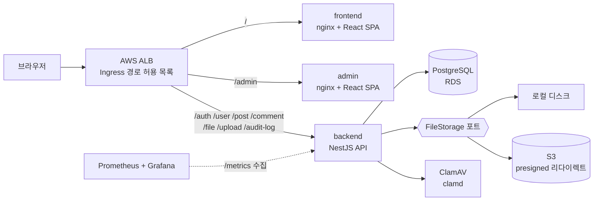
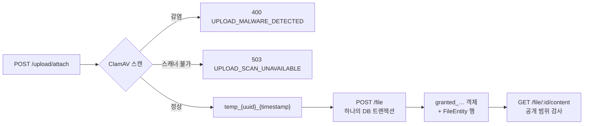
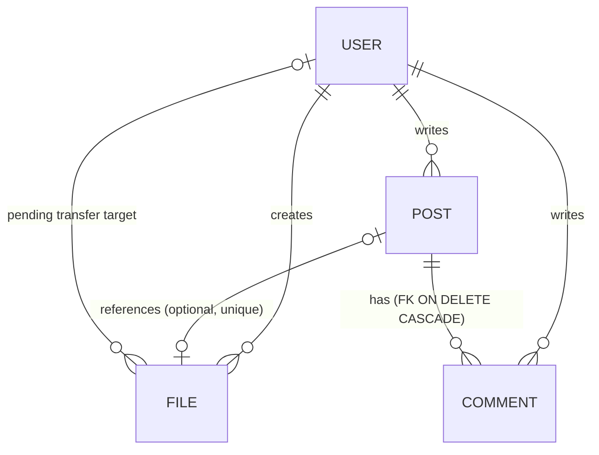
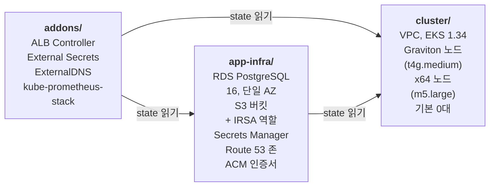

[](https://github.com/Bluecode77732/Upload-Board-Project/actions/workflows/ci.yml)


# Sharenpo

> English version: [README.en.md](README.en.md)

로그인한 사용자가 이미지, 오디오, 동영상을 올리고, 각 파일별로 볼 수 있는 사람을 직접 지정할 수 있습니다. 이렇게 업로드된 파일들은 게시글과 댓글이 있는 게시판 형태로 공유됩니다. 서비스는 NestJS 기반의 API와 React로 만든 클라이언트, 그리고 별도의 관리자 콘솔로 구성돼 있습니다. 배포는 Helm과 Terraform을 사용해 AWS EKS 환경에 이뤄지며, 운영 상태는 Prometheus와 Grafana로 모니터링하고 있습니다.

- 기간: 첫 커밋 2025년 12월 17일, 현재도 진행 중입니다.
- 범위: 개발자 한 명이 [CLAUDE.ko.md](CLAUDE.ko.md) 파일의 규칙을 따르며, AI의 도움을 받아 전체를 개발합니다. 작업에는 백엔드, `frontend/`, `admin/`, 컨테이너 작성, CI, Helm, Terraform까지 모두 포함됩니다.
- 역할: 비밀번호 정책과 에러 코드 정의, 프론트엔드를 외부 호스팅 대신 같은 ALB에서 서비스하도록 변경, 앱 시크릿 규칙 완화 대신 Terraform 생성기 수정 등 주요 결정은 개발자가 직접 내렸습니다. 코드를 작성하기 전에는 AI가 여러 방안을 표로 비교해주고, 개발자가 최종 선택한 방법만 구현하는 방식으로 진행했습니다. 모든 변경 사항은 개발자가 직접 읽고 승인합니다. 실제 동작 여부는 테스트와 CI, 그리고 AWS EKS 환경에서 ClamAV를 실제로 연결해 동작까지 모두 검증합니다.
- 참고: 이 README는 저장소 전체 구조를 설명합니다. 백엔드는 저장소 루트에 위치하며, 프론트엔드와 관리 콘솔은 각 폴더에 별도의 안내문이 있습니다. 자세한 내용은 [frontend/README.ko.md](frontend/README.ko.md), [admin/README.ko.md](admin/README.ko.md)에서 확인할 수 있습니다.

## 상태

상시 운영하는 데모는 따로 없습니다. 이 스택은 한때 AWS/EKS에서 적용해 봤다가, 필요에 따라 잠깐씩만 실행한 적이 있습니다. 구체적인 실행 날짜는 [ROADMAP.ko.md](docs/ROADMAP.ko.md) §9와 ADR에 따로 기록해 두었고요. 현재 서비스가 켜져 있는지 여부는 README에 따로 안내하지 않습니다.

프로젝트를 직접 확인하려면 아래에서 해보시면 됩니다.

- 아래 [스크린샷과 GIF](#스크린샷)를 참고하세요.
- Docker로 직접 실행해 볼 수 있습니다. [빠른 시작](#빠른-시작) 안내를 참고하세요.
- 모든 엔드포인트를 직접 Swagger에서 로컬로 호출해서 API를 테스트해 볼 수도 있습니다. ([API 써 보기](#api-써-보기-swagger))

## 요약본

- **2단계 업로드**: 파일은 먼저 `temp_…` 이름으로 임시 저장한 뒤, 하나의 DB 트랜잭션 안에서 `granted_…`로 승격됩니다. 만약 이동이 실패하면 insert 과정도 함께 롤백됩니다. 예외적으로, 이동에는 성공했지만 커밋이 실패할 경우에는 고아 상태의 `granted_` 파일이 남게 되는데, 이런 파일은 주기적으로 정리 작업을 통해 탐지되어 처리됩니다. 동일한 파일 업로드를 두 번 시도해도 에러 없이 이미 처리된 결과를 다시 제공합니다
  ([ADR 0003](docs/ADR/0003-two-phase-upload-contract.ko.md), [0019](docs/ADR/0019-upload-claim-idempotency.ko.md), [0051](docs/ADR/0051-orphaned-granted-file-reclaim.ko.md)).

- **정적 파일 서빙 금지**: 파일 콘텐츠는 반드시 공개 여부를 먼저 확인하는 `GET /file/:id/content` 엔드포인트를 통해서만 제공됩니다([ADR 0025](docs/ADR/0025-file-visibility-and-media-expansion.ko.md)).

- **리프레시 토큰 재사용 감지**: 서버는 리프레시 토큰의 해시값만을 저장해 재사용 시 즉시 감지할 수 있습니다
  ([ADR 0012](docs/ADR/0012-refresh-cookie-rotation.ko.md)).

- **저장 전 악성코드 검증**: 모든 업로드 파일은 저장 이전에 반드시 fail-closed 방식으로 악성코드 검사를 거칩니다([ADR 0059](docs/ADR/0059-upload-malware-scanning-clamav.ko.md)).

- **테스트 결과**: 백엔드 단위 테스트, 실제 PostgreSQL이 적용된 백엔드 E2E 테스트, 두 클라이언트의 Playwright E2E 테스트 모두 통과했습니다(건수와 날짜는 [테스트와 CI](#테스트와-ci) 참고). 현재까지 결정 사항을 기록한 ADR 문서는 총 68개입니다.

- **AI와 공동 개발**: 본 프로젝트는 미리 정의한 문서 규칙에 따라 AI와 함께 개발했습니다. 코드 대부분은 Claude Code가 작성했고, 개발자는 [CLAUDE.ko.md](CLAUDE.ko.md)에서 개발 규칙을 관리하며, 여러 옵션 중 적합한 대안을 골라 ADR 문서로 기록하고 있습니다. AI가 규칙에서 벗어난 부분도 함께 정리했습니다([만든 방식](#만든-방식) 참고).

- **필독 파일 안내**: [backend/file/file.service.ts](backend/file/file.service.ts)에서는 트랜잭션과 업로드 파일 확정(청구) 과정을, [backend/auth/auth.service.ts](backend/auth/auth.service.ts)에서는 토큰 관리 내용을, [backend/storage/](backend/storage/)에서는 스토리지 포트 관련 내용을 확인할 수 있습니다.

## 스크린샷

이 스크린샷들은 임시 데모 데이터를 활용한 로컬 스택 환경에서, 한국어 UI와 한국어 예시 글, 라이트 테마로 촬영한 결과입니다. UI는 기본적으로 영어 및 다크 테마도 지원합니다. 모든 이미지는 동일한 900 × 1000 프레임에 맞췄으며, 필요한 부분이 잘 보이도록 적절히 스크롤해서 캡처했습니다. 파일 URL은 실제 서비스 환경(ALB 뒤)처럼 클라이언트와 동일하게 노출되며, 링크 공유 토큰은 삭제 처리했습니다. 더 자세한 내용과 한계점은 [알려진 한계](#알려진-한계와-다음-단계)에서 참고하실 수 있습니다.

<table>
<tr>
<td width="50%"><br><sub><b>로그인</b> — Basic 인증 로그인, 회원가입 전환, 비밀번호 표시/숨김</sub></td>
<td width="50%"><br><sub><b>게시판</b> — 파일을 붙일 수 있는 새 글 폼, 검색·정렬, 페이지네이션</sub></td>
</tr>
<tr>
<td width="50%"><br><sub><b>게시글 상세</b> — 첨부 이미지와 오래된 순의 평면 댓글 스레드</sub></td>
<td width="50%"><br><sub><b>파일 보드</b> — 업로드 폼, 검색·정렬·작성자 필터, 아래로 이어지는 미리보기 그리드</sub></td>
</tr>
<tr>
<td width="50%"><br><sub><b>여러 미디어</b> — 이미지·오디오·영상 타일과 공개·링크 공유·비공개 배지</sub></td>
<td width="50%"><br><sub><b>파일 상세</b> — 이미지, 공개 범위 설정, 소유권 이전</sub></td>
</tr>
<tr>
<td width="50%"><br><sub><b>링크 공유 파일</b> — 공유 링크(토큰은 가림), 링크 재발급 버튼, 공개 범위 설정</sub></td>
<td width="50%"><br><sub><b>영상</b> — 브라우저 기본 플레이어로 재생하는 공개 영상(탐색은 Range 요청으로 처리)</sub></td>
</tr>
<tr>
<td width="50%"><br><sub><b>오디오</b> — 브라우저 기본 플레이어로 재생하는 공개 오디오</sub></td>
<td width="50%"><br><sub><b>관리자 콘솔</b> — 총계와 최근 감사 로그(관리자 UI는 영어만 지원)</sub></td>
</tr>
</table>

### GIF

정지 사진으로는 알 수 없는 네 가지 흐름을 짧은 GIF로 만들어봤습니다(640 × 498, 각 파일 크기는 0.5MB 미만입니다). 모두 위와 같은 로컬 스택과 예시 데이터를 활용해 촬영했습니다.

<table>
<tr>
<td width="50%"><br><sub><b>여러 파일 업로드</b> — 종류가 다른 파일 세 개를 한 번에 골라 제목을 붙이고, 파일별 진행률을 보며 하나씩 올리는 과정</sub></td>
<td width="50%"><br><sub><b>공유 링크</b> — 비공개를 링크 공유로 바꿔 공유 링크를 만들고, 복사한 뒤 재발급해 새 토큰을 받는 과정(토큰은 앞부분만 표시)</sub></td>
</tr>
<tr>
<td width="50%"><br><sub><b>소유권 이전</b> — 소유자가 이메일로 제안하고, 받는 사람이 자기 계정에서 수락해야 소유권이 옮겨지는 과정</sub></td>
<td width="50%"><br><sub><b>약한 비밀번호</b> — "password"로 가입하면 구체적인 규칙 안내가 뜨고, 규칙에 맞게 고치면 가입과 로그인까지 되는 과정</sub></td>
</tr>
</table>

## 기능

- **인증** — HTTP Basic 인증을 이용해 가입과 로그인을 처리하며, 로그인하면 `type` 클레임이 포함된 JWT 액세스·리프레시 토큰 쌍을 서로 다른 시크릿으로 서명해 발급합니다. 리프레시 토큰은 httpOnly 쿠키로 전달되고, 갱신할 때마다 새 토큰으로 교체하며 재사용 여부도 감지합니다. 자세한 내용은 [ADR 0002](docs/ADR/0002-dual-secret-token-pair.ko.md)와 [0012](docs/ADR/0012-refresh-cookie-rotation.ko.md) 문서를 참고하세요.

- **2단계 업로드** — `temp_`에서 `granted_`로 상태가 전환되는 상태 머신 구조입니다. 파일 이동 작업은 DB 트랜잭션 내에서 실행됩니다. attach 단계에서 받은 임시 파일명이 곧 한 번만 쓸 수 있는 청구 토큰 역할을 하며, 이외에 별도 토큰은 발급하지 않습니다. 동일 사용자가 다시 요청하면 기존 파일을 반환하고(200), 다른 사용자가 시도하면 409 `FILE_ALREADY_CLAIMED` 응답을 보냅니다. 자세한 흐름은 [ADR 0003](docs/ADR/0003-two-phase-upload-contract.ko.md), [0019](docs/ADR/0019-upload-claim-idempotency.ko.md)에서 확인할 수 있습니다.

- **악성코드 검사** — 파일을 저장하기 전에 ClamAV로 사전 검사하며, 스캐너를 사용할 수 없는 경우에는 업로드를 차단(fail-closed)합니다. 관련 내용은 [ADR 0059](docs/ADR/0059-upload-malware-scanning-clamav.ko.md)에 정리되어 있습니다.

- **파일 공개 범위** — 파일은 `public`, `private`(기본값), `unlisted`로 공개 범위를 설정할 수 있습니다. unlisted의 경우 공유 링크에 토큰을 재발급하거나 만료 설정이 가능합니다. 파일 데이터는 반드시 접근 검토가 진행되는 `GET /file/:id/content` 경로로만 제공됩니다. 자세한 내용은 [ADR 0025](docs/ADR/0025-file-visibility-and-media-expansion.ko.md), [0026](docs/ADR/0026-file-visibility-implementation.ko.md)에서 볼 수 있습니다.

- **스토리지 포트** — `FileStorage` 인터페이스 기반으로 로컬 디스크와 S3 어댑터(`STORAGE_DRIVER`)를 제공합니다. S3를 이용할 땐 접근 검사를 통과하면 짧은 수명의 presigned URL로 리다이렉트 처리합니다. 관련 사항은 [ADR 0029](docs/ADR/0029-storage-port-adapter.ko.md), [0036](docs/ADR/0036-s3-presigned-content-redirect.ko.md)을 참고하세요.

- **게시판** — 원하는 경우 파일을 첨부할 수 있는 게시글 작성, 평평하게 이어지는(플랫) 댓글, 그리고 하나의 규칙으로 통합된 검색·필터·정렬·페이지네이션 기능을 지원합니다. 자세한 설계는 [ADR 0021](docs/ADR/0021-list-query-search-filter-sort.ko.md), [0023](docs/ADR/0023-board-domain-schema.ko.md) 문서에 설명되어 있습니다.

- **RBAC와 감사 로그** — `user`, `admin`, `superadmin` 세 가지 역할을 기준으로 소유자 본인 또는 admin만 수정·삭제할 수 있도록 소유권 검사를 거칩니다. 역할 변경과 삭제 등의 중요한 행위는 모두 감사 로그에 기록됩니다. 이 구조는 [ADR 0013](docs/ADR/0013-rbac-and-audit-log.ko.md)에서 자세히 설명하며, [0007](docs/ADR/0007-ownership-checks-without-rbac.ko.md)의 소유권 검사 방식을 토대로 설계되었습니다.

- **계정과 파일의 수명 주기**  
  계정을 삭제하면 해당 계정의 댓글과 게시글도 함께 삭제됩니다. 파일은 `?deleteFiles=true` 옵션으로 따로 확인했을 때에만 같이 삭제되며, 파일이 있는데 이 확인을 거치지 않으면 409 오류가 발생합니다. 한 번 삭제된 정보는 설계상 복구할 수 없습니다(관련 내용은 [ADR 0020](docs/ADR/0020-account-deletion-cascade.ko.md)에 정리되어 있습니다). 파일 소유권을 다른 사람에게 넘길 때는 받는 사람의 동의를 먼저 받아야 하고, 이를 위한 제안·수락·거절·취소 과정이 있습니다(자세한 내용은 [ADR 0050](docs/ADR/0050-consent-based-file-ownership-transfer.ko.md) 참고).

- **보안 강화**  
  전역 `ValidationPipe`를 사용해 허용된 값만 받고(비허용 값은 거부), 직렬화된 엔티티에는 비밀번호를 아예 포함하지 않습니다. 토큰 시크릿이나 비밀번호 역시 복잡성을 검증합니다. 보안 응답 헤더와 비루트(non-root) 컨테이너 이미지, 기본 거부(default-deny) 규칙을 쓴 NetworkPolicy, 그리고 특정 Ingress 경로만 허용하는 정책 등 다양한 방법으로 보안을 강화하고 있습니다. 자세한 내용은 아래 링크([ADR 0055](docs/ADR/0055-helmet-security-headers.ko.md), [0030](docs/ADR/0030-container-non-root-and-arch-stance.ko.md), [0056](docs/ADR/0056-networkpolicy-east-west-restriction.ko.md), [0058](docs/ADR/0058-ingress-path-allowlist.ko.md))에 정리되어 있습니다.

- **요청 횟수 제한**  
  각 라우트별로 요청 횟수를 제한합니다. 기본적으로 분당 100회까지 허용하며, 이 기준은 컨트롤러, 핸들러, 클라이언트 IP 각각을 구분해 적용됩니다. 회원가입·로그인·토큰 갱신 등 민감한 엔드포인트(POST /auth/register, signin, token/refresh)는 분당 5회, 그리고 파일 첨부 업로드(POST /upload/attach)는 분당 15회로 제한합니다. 헬스체크와 메트릭스 프로브는 이 제한에서 제외됩니다. ([ADR 0053](docs/ADR/0053-global-rate-limiting.ko.md), [0054](docs/ADR/0054-per-route-rate-limit-tuning.ko.md) 참고)

- **운영**  
  liveness/readiness 엔드포인트로 운영 상황을 점검하고, Prometheus와 Grafana를 활용해 메트릭을 시각화합니다. 고아 상태의 임시 파일(temp_)은 주기적으로 자동 정리하며, grant 파일(granted_)도 감지해 보고만 하고, 삭제는 운영자가 따로 켜야 합니다. ([ADR 0031](docs/ADR/0031-health-and-readiness-endpoints.ko.md), [0047](docs/ADR/0047-observability-prometheus-grafana.ko.md), [0018](docs/ADR/0018-orphan-temp-file-cleanup.ko.md), [0051](docs/ADR/0051-orphaned-granted-file-reclaim.ko.md))

- **Swagger**  
  `/doc` 경로에서 API 문서를 제공하고, 여기서 직접 테스트도 할 수 있습니다.

- **React 클라이언트(frontend/)**  
  로그인과 가입, 게시판(댓글 가능), 미리보기 가능한 파일 보드, 미디어별 재생 기능, 공개 범위와 공유 링크 관리, 소유권 이전, 계정 삭제 기능이 있습니다. 파일 업로드 폼에서는 한 번에 최대 15개까지 파일별 업로드 진행 상황을 볼 수 있고, 파일을 하나씩 순차적으로 보냅니다([ADR 0065](docs/ADR/0065-multi-file-upload-client-sequential.ko.md) 참고). UI는 영어와 한국어, 라이트·다크 테마를 지원합니다.

- **관리자 콘솔(admin/)**  
  로그인 후 전체 통계와 최근 감사 로그를 볼 수 있는 대시보드, 역할별 사용자 목록, 감사 로그 뷰어 등이 있습니다. 같은 ALB에서 `/admin` 하위 경로로 서비스됩니다([ADR 0062](docs/ADR/0062-admin-same-alb-subpath-routing.ko.md) 참고).

## 아키텍처

하나의 Helm 릴리스를 통해 백엔드와 `frontend/`, `admin/` 서비스를 하나의 ALB 뒤에서 실행하며, ClamAV는 별도의 Deployment로 함께 운영됩니다. Ingress는 경로 기반으로 접근을 허용하는 목록으로 구성되어 있습니다. 다만, `/health`, `/metrics`, `/doc` 경로는 Ingress를 통해 라우팅되지 않습니다.
([ADR 0058](docs/ADR/0058-ingress-path-allowlist.ko.md)).



업로드 과정은 두 단계로 진행됩니다. 먼저, 첫 번째 요청에서 파일을 스캔한 뒤 'temp_'로 시작하는 임시 파일로 저장합니다. 이후 두 번째 요청이 들어오면, 이 파일을 하나의 트랜잭션으로 처리하면서 소유자와 공개 범위를 설정하게 됩니다. 자세한 내용은 [ADR 0003](docs/ADR/0003-two-phase-upload-contract.ko.md) 문서를 참고하시면 됩니다.



데이터 모델은 `backend/*/entity/`에서 사용되는 엔티티 관계를 그대로 반영한 것입니다.



게시글은 파일을 참조만 할 뿐이어서, 게시글을 지워도 파일 자체는 그대로 남아 있습니다. `comment.postId`만이 이 스키마에서 데이터베이스 수준에서 연쇄적으로 삭제되는 유일한 항목입니다(자세한 내용은 [ADR 0023](docs/ADR/0023-board-domain-schema.ko.md) 문서를 참고하세요).

AWS 관련 부분은 Terraform state가 총 세 개로, 각각 독립적인 루트 모듈로 구성되어 있습니다. 여기에 그려진 구조는 Terraform 코드에 정의된 내용을 기준으로 했고, 실제 Terraform state와 직접 비교해보진 않았습니다. 화살표는 모두 `terraform_remote_state`를 통해 읽어오는 방향만 나타내며, 한쪽 방향으로만 흐릅니다. `cluster/`는 나머지 두 state를 읽지 않습니다(더 자세한 내용은 [ADR 0044](docs/ADR/0044-terraform-three-state-split.ko.md) 참고).



도식에는 담지 않았지만, 실제로 각 리소스가 어떻게 연동되어 동작하는지 설명드리면 다음과 같습니다.

- RDS는 퍼블릭이 아닌 프라이빗 환경에 위치해 있고, 오직 노드 보안 그룹에서 들어오는 5432 포트의 접근만 허용합니다. S3 버킷 역시 퍼블릭 접근이 차단되어 있으며, 애플리케이션은 IAM 역할(IRSA)을 통해 S3에 접근합니다.
- Secrets Manager에 저장된 값은 External Secrets가 읽어와서 Kubernetes Secret으로 만듭니다. 이를 위해 최초 한 번은 수동으로 `kubectl apply` 명령을 실행해주어야 이후 자동으로 동작합니다.
- ExternalDNS는 ALB의 DNS 레코드를 Route 53 호스티드 존에 등록합니다. Ingress는 ACM에서 발급한 인증서를 ALB에 연동합니다.
- ALB와 네 개의 워크로드 리소스는 Terraform으로 만들지 않고, Ingress와 Helm이 생성 및 관리합니다.

백엔드 구조는 관심사별로 NestJS 모듈을 분리해 구성했습니다(auth, user, file, post, comment, upload, storage, audit log). 운영과 관련해서는 정리 작업, health, metrics 등을 위한 별도 모듈도 마련해두었습니다. 모듈 구조나 요청·데이터의 흐름 등 자세한 내용은 [ARCHITECTURE.ko.md](docs/ARCHITECTURE.ko.md)를 참고하시면 됩니다.

## 기술 스택

| 기술 | 여기서 하는 일 | 위치 |
|---|---|---|
| NestJS 11(Express), TypeScript | REST API. 관심사마다 모듈 하나 | [backend/app.module.ts](backend/app.module.ts), [backend/main.ts](backend/main.ts) |
| TypeORM 0.3 + PostgreSQL | 엔티티와 관계. `synchronize: false`이고 스키마는 마이그레이션으로 관리([ADR 0006](docs/ADR/0006-schema-policy-and-migration-adoption.ko.md)) | [backend/entities.ts](backend/entities.ts), [backend/migrations/](backend/migrations/), [backend/data-source.ts](backend/data-source.ts) |
| 트랜잭션 | 파일 이동이 DB 쓰기와 함께 커밋되어야 할 때는 수동 QueryRunner, 순수 DB 쓰기에는 `dataSource.transaction()`([ADR 0004](docs/ADR/0004-transaction-pattern-selection.ko.md)) | [backend/file/file.service.ts](backend/file/file.service.ts), [backend/user/user.service.ts](backend/user/user.service.ts) |
| Passport JWT, bcrypt | Basic 인증 로그인, 분리된 액세스·리프레시 시크릿, 토큰 교체 | [backend/auth/](backend/auth/) |
| class-validator, Joi | 경계에서 DTO 검증, 부팅 시 환경변수 검증 | [backend/common/validation-pipe-options.ts](backend/common/validation-pipe-options.ts), [backend/app.module.ts](backend/app.module.ts) |
| `@nestjs/throttler`, helmet | 라우트별 요청 횟수 제한, 보안 응답 헤더 | [backend/app.module.ts](backend/app.module.ts), [backend/main.ts](backend/main.ts) |
| `clamscan`(ClamAV) | 업로드마다 동기식 fail-closed 스캔 | [backend/upload/scan.service.ts](backend/upload/scan.service.ts) |
| AWS SDK v3 | S3 어댑터와 presigned 리다이렉트 | [backend/storage/s3.storage.ts](backend/storage/s3.storage.ts) |
| `@nestjs/schedule` | 고아 `temp_`·`granted_` 파일 정리 | [backend/temp-cleanup/](backend/temp-cleanup/), [backend/file/granted-cleanup.service.ts](backend/file/granted-cleanup.service.ts) |
| `prom-client`, Swagger | `GET /metrics`, `/doc`의 API 문서 | [backend/metrics/](backend/metrics/), [backend/main.ts](backend/main.ts) |
| React 19, Vite, React Router 7 | `frontend/`: CSS Modules, 단순한 `fetch` 래퍼, 상태·데이터 패칭 라이브러리 없음 | [frontend/src/](frontend/src/), [frontend/src/api/client.ts](frontend/src/api/client.ts) |
| React 19, Zustand, axios | `admin/`: 역할 관리와 감사 로그 뷰어 | [admin/src/](admin/src/) |
| Jest, Playwright | 서비스 단위 테스트, 실제 PostgreSQL을 쓰는 백엔드 E2E, 클라이언트 E2E | `backend/**/*.spec.ts`, [test/](test/), [frontend/e2e/](frontend/e2e/), [admin/e2e/](admin/e2e/) |
| Docker, Compose, GitHub Actions | 멀티 스테이지 이미지(`main`에서는 `linux/amd64`와 `linux/arm64`), 로컬 스택, 이미지를 발행하는 CI | [Dockerfile](Dockerfile), [docker-compose.yml](docker-compose.yml), [.github/workflows/ci.yml](.github/workflows/ci.yml) |
| Helm, Terraform | 백엔드, `frontend/`, `admin/`, ClamAV를 위한 릴리스 하나. 세 개의 state로 나눈 VPC, EKS, RDS, S3, Route 53과 ACM, 그리고 ALB Controller, External Secrets, ExternalDNS, kube-prometheus-stack | [k8s/helm/](k8s/helm/), [k8s/infra/terraform/](k8s/infra/terraform/) |

이 스택을 선택한 이유는 나중에 작성한 [ADR 0066](docs/ADR/0066-stack-selection-rationale-retroactive.ko.md)에 자세히 설명되어 있습니다. NestJS와 TypeORM, PostgreSQL은 앞으로 서비스 분리를 염두에 두고 골랐습니다. AWS와 EKS는 배포 시장에서 표준으로 쓰이는 도구라, 익숙해지는 데 목적이 있었습니다. 프론트엔드는 화면 수가 많지 않아 상태 관리 라이브러리가 필요하지 않았습니다. 그리고 ECS와의 비교처럼, 직접 글로 비교하지 않은 부분도 ADR에 함께 정리해두었습니다.

## 프로젝트 구조

| 경로 | 들어 있는 것 |
|---|---|
| `backend/` | NestJS API. 모듈마다 폴더 하나(`auth`, `user`, `file`, `post`, `comment`, `upload`, `storage` 등), `migrations/`, `entities.ts` |
| `frontend/` | React 클라이언트. 자체 README와 Playwright E2E가 있습니다 |
| `admin/` | 관리자 콘솔. 자체 README와 테스트가 있습니다 |
| `test/` | 백엔드 E2E 스위트(실제 PostgreSQL, 일회용 데이터베이스) |
| `k8s/helm/`, `k8s/infra/terraform/` | Helm 차트와 세 개의 Terraform state(`cluster`, `app-infra`, `addons`) |
| `docs/` | 결정 기록, 로드맵, 아키텍처 설명, 변경 이력, 스크린샷([문서](#문서) 참고) |
| `perf/` | [ADR 0049](docs/ADR/0049-performance-capacity-criteria.ko.md)의 근거가 된 부하 테스트와 `EXPLAIN` 스크립트 |

## 빠른 시작

### 가장 빠른 방법: Docker

Compose 2.24 이상이 포함된 Docker가 필요합니다. PostgreSQL, ClamAV, 마이그레이션, API를 함께
띄웁니다([ADR 0015](docs/ADR/0015-docker-and-compose.ko.md),
[ADR 0059](docs/ADR/0059-upload-malware-scanning-clamav.ko.md)).

1. 저장소 루트에서 `.env.example`을 `.env`로 복사하고 세 값만 채웁니다. 나머지는 로컬 개발용으로
   그대로 동작합니다.

   ```bash
   cp .env.example .env
   # 그다음 .env에서 다음을 설정합니다:
   #   DB_PASSWORD           원하는 비밀번호
   #   ACCESS_TOKEN_SECRET   32자 이상, 소문자·대문자·숫자·기호 포함
   #   REFRESH_TOKEN_SECRET  같은 규칙, 다른 값
   ```

   이 세 값은 일부러 비워 두거나 규칙에 어긋나게 해 두었습니다. 공개 저장소에서 누구나 읽을 수 있는
   값으로 서버가 뜨는 일이 없도록, 직접 채우기 전에는 부팅이 막힙니다.

2. 스택을 띄웁니다.

   ```bash
   docker compose up --build   # db + clamav → migrate(one-shot) → api를 :3000에 기동
   ```

   처음 시작할 때는 ClamAV가 시그니처 DB를 내려받으므로 `api`가 healthy가 되기까지 몇 분 걸릴 수
   있습니다. 그 뒤 `http://localhost:3000/doc`을 엽니다([API 써 보기](#api-써-보기-swagger)).

위 단계로는 API만 뜨고 화면은 없습니다. 클라이언트를 실행하려면 별도 터미널에서 다음을 실행합니다.

```bash
cd frontend && pnpm install && pnpm dev   # http://localhost:5173 (백엔드 :3000으로 프록시)

cd admin && cp .env.example .env          # VITE_API_URL=http://localhost:3000 설정
pnpm install && pnpm dev                  # http://localhost:5174
```

`admin`은 백엔드를 다른 출처로 호출하므로, 백엔드의 `.env`에 `CORS_ORIGIN=http://localhost:5174`를
넣고 백엔드를 다시 시작하세요(`admin/README.ko.md` 참고).

`admin`에 로그인하려면 superadmin 계정이 필요합니다. 먼저 계정을 등록하고(`POST /auth/register`는
Swagger에서 호출할 수 있습니다), 그 이메일을 `.env`의 `SUPERADMIN_EMAIL`에 넣은 뒤
`docker compose up -d`로 `api`를 새 값으로 다시 만들고, 계정을 직접 승격합니다
([ADR 0052](docs/ADR/0052-superadmin-seed-manual-trigger.ko.md)).

```bash
docker compose exec api node dist/scripts/promote-superadmin.js
```

<details>
<summary>참고: 포트, 마이그레이션, <code>.env.local</code></summary>

- `db` 서비스가 `${DB_PORT}`(5435) 포트를 사용하고 있으니, 호스트에서 실행하는 `pnpm test:e2e`나 `pnpm migration:*` 명령어도 같은 데이터베이스에 접속하게 됩니다. 만약 이 포트를 사용하는 기존의 `upload-board-pg` 컨테이너가 있다면, 먼저 해당 컨테이너를 중지하세요.
- 마이그레이션은 `api`를 시작할 때 자동으로 되는 것이 아니라, 별도로 분리된 `migrate` 서비스에서 실행됩니다([ADR 0032](docs/ADR/0032-migration-as-separate-deploy-step.ko.md)). 이미지는 일반 사용자가(non-root) 실행하도록 구성되어 있습니다([ADR 0030](docs/ADR/0030-container-non-root-and-arch-stance.ko.md)). 그리고 네이티브 리눅스 환경에서 `./file` 디렉터리를 바인드 마운트했을 때 파일 쓰기에 실패한다면, `sudo chown -R 1001:1001 file/` 명령을 한 번 실행해 주세요.
- `.env` 파일을 직접 수정하지 않고, 현재 사용하는 이 컴퓨터에서만 환경변수 값을 바꾸고 싶다면 gitignore된 `.env.local` 파일에 해당 내용을 추가하면 됩니다. `api`와 `migrate` 서비스는 `.env` 파일 이후에 이 파일도 읽어서 적용합니다([ADR 0015](docs/ADR/0015-docker-and-compose.ko.md) 2026-10-03 추가 기록).

</details>

### Docker 없이 실행

<details>
<summary>사전 요건과 명령</summary>

사전 요건: Node.js 24(자세한 버전은 [.nvmrc](.nvmrc) 파일 참고), Corepack을 이용한 pnpm 10, PostgreSQL 16, 그리고 접속이 가능한 clamd가 필요합니다. clamd의 주소와 포트는 각각 CLAMD_HOST와 CLAMD_PORT로 지정하며, 기본값은 ‘clamav’와 ‘3310’입니다. 만약 스캐너가 연결되어 있지 않으면, ‘POST /upload/attach’ 요청에 대해 503 UPLOAD_SCAN_UNAVAILABLE 응답을 반환하게 됩니다.

```bash
pnpm install
cp .env.example .env              # 위의 세 값을 채웁니다. DB_HOST는 이미 localhost이고,
                                  # DB_PORT=5435는 compose의 db 포트이니 본인의 포트(보통 5432)로 바꿉니다
# 그다음 DB_DATABASE에 지정한 데이터베이스를 만듭니다
pnpm migration:run                # 스키마 적용 (ADR 0006)
pnpm run start:dev                # 포트 3000, Swagger는 http://localhost:3000/doc

# 선택: superadmin 승격 — 먼저 계정을 등록하고 .env의 SUPERADMIN_EMAIL을 그 주소로 설정한 뒤
pnpm promote-superadmin           # 의도적인 수동 단계 (ADR 0013/0052)

pnpm test                         # 단위 테스트
pnpm run test:cov                 # 커버리지 (서비스만 측정)
```

</details>

### 환경변수

<details>
<summary>필수 변수와 자주 바꾸는 변수</summary>

필수 항목들은 부팅할 때 Joi가 검증하고, 하나라도 빠지면 바로 실패합니다. `ENV`, `DB_TYPE`(항상 `postgres`여야 합니다), `DB_HOST`, `DB_PORT`, `DB_USERNAME`, `DB_PASSWORD`, `DB_DATABASE`, `HASH_ROUNDS`(10 이상 설정), 그리고 `ACCESS_TOKEN_SECRET`, `REFRESH_TOKEN_SECRET`(각각 32자 이상이면서 소문자, 대문자, 숫자, 기호를 모두 포함해야 합니다), `ACCESS_TOKEN_SECRET_EXPIRES_IN`, `REFRESH_TOKEN_SECRET_EXPIRES_IN`(숫자 값) 등이 이에 해당합니다.

이 외의 변수들은 모두 선택 사항이며, 기본값이 정해져 있습니다. 그중에서도 자주 바꾸는 건 `BASE_URL`이나 `CORS_ORIGIN`(자세한 내용은 [docs/ADR/0008-opt-in-cors.ko.md](docs/ADR/0008-opt-in-cors.ko.md) 참고), `STORAGE_DRIVER`(‘local’ 또는 ‘s3’, 자세한 설명은 [docs/ADR/0029-storage-port-adapter.ko.md](docs/ADR/0029-storage-port-adapter.ko.md) 참고), `CLAMD_HOST`와 `CLAMD_PORT` 등이 있습니다. 이들은 모두 `.env.example` 파일에 설명이 나와 있으니 참고하면 됩니다.

마지막으로, `THROTTLE_ENABLED`는 기본적으로 `true`로 두는 게 좋습니다. 이 값은 E2E 테스트 스위트에서 요청 횟수 제한을 우회할 때만 사용됩니다.

</details>

### AWS / Kubernetes 배포

<details>
<summary>배포는 이렇게 진행합니다</summary>

백엔드, `frontend/`, `admin/`은 모두 하나의 ALB 뒤에서 하나의 Helm 릴리스로 함께 배포됩니다. ClamAV는 별도의 Deployment로 추가되어 배포됩니다. 자세한 내용은 [ADR 0060](docs/ADR/0060-frontend-same-alb-path-routing.ko.md)과 [ADR 0062](docs/ADR/0062-admin-same-alb-subpath-routing.ko.md) 문서에서 더 확인할 수 있습니다.

기본적으로 `bash k8s/infra/terraform/deploy.sh all` 명령어를 사용해 배포를 진행합니다. 세 개의 Terraform 상태를 순서대로 적용한 뒤, 세 가지 이미지에 동일한 `:<git-sha>` 태그를 붙여 `helm upgrade --install` 명령을 실행합니다(관련 내용은 [ADR 0046](docs/ADR/0046-deploy-sequence-automation.ko.md) 참고). 각 `apply` 전에는 직접 `y`를 입력해야만 다음 단계로 넘어갈 수 있습니다.

플래그, 선행 조건, 그리고 도메인 구매·NS 위임이나 1회성 External Secrets 동기화, `ingress.enabled` 설정과 같은 수동 단계는
[k8s/infra/terraform/README.ko.md](k8s/infra/terraform/README.ko.md)와
[k8s/helm/README.ko.md](k8s/helm/README.ko.md) 문서에 정리되어 있으니 참고해 주세요.

</details>

**CI는 배포를 담당하지 않습니다.**  
GitHub Actions에서는 세 가지 이미지(`bluecode1775/sharenpo`, `-frontend`, `-admin`)만 Docker Hub에 올립니다([ADR 0048](docs/ADR/0048-ci-trigger-restoration-and-docker-publish-design.ko.md)).  
구체적인 배포 작업인 `terraform apply`나 `helm upgrade`는 직접 사람이 실행합니다.  
이 스택은 실제 AWS 환경에 여러 번 적용해서 제대로 동작하는지 확인을 마쳤습니다.  
AWS 리소스의 최신 상태는 실제 AWS 콘솔에서 확인해야 합니다.  
`apply`나 `destroy`를 실행하면 이 문서에 적힌 내용은 바로 진부해져 버릴 수 있기 때문입니다.

## API 써 보기 (Swagger)

Swagger UI는 백엔드에서 `/doc` 경로로 직접 제공되고 있습니다. 하지만 배포된 Ingress에서는 의도적으로 `/doc` 경로를 라우팅하지 않아서([ADR 0058](docs/ADR/0058-ingress-path-allowlist.ko.md)), 백엔드를 직접 실행할 때만 접근할 수 있습니다. 만약 Docker로 빠르게 실행했다면([Docker 빠른 시작](#가장-빠른-방법-docker)), `http://localhost:3000/doc`에서 Swagger UI를 확인할 수 있습니다.

1. `/doc`을 열고 **Authorize** 버튼을 누르면, 창에 세 가지 인증 방식이 나옵니다. 각각 `bearer`(토큰 붙여넣기), `basic`(이메일과 비밀번호), `cookie`(리프레시 쿠키)입니다.

2. `basic`에는 이메일과 규칙에 맞는 비밀번호(10자 이상, 소문자·대문자·숫자·기호 포함)를 입력해서 적용하세요.

3. 그리고 **Try it out** 기능으로 `POST /auth/register`를 실행합니다. 방금 입력한 값이 Basic 인증 정보로 사용되며, 응답이 201로 오면 회원가입이 완료됩니다. 이어서 `POST /auth/signin`을 실행한 뒤, 응답 결과에서 `accessToken` 값을 복사하세요.

4. 이 토큰을 `bearer` 칸에 붙여넣고 적용하면, 다른 API들도 호출할 수 있게 됩니다. 예를 들어, `GET /file`을 실행할 수 있습니다. 토큰이 없으면 이 요청은 401 에러가 뜨고, 토큰이 있으면 200 응답이 옵니다.

참고로 `persistAuthorization`이 켜져 있어서, 입력한 인증 정보는 브라우저를 새로고침해도 그대로 남아 있습니다.

그리고 `POST /upload/attach`는 멀티파트 업로드 방식입니다. `image`, `audio`, `video` 필드 중에서 정확히 하나만 파일을 선택해 업로드해야 하고, 응답으로 받은 `temp_…` 이름을 다음에 `POST /file`의 `filePath`로 사용하면 됩니다.

2026년 10월 21일, 위 과정을 Docker 스택 환경에서 직접 확인했습니다. `/doc` 페이지가 콘솔 에러 없이 잘 서빙되고 렌더링됐습니다. 회원가입 요청 (`POST /auth/register`)에는 201 응답이, 로그인 요청 (`POST /auth/signin`)에는 액세스 토큰이 정상적으로 반환됐습니다. 또, `GET /file` 요청도 토큰이 없는 경우에는 401, 토큰이 있으면 200 응답을 받았습니다.

1×1 PNG 파일 테스트에서는 `attach`(201, ClamAV 스캔 통과)와 `POST /file`(201, 비공개) 과정을 거쳤고, 이후 같은 파일로 다시 `POST /file`을 보내면 200 응답이 왔습니다. 해당 파일의 콘텐츠에 접근할 때는 토큰이 없으면 403이 뜨고, 파일 소유자는 200 응답을 받을 수 있었습니다.

Authorize 창이 제대로 열리는 것까지 브라우저에서 확인했습니다. 다만, 그 안에 직접 값을 입력하고 버튼을 누르는 동작까지는 테스트하지는 않았습니다.

## 핵심 API

주요 라우트는 사용자, 소유권 이전, 감사 로그, health, metrics 등 여섯 개가 중심을 이룹니다. 여기에 파일, 게시글, 댓글 관련 라우트까지 포함하면 전체 라우트, 파라미터, 에러 코드는 모두 `/doc`에서 Swagger 문서로 확인할 수 있습니다.

`POST /auth/register`, `POST /auth/signin`(기본 인증), `POST /auth/token/refresh`(리프레시 쿠키 사용), 그리고 운영을 위한 `/health/*`와 `/metrics`, 또 `GET /file/:id/content`(Bearer 토큰 선택 가능)을 제외하면, 나머지 모든 라우트에서는 Bearer 액세스 토큰이 필수입니다.

| 라우트 | 인증 | 하는 일 | 주요 에러, ADR |
|---|---|---|---|
| `POST /auth/register`, `POST /auth/signin` | Basic | `base64(email:password)`로 계정을 만듭니다(비밀번호는 10자 이상이고 네 가지 문자 종류를 모두 포함해야 합니다). 로그인은 `{ accessToken }`을 돌려주고 httpOnly 리프레시 쿠키를 설정합니다 | 400 `AUTH_WEAK_PASSWORD`, 400 `AUTH_EMAIL_TAKEN`([ADR 0002](docs/ADR/0002-dual-secret-token-pair.ko.md)) |
| `POST /auth/token/refresh` | 리프레시 쿠키 | 리프레시 쿠키를 교체하고 새 액세스 토큰을 돌려줍니다 | 401 `AUTH_REFRESH_REUSED`([ADR 0012](docs/ADR/0012-refresh-cookie-rotation.ko.md)) |
| `POST /upload/attach` | Bearer | 스캔한 뒤 파일 하나(`image`, `audio`, `video` 필드, 100 MB)를 `temp_…`로 임시 저장하고 그 이름을 돌려줍니다 | 400 `UPLOAD_MALWARE_DETECTED`, 400 `UPLOAD_INVALID_TYPE`, 503 `UPLOAD_SCAN_UNAVAILABLE`([ADR 0059](docs/ADR/0059-upload-malware-scanning-clamav.ko.md)) |
| `POST /file` | Bearer | 임시 저장한 파일을 하나의 트랜잭션으로 소유자가 있는 `private` 파일로 승격합니다. 같은 사용자가 다시 보내면 기존 결과를 돌려줍니다(200) | 409 `FILE_ALREADY_CLAIMED`([ADR 0019](docs/ADR/0019-upload-claim-idempotency.ko.md)) |
| `GET /file/:id/content` | 선택적 Bearer | 공개 범위를 검사한 뒤 바이트를 `Range`와 함께 스트리밍합니다. S3에서는 presigned URL로 `302` 리다이렉트합니다 | 403 `FORBIDDEN_NOT_OWNER`, 403 `FILE_SHARE_INVALID`([ADR 0025](docs/ADR/0025-file-visibility-and-media-expansion.ko.md)) |
| `POST /post` | Bearer | 선택적 `fileId`와 함께 게시글을 만듭니다. `fileId`가 멱등 키 역할도 합니다 | 409 `POST_FILE_TAKEN`, 403 `FORBIDDEN_NOT_OWNER`([ADR 0023](docs/ADR/0023-board-domain-schema.ko.md)) |

### 에러 응답

모든 에러는 바뀌지 않는, 기계가 읽을 수 있는 형식을 따릅니다
([ADR 0011](docs/ADR/0011-error-code-contract.ko.md)):

```json
{
  "statusCode": 400,
  "code": "FILE_TITLE_TAKEN",
  "message": "Title already in use.",
  "timestamp": "2026-07-23T09:00:00.000Z",
  "path": "/file/1"
}
```

에러를 구분할 때는 `code`(바뀌지 않는 계약 — `backend/common/error-code.ts` 참고)만 쓰고,
바뀔 수 있는 `message`로는 구분하지 마세요. 검증 실패는
`code`가 `VALIDATION_FAILED`이고 `message`가 배열로 오며, `ENV=dev`에서는 `stack`
필드가 추가됩니다.

## 트러블슈팅과 결정

측정하거나 재현한 문제와 그 전체 기록이 있는 위치는 아래와 같습니다. 선택 이유는 기록에 남겨진 내용만 정리했습니다.

**`docker stop`이 10.4초 걸리고 컨테이너가 종료 코드 137로 종료됨**
([ADR 0061](docs/ADR/0061-shutdown-hooks-and-pid1-sigterm.ko.md))

- **원인:** `node`가 PID 1로 실행되면서 SIGTERM 신호를 무시해, DB 연결이 제대로 닫히지 않았음.
- **해결:** [backend/main.ts](backend/main.ts)에 `app.enableShutdownHooks([], { useProcessExit: true })`를 추가.
- **선택 이유:** 기존에는 이벤트 루프를 붙잡는 것이 하나라도 남아 있으면 종료가 지연됐음. 예를 들어 타이머가 남아 있을 때 10.4초가 걸렸지만, 옵션을 적용하면 0.4초 만에 종료됨. 이후에는 핸들이 새도(대표적으로 `S3Storage`)로 남아 있는 경우에도 종료가 느려지지 않게 됨.
- **결과:** 로컬 컨테이너와 `kind` 클러스터의 파드에서는 약 0.4초 만에 종료코드 0으로 완료. EKS에서는 별도 측정하지 않음.

**스캐너가 판정을 내리지 못한 경우에도 업로드가 악성코드 스캔을 통과함**
([ADR 0059](docs/ADR/0059-upload-malware-scanning-clamav.ko.md), 2026-10-03 및 2026-10-12 추가 기록)

- **원인:** `clamscan`이 거부(reject)하지 않고 `isInfected: null`(즉, "스캔 불가")로 처리했는데, 코드에서는 이를 정상으로 받아들였음.
- **해결:** 스캔 결과가 boolean이 아닐 경우 판정 실패로 간주하고, 한 번 재시도한 뒤에도 실패하면 503 `UPLOAD_SCAN_UNAVAILABLE`을 반환하도록 변경.
- **선택 이유:** 스캐너의 판정 불가능 상태는 정상 처리 대상이 아니므로, 아예 사용 불가와 같은 fail-closed 방식을 적용하고 기존의 재시도 및 503 처리 흐름을 재사용함. 실제로 `clamd`를 이용해 먼저 재현했고, 스캔 도중 재시작이나 종료만으로도 발생함을 확인함.
- **결과:** `clamd`로 재현 후 수정했고, 수정 후 재확인함.

**시크릿 강도 규칙 적용 뒤 첫 AWS 배포에서 백엔드가 crash-loop 현상 발생**
([ADR 0064](docs/ADR/0064-jwt-secret-generation-joi-strength-rule.ko.md))

- **원인:** Terraform이 JWT 시크릿을 영숫자 48자로만 생성했으나, 앱에서 적용한 Joi 규칙은 특수문자 포함을 요구함.
- **해결:** 시크릿 생성기가 반드시 문자 종류별로 최소 1개씩 포함하도록 수정함.
- **결과:** 변경 후 다시 배포해 백엔드가 정상적으로 부팅되고 로그인까지 확인됨.

**`GET /file`의 페이지 순서가 일정하지 않음**
([ADR 0021](docs/ADR/0021-list-query-search-filter-sort.ko.md))

- **원인:** 쿼리에 `ORDER BY`가 없어, offset 기반 페이지네이션에서 행이 중복되거나 누락될 수 있었음.
- **해결:** 기본 정렬을 `createdAt DESC`로 하고, 동일값이 있을 경우 `id`를 추가로 비교하도록 보완. 정렬할 필드는 미리 정해진 표를 거쳐 매핑해, 클라이언트에서 전달한 문자열이 그대로 컬럼명이 되지 않게 함.
- **결과:** 파일과 게시글 모두 하나의 정렬 방식을 공유함.

**ADR 0021에서 미뤘던 목록 쿼리 인덱스 도입**
([ADR 0049](docs/ADR/0049-performance-capacity-criteria.ko.md))

- **원인:** ADR 0021에서 테이블 데이터가 10,000행에 이를 때까지 인덱스 도입을 보류했었고, 측정 데이터는 없었음.
- **해결:** `file_entity`와 `post_entity` 각각에 10,000행을 삽입하고 성능 측정 후 모든 인덱스를 적용함.
- **선택 이유:** 응답 시간 목표는 이미 충족되었지만, 쿼리 속도가 1.6~70배나 빨라졌고, 인덱스 크기도 합계 약 2.16MB로 충분히 관리 가능한 수준이었음.
- **결과:** 총 6개의 인덱스를 적용함.

## 만든 방식

코드의 대부분은 Claude Code로 만들어졌고, 이 내용은 커밋 기록에서도 그대로 확인할 수 있습니다. 실제로 커밋의 90% 이상에 `Co-Authored-By: Claude` 트레일러가 달려 있죠.

AI가 작업 중에 발생할 수 있는 심각한 문제는 [CLAUDE.ko.md](CLAUDE.ko.md) 파일에서 미리 원칙으로 정리해 두었습니다. 하지만 예상하지 못한 일이 실제로 생기면, 그 날짜와 경위를 교훈 삼아 관련 문서에 따로 기록합니다. 규칙이 모든 사고를 완전히 막을 수 있다고는 생각하지 않습니다. 이미 정해진 규칙이 있는데도 같은 유형의 실수가 반복된 경우도 역시 같은 문서에서 찾아볼 수 있습니다.

### AI 운영 방식

- **규약을 문서로 남겼습니다.** [CLAUDE.ko.md](CLAUDE.ko.md)에는 개발자가 별도 논의 없이 바꿀 수 있는 사항, 코드에 들어가면 안 되는 요소(예: any, 미검증 환경변수, 클라이언트가 보낸 경로로 파일을 반환하는 코드), 작업 완료 전 반드시 실행해야 하는 검증 항목 등이 정리돼 있습니다. 또 `.claude/hooks/` 폴더에 있는 훅들은 영향이 큰 파일을 수정하거나 `migration:generate` 명령을 실행하기 전에 확인하라는 안내 역할을 합니다.

- **선택은 개발자가, 과정은 기록에 남깁니다.** 실제 선택지가 있었던 상황에서는 여러 대안을 표로 정리해 개발자들에게 비교 후 의사를 묻고, 그 결과를 ADR 문서에 남겼습니다. 저장소에서 확인할 수 있는 예로는, 코드 작성 전에 확정한 비밀번호 정책과 에러 코드, 세 가지 대안을 검토하고 `AUTH_EMAIL_TAKEN` 노출을 유지하기로 한 결정([CLAUDE.ko.md](CLAUDE.ko.md)의 알려진 미해결 지점), 그리고 프론트엔드를 외부 호스팅 대신 같은 ALB에서 서비스하기로 한 결정([ADR 0060](docs/ADR/0060-frontend-same-alb-path-routing.ko.md)) 등이 있습니다.

- **실제 환경에서 검증합니다.** 단위 테스트는 물론, 실제 PostgreSQL을 사용하는 E2E 테스트, 운영 중인 백엔드를 대상으로 하는 Playwright 테스트, 날짜별로 기록을 남기는 AWS 라이브 테스트 기록([ROADMAP.ko.md](docs/ROADMAP.ko.md)의 9번 항목)까지 폭넓게 점검하고 있습니다.

### 예시 1. AI를 활용한 의사결정: 파일 업로드 시 악성코드 스캔

<details>
<summary>AI에게 내린 지시, ADR 0059에 기록한 판단, 이후 발견한 허점</summary>

개발자가 AI에게 맡긴 범위는 `clamd`에 대한 설명, 기존에 사용했던 구 패키지(`clamdjs`)와 현재 쓰고 있는 패키지(`clamscan`)의 차이 조사, 두 패키지 각각의 안전성과 의존성, 구현 위치와 코드, 실제 사용처에 대한 검토 등이었습니다. 그 결과 [ADR 0059](docs/ADR/0059-upload-malware-scanning-clamav.ko.md)에 다음과 같은 결론을 남겼습니다. `clamdjs`는 마지막 릴리스가 2019년이고 다운로드 수도 `clamscan`의 4% 수준에 그쳐서 탈락했고, `clamscan`은 보안 취약점(`CVE-2020-7613`)이 수정된 2.4.0 버전을 사용하되, 취약한 경로는 비활성화하기로 했습니다. 또, 파일은 저장 전에 메모리 버퍼에서 검사하고, 스캐너에 연결하지 못하면 그대로 통과시키지 않고 아예 업로드를 거부하도록 정했습니다. 이후 의존성 점검 과정에서, 스캐너가 판정을 내리지 못하면(`null`) 그냥 통과시키는 허점이 있는 것을 발견했습니다. 실제 `clamd` 환경에서 이 문제가 재현되는 걸 확인하고, 이후 이를 고쳤으며, 이 과정 또한 같은 ADR 문서에 추가로 남겼습니다.

</details>

### 예시 2. AI의 허점을 바로잡은 경우

<details>
<summary>AI의 전제나 진단이 틀렸던 두 경우</summary>

- **노드 구성 설계**([ADR 0043](docs/ADR/0043-terraform-project-adaptation.ko.md)): AI가 기억에 의존해 잘못된 전제를 내놓았고, 개발자 역시 그 정보를 바탕으로 판단했습니다. 하지만 AI가 다른 문서를 읽으면서 오류를 눈치챘고, 전제를 정정한 뒤 두 가지 방안 중 무엇을 택할지 개발자에게 물었습니다. 최종적으로 x64와 ARM 노드 그룹을 모두 두는 쪽으로 정리됐죠. 당시 AI가 낸 오류 세 가지는 그대로 ADR 과정 메모에 남아 있습니다.
- **알림 설명이 깨진 문제**([ADR 0047](docs/ADR/0047-observability-prometheus-grafana.ko.md)): 개발자가 알림 규칙 설명이 정상적인 한글이나 영어가 아니라 이상한 문자로 나온다고 보고했습니다. AI가 저장된 값을 바이트 단위로 검사해 깨진 문자(`U+FFFD`)가 들어간 것을 찾아냈고, 클라이언트 셸의 인코딩 문제로 보고 상황을 설명했습니다. 원래 설명 문장은 복구할 수 없어서 새로운 문구를 작성해 개발자에게 확인받고 적용했습니다.

</details>

### 기존 규칙을 어긴 사례

<details>
<summary>파일 44개 삭제와 낡은 근거로 우선순위를 매긴 일</summary>

- **파일 44개 삭제 (2026-09-05)**: [ADR 0051](docs/ADR/0051-orphaned-granted-file-reclaim.ko.md)에는 이미 "DB 이력이 없으면 전부 고아로 처리된다"는 위험이 적혀 있었습니다. 그런데도 실제 디렉터리를 삭제 모드로 실행한 탓에 사고가 났습니다. 다행히 삭제된 파일들은 테스트 데이터라 별다른 피해는 없었으나, 이 내용은 ADR 0051의 추가 기록과 [CLAUDE.ko.md](CLAUDE.ko.md)에 남겼습니다. 이후로는 격리된 환경에서만 라이브 검증을 했고, 파괴적 작업을 할 때는 실행 전 대상과 수량, 복구 방안을 반드시 확인하는 규칙으로 넓혔습니다.
- **낡은 근거로 우선순위를 매긴 사례 (2026-10-14~16)**: "근거에는 유효기간이 있다"는 규칙이 이미 있었지만 제대로 지키지 않은 일이어서, 같은 규칙에 사례로 추가했습니다.

</details>

현재는 개발자 한 명이 모든 검토를 맡고 있으며, 별도의 검토자는 두지 않았습니다.

## 테스트와 CI

- **단위 테스트** — Jest를 사용하며, 테스트 파일은 소스 파일과 같은 위치에 `*.spec.ts`로 둡니다. 커버리지는 서비스만 측정하고, 리포지토리와 QueryRunner는 모킹해서 데이터베이스 없이도 테스트할 수 있습니다(`pnpm test`). 2026-10-26 기준, 20개의 테스트 스위트와 282개의 테스트가 모두 통과했습니다.
- **백엔드 E2E** — `pnpm test:e2e` 명령어로 실제 앱을 실제 PostgreSQL에 연결해 테스트합니다. 테스트마다 일회용 `sharenpo_e2e` 데이터베이스를 만들고, 각 테스트 사이 데이터를 비운 뒤 테스트가 끝나면 데이터베이스를 삭제합니다. 개발용 데이터베이스에 영향을 주지 않습니다. 2026-10-22에 76개의 테스트가 모두 성공적으로 실행됐습니다.
- **클라이언트 E2E** — `frontend/`와 `admin/` 폴더에서 각각 Playwright로 E2E 테스트를 진행합니다. 자세한 방법은 각 폴더의 README에 설명되어 있습니다. 두 작업 모두 2026-10-22 CI에서 통과를 확인했습니다.
- **GitHub Actions** — ([ADR 0016](docs/ADR/0016-github-actions-ci.ko.md), [ADR 0048](docs/ADR/0048-ci-trigger-restoration-and-docker-publish-design.ko.md))  
  Github Actions에서는 lint, 단위 테스트, PostgreSQL·ClamAV 서비스 컨테이너를 활용한 백엔드 E2E 테스트, 그리고 클라이언트별 lint와 E2E 테스트를 순서대로 진행합니다. 이후 백엔드와 `frontend/`, `admin/` 이미지를 빌드하고 발행합니다. 이미지를 푸시하기 전에, 직접 빌드한 이미지를 일회용 데이터베이스에 연결해 기동시키고, `HEALTHCHECK`가 정상 상태(healthy)가 될 때까지 확인합니다.
- 배포 파이프라인이나 git 훅은 따로 없습니다. CI의 단계는 이미지 발행까지로 마무리됩니다.

## 알려진 한계와 다음 단계

아직 해결되지 않은 항목들은 각각 발견된 위치에 기록되어 있습니다. 전체 목록은 [ROADMAP.ko.md](docs/ROADMAP.ko.md) 7번 항목과 CLAUDE.ko.md의 ‘알려진 미해결 지점’에서 확인할 수 있습니다.

- **청구 전 업로드 파일명이 업로더에게 고정되어 있지 않습니다.** 처음 `POST /file` 요청 전까지는, `temp_` 형식의 파일명을 알고 있는 로그인 사용자라면 누구나 해당 파일을 청구할 수 있습니다. 다만 이 위험은 낮게 판단했습니다. v4 UUID와 24시간 뒤 만료 등으로 보완하고 있습니다. (자세한 내용은 [ADR 0019](docs/ADR/0019-upload-claim-idempotency.ko.md), 2026-10-06 추가 기록 참고)
- **브라우저 탭 간 리프레시 문제가 발생할 수 있습니다.** 계정마다 앵커는 하나씩만 제공되고, 유예 시간이 적용되지 않아 탭이 여러 개일 때 경합이 생길 수 있습니다. 실제로 재현되는 경우는 드물었지만, 잠재적인 이슈로 남아 있습니다.
- **업로드 범위가 제한적입니다.** 업로드가 끊길 경우 처음부터 다시 올려야 하며(이어 올리기나 청크 업로드는 현재 지원하지 않고, 설계도 계획하지 않았습니다), 각 게시글은 파일을 하나만 참조할 수 있습니다. 한 게시글에 여러 파일을 첨부하는 기능은 아직 결정되지 않은 스키마 변경 사항입니다([ADR 0065](docs/ADR/0065-multi-file-upload-client-sequential.ko.md) D5 참고).
- **회원가입 시 이미 등록된 이메일인 경우 안내가 표시됩니다**(`AUTH_EMAIL_TAKEN`). 여러 방안을 고민했지만 기존 정책을 유지하기로 했고, 분당 5회로 시도 제한을 두는 것이 유일한 완화 조치입니다. (자세한 내용은 [ROADMAP.ko.md](docs/ROADMAP.ko.md) 7번 참고)
<details>
<summary>그 밖의 열린 항목</summary>

- **워크로드마다 레플리카가 하나라 고가용성은 아닙니다.** 요청 횟수 카운터가 각 인스턴스의 메모리에 저장되어 있어서, 레플리카 수를 늘리려면 요청 횟수를 여러 인스턴스에서 공유할 수 있는 카운터 저장소가 필요합니다([ADR 0053](docs/ADR/0053-global-rate-limiting.ko.md) 참고).

- **로컬 개발 환경에서는 공개 또는 링크 공유 미디어가 제대로 렌더링되지 않습니다.** 클라이언트(`:5173`)와 API(`:3000`)의 출처가 달라서, API에서 보내는 `Cross-Origin-Resource-Policy: same-origin` 헤더 때문에 미디어가 삽입되지 않습니다. 위 스크린샷에서는 `BASE_URL`을 클라이언트와 동일한 출처로 맞추어 문제를 피해갔습니다. 하나의 ALB 아래에 있으면 출처가 같아지기 때문에([ADR 0060](docs/ADR/0060-frontend-same-alb-path-routing.ko.md)) 이런 이슈는 발생하지 않을 것으로 예상하지만, 실제 배포 환경에서는 아직 직접 확인하지 않았습니다.

- **공유 링크를 누르면 앱 화면이 아니라 파일 자체가 열립니다.** 로그인하지 않은 방문자는 앱 화면 대신 로그인 화면으로 이동하고, 크롤러로 접근하면 빈 페이지만 보입니다. 2026-10-20 기준으로는 로컬 스택에서만 동작을 확인했으며, 아직 최종 결정을 내리지는 않았습니다([ADR 0055](docs/ADR/0055-helmet-security-headers.ko.md) 참고, [ROADMAP.ko.md](docs/ROADMAP.ko.md) §7에도 기록되어 있습니다).

- **배포는 수동으로 진행되고 서비스 메시는 적용하지 않았습니다.** 현재 배포는 사람이 직접 실행합니다. Istio는 원래 워크로드가 하나였던 2026-08-31에 적용 계획에서 제외했습니다. 지금은 워크로드가 네 개(백엔드, `frontend/`, `admin/`, ClamAV)로 늘었지만, Istio 적용 여부는 그 이후로 다시 검토하지 않았습니다([ROADMAP.ko.md](docs/ROADMAP.ko.md) §7 참고).

- **AWS 계정 번호와 데이터베이스 주소가 git 이력에는 남아 있습니다.** 현재 코드에는 자리표시자만 남아있고, 실제 값은 gitignore된 오버레이 파일에서 관리 중입니다([ADR 0068](docs/ADR/0068-deploy-identifiers-gitignored-overlay.ko.md) 참고). 두 값 모두 자격 증명이 아니라 식별자이며, git 이력은 수정하지 않았습니다. 2026-10-22에 gitleaks로 전체 이력을 검사한 결과 11건이 발견됐으나 모두 오탐이었습니다.

- **의존성 관리.** 2026-10-27에 `pnpm audit --prod`를 실행해본 결과, 알려진 취약점은 검출되지 않았습니다. 2026-10-23에 공개된 high 등급의 보안 권고 두 건(‘body-parser’, ‘multer’)은 `package.json` overrides로 버전을 올려 해결했습니다. 일반 `pnpm audit`에서는 총 67건(심각 3건)의 취약점이 나왔지만, 모두 빌드 또는 테스트 도구에만 해당합니다.

</details>

아직 구현하지 않은 일들은 로드맵에 적혀있는 순서대로 다음과 같습니다. 다중 레플리카 환경에서 Redis 기반의 요청 횟수 제한 저장소와 PodDisruptionBudget을 함께 두는 것(이 부분은 이미 방향을 정했고, 아직 작업 전), 업로더가 청구 전에 업로드한 파일명을 한번에 확인할 수 있게 묶어주는 기능(추후 보완하기로 했으며, 역시 아직 시작 전), 그리고 위에 정리한 미결정 항목들입니다.

## 문서

| 문서 | 목적 |
|---|---|
| [ARCHITECTURE.ko.md](docs/ARCHITECTURE.ko.md) | 모듈 구성, 요청 흐름, 엔티티, 관례 |
| [ADR/](docs/ADR/README.ko.md) | 아키텍처 결정 기록 — 설계 이면의 *이유* |
| [CHANGELOG.ko.md](docs/CHANGELOG.ko.md) | 버전 이력 |
| [ROADMAP.ko.md](docs/ROADMAP.ko.md) | 단계별 전체 프로젝트 계획과 알려진 공백 |
| [CONTRIBUTING.ko.md](docs/CONTRIBUTING.ko.md) | 개발 워크플로와 관례 |
| [CLAUDE.ko.md](CLAUDE.ko.md) | AI 협업 개발을 위한 운영 규약 |
| [frontend/README.ko.md](frontend/README.ko.md) | React 클라이언트 — 구조, 인증 모델, E2E |
| [admin/README.ko.md](admin/README.ko.md) | 관리자 콘솔 — 무엇을 어떻게 맞췄고 어디에 호스팅되는지 |
| [k8s/helm/README.ko.md](k8s/helm/README.ko.md) | Helm 차트 — values, 시크릿, NetworkPolicy |
| [k8s/infra/terraform/README.ko.md](k8s/infra/terraform/README.ko.md) | Terraform — 세 개의 state, apply·destroy 순서 |

각 문서에는 영어 원본(`.md`)과 한국어 버전(`.ko.md`)이 있습니다.

## 라이선스

[MIT](LICENSE)

## 작성자

BLUECODE77732 — https://github.com/Bluecode77732
